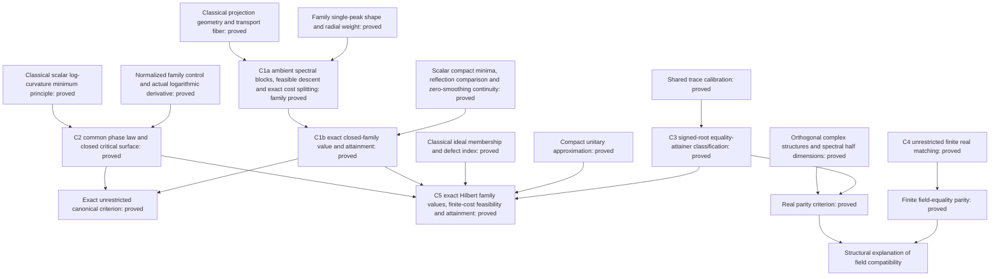

# Publication core: spectral penalties, field compatibility and ideals

Assessment begun at mathematical checkpoint `ff3c1657d`, updated 27 October 2026.
The real equality checkpoint passed 21,427 jobs with warnings as errors.
The closed-family exact value/attainment theorem and all consumers passed
21,463 jobs with warnings as errors after `lake exe cache get` and `lake build`.
The log is `/tmp/dkps-unification/family-closed-full.log`. The preceding
ambient structural checkpoint passed 21,453 jobs. The subsequent shared C2
phase law, closed unrestricted canonical criterion and all consumers passed
**21,475 jobs**, warnings as errors, after the same cache/build commands.
Log: `/tmp/dkps-unification/family-phase-core-full.log`. The common C5
Hilbert-space value/attainment theorem and all consumers subsequently passed
**21,495 jobs**, warnings as errors, after the cache/build commands.
Log: `/tmp/dkps-unification/family-hilbert-core-full.log`.
The success criterion is a coherent central theory and defensible attribution,
not completion of the research backlog. This assessment is research planning;
the proposed abstract below is not a manuscript edit.

## Central thesis and present decision

**Spectral penalties determine optimal phase selection; the scalar field
determines compatibility constraints on those phases; and operator-ideal
geometry determines infinite-dimensional feasibility and attainment.**

The newly completed real equality-attainer theorem makes this a structural
statement at the nuclear endpoint: the same signed-root certificate works
over both fields, while its real solvability is an even-multiplicity condition.
The complex strict-Schatten and Charbonnier classifications explain two regular
phase-selection regimes. Finite real matching explains how real compatibility
changes the value when complex phases cannot be realized.

The organizing theorem is now proved in arbitrary complex Hilbert dimension
for the full closed smoothed-power family, under its exact finite-cost and
defect conditions. C1 derives the finite ambient minimum, C2 determines its
phase transition, and C5 supplies the common ideal lower-bound and attainment
lift. The regular members share one finite-correction construction; the nuclear
corner uses the already proved signed-root construction. C3/C4 describe the
field-dependent compatibility boundary. The broader arbitrary-penalty operator
fragment remains conjectural; it is not needed for this family theorem.

## Five principal statements

### C1. Common ambient structure and exact minimum — proved

**C1a, positive smoothing.** Let E be a finite-dimensional complex Hilbert
space, `1<=p<=2`, `tau>0`, and U any local minimum of the literal family
spectral cost on the full fiber taking P_K to Q. Put J=2P_K-I, let G be its
actual phase gradient, H the positive gradient space and Z=ker G. There are
an orthonormal basis e_j of H, phases `alpha_j,beta_j in (0,pi)`, and a
self-adjoint unitary R on Z such that the isometric coordinates

\[
 d(x,y,z)=x+Jy+z,\qquad
 d^{-1}Ud=\operatorname{diag}\bigl(\operatorname{diag}(e^{i\alpha_j}),
                   \operatorname{diag}(e^{-i\beta_j}),R\bigr),
 \quad 0<(\alpha_j+\beta_j)/2\le\pi/2
\]

split the actual cost as

\[
 \mathcal F_{p,\tau}(U)=\sum_j\{\phi_{p,\tau}(\alpha_j)+\phi_{p,\tau}(\beta_j)\}
                           +\mathcal F_{p,\tau}(R).
\]

The theorem derives these actual invariant blocks from ambient local
minimality, including empty positive/kernel spaces and the maximal gradient
level. Its declaration is `SmoothedPowerTransport.spectral_decomposition_of_isLocalMinOn_transports`
in [SmoothedPowerSpectralDecomposition](../DavisKahan/FiniteDimensional/DirectRotation/SmoothedPowerSpectralDecomposition.lean),
with prefix `TauCeti.DavisKahan.FiniteDimensional`.

**C1b, the full closed family.** Let E be finite-dimensional complex Hilbert
space, K,L subspaces of equal rank, `1<=p<=2` and `tau>=0`. Define

\[
 \rho_{p,\tau}(s)=(\tau^2+s^2)^{p/2}-\tau^p,\quad
 \phi_{p,\tau}(t)=(\tau^2+2-2\cos t)^{p/2}-\tau^p,
\]
\[
 m_{p,\tau}(\theta)=\min_{0\le\delta\le\theta}
  \{\phi_{p,\tau}(\theta+\delta)+\phi_{p,\tau}(\theta-\delta)\}.
\]

Then the unrestricted minimum is attained and equals

\[
 \min_{UP_KU^*=P_L}\operatorname{Tr}\rho_{p,\tau}(|I-U|)
   =\sum_{j=1}^{\dim K}m_{p,\tau}(\theta_j).
\]

The source-indexed angles include zeros and right angles. An attainer is
constructed by independent minimizing phases in a canonical CS basis and
fixes unused common directions. Every ambient unitary transporter obeys
the lower bound, without any prescribed-plane hypothesis. The exact declaration
is `SmoothedPowerTransport.exists_unitary_minimizing_transport_principalAngles_of_nonneg`
in [SmoothedPowerBoundary](../DavisKahan/FiniteDimensional/DirectRotation/SmoothedPowerBoundary.lean),
with the same prefix as C1a. The literal CFC trace is identified with the
native Schatten power at zero smoothing by `displacementCost_zero_smoothing`.

For positive smoothing the proof uses C1a, the actual paired-angle trace,
and the common reflection comparison

\[
 \mathcal F_{p,\tau}(R)=\frac{\rho_{p,\tau}(2)}2\|I-R\|_1,\qquad
 2\sum\sin\theta_j\le\|I-R\|_1,\qquad
 m_{p,\tau}(\theta)\le\rho_{p,\tau}(2\sin\theta)
                              \le\rho_{p,\tau}(2)\sin\theta.
\]

The last bound is norm-power convexity along the augmented Hilbert line
`(tau,0)` to `(tau,2)`. Compact attainment transfers the local-minimum lower
bound to every competitor. Scalar minimum values and each fixed finite
unitary cost are continuous in smoothing; their right limits give the zero-
smoothing lower bound. A canonical construction directly attains that value.
No claim about entire optimizer sets is passed through this limit.

**Exact boundary.** C1b proves values and an attaining construction. C1a is
necessary local-minimum structure for positive smoothing. Neither is a
classification of all family optimizers. C2 now supplies the separate
minimizing-phase law described below.
The proof shares variation and spectral restriction mechanisms across the
family, rather than dispatching cases to the older optimum theorems.

**Wider shape conjecture.** The unverified manuscript fragment proposes a
convex C¹ penalty rho with rho(0)=rho'(0)=0, positive derivative on (0,2],
C² regularity away from zero, and a phase derivative increasing to one peak
and then decreasing with negative curvature. The family theorem does not
establish that broader assertion: generic differentiation and the required
phase/angle budget still need their own hypotheses and proof. No concrete
counterexample is claimed here.

### C2. One phase-transition surface and an ambient criterion — proved

For `1<=p<=2`, `tau>=0`, put

\[
 C_{p,\tau}=\frac{\tau^2+2-
       \sqrt{(\tau^2+2)^2-4p(2-p)}}{2p}.
\]

For `tau>0`, `0<theta<pi/2`, zero phase is the unique global minimizer
on `[0,theta]`
exactly when `C_(p,tau)<=cos(theta)`. Equality is included. If
`cos(theta)<C_(p,tau)`, there is exactly one positive stationary phase in
`(0,theta)`, and it is the unique global minimum on `[0,theta]`. Its equation is

\[
 \phi'_{p,\tau}(\theta+\delta)=\phi'_{p,\tau}(\theta-\delta).
\]

These are `canonical_phase_unique_min_of_subcritical`,
`exists_unique_phase_minimizer_of_supercritical`, `phaseCost_stationary_unique`
and `positive_stationary_isMinOn` in
[SmoothedPowerPhaseSelection](../DavisKahan/FiniteDimensional/DirectRotation/SmoothedPowerPhaseSelection.lean),
with prefix `TauCeti.DavisKahan.FiniteDimensional.SmoothedPowerTransport`.

The proof uses a **generic scalar minimum principle**, not separate
Schatten/Charbonnier optimizer theorems. If `L(0)=0`, `L'=w H` on `[0,theta)`
with w positive and H strictly increasing, and the derivative of a continuous
cost has L's sign, nonnegative H(0) gives a strictly increasing cost. Negative
H(0), together with a positive endpoint derivative, gives one interior global
minimum. No continuity of H or infinite endpoint limit of L is required.
The exact sufficient hypotheses and conclusions are in
[SingleCrossingMinimum](../ForTauCeti/Analysis/Calculus/SingleCrossingMinimum.lean).
The old Schatten stationary-uniqueness theorem now consumes its two-Rolle
principle too. The family verifies these hypotheses through its actual
logarithmic derivative and the decreasing normalized cubic `N/(d-c)^2`,
not by assuming the desired minimizing phase.

**Closed boundaries are retained.** At zero smoothing, the literal cost and
its compact minimum are proved equal to the established Schatten scalars.
Thus `C_(p,0)=(2-p)/p` gives the existing strict-Schatten law, while the nuclear
corner has its unique endpoint phase `delta=theta`. At p=2 the cost is
`4-4 cos(theta)cos(delta)`, independent of smoothing, and is flat at a right
angle. For p<2 a right-angle cost instead has its unique endpoint phase.
`canonical_phase_isMinOn_iff_on_physical_interval` and
`phaseMinimum_eq_canonical_iff`, in
[SmoothedPowerPhaseEndpoints](../DavisKahan/FiniteDimensional/DirectRotation/SmoothedPowerPhaseEndpoints.lean),
prove the common canonical criterion for all `theta in [0,pi/2]` and the
full closed parameter family. The zero-angle interval is a singleton.
No endpoint optimizer-set limit follows from these statements.

**Ambient consequence.** For finite complex equal-rank pairs, throughout
`1<=p<=2`, `tau>=0`, canonical nonacute direct rotation globally minimizes
the literal spectral transport cost if and only if

\[
 \forall j,\qquad C_{p,\tau}\le\cos\theta_j.
\]

The exact declaration is
`nonacuteDirectRotation_isMin_iff_principalAngles_critical` in
[SmoothedPowerCanonicalCriterion](../DavisKahan/FiniteDimensional/DirectRotation/SmoothedPowerCanonicalCriterion.lean),
with the same namespace prefix. This is a consequence of C1b and C2 over
all ambient competitors, not a scalar-only optimality statement. At p=2
it recovers classical canonical optimality; at the nuclear corner it requires
all angles to vanish. It does not classify all family optimizers or extend
the planar conclusion to the real field. Exact priority remains unresolved.

### C3. Nuclear signed roots and exact real compatibility — formally proved

Let H be a complete real or complex Hilbert space, K,L orthogonally
complemented subspaces, Delta=P_K-P_L trace class, and D an actual isometric
equivalence of the crossed defects. Set S=|Delta|, J=2P_K-I, C the canonical
cosine, R the completed direct rotation and V its established nuclear dual.
Then **every** transporter attaining `||I-T||_1=||Delta||_1` corresponds
bijectively to a bounded operator A satisfying

\[
A=A^*,\quad |A|=S,\quad [A,VC]=0,\quad JAJ=-A.
\]

The relative unitary is `Z=C+VA`, and `T=RZ*`. Over the reals, the equality
fiber is nonempty iff each `0<s<1` has even source multiplicity
`dim_R(K ∩ ker(S-sI))`, equivalently `4 | dim_R ker(S-sI)`.
The full/half dimension identity is proved for actual eigenspaces. Right-angle
blocks require no extra parity; the zero block has no root freedom.
In the complex case these are all global nuclear optimizers. When real parity
fails, each real transporter has strictly larger cost than the finite bound;
a uniform gap for the infimum is not asserted.

**Evidence:** `nuclearSignedSineEquivProjectionBoundAttainers`,
`nuclear_eq_projection_sub_iff_certificate`,
`exists_real_nuclear_transport_eq_projection_sub_iff_even_source_multiplicity`
and `finrank_sine_eigenspace_eq_two_mul_source_side_real` in the polar modules.
No separability or finite-rank hypothesis is imposed.

### C4. Real matching and finite field dependence — formally proved

For finite-dimensional real H, equal-rank K,L and `1<=p<2`, the unrestricted
orthogonal Schatten-power minimum is the exact matching functional on the
accepted principal angles, with an actual ambient attainer. At p=1 its value
equals the complex lower value `2 sum sin(theta_j)` iff every strictly acute
positive angle multiplicity is even. The matching theorem concerns all
orthogonal competitors, including mixing and both determinant classes.

**Evidence:** `RealTransport.realTransportPowerMinimum_eq_matching`,
`exists_minimizing_real_schatten_transport_matching_of_one_le` and
`realTransportPowerMinimum_one_eq_sine_sum_iff_even_multiplicities`.
It is a value/attainment theorem, not an all-real-optimizer classification.
C3 now explains its parity by complex structures on spectral half-spaces.
A new literal equality between the finite labelled angle counts and C3's
intrinsic multiplicity has not yet been added; both exact formulations compile.

### C5. Exact Hilbert-space family values, feasibility and attainment — proved

Let E be any complete complex Hilbert space, K,L orthogonally complemented,
`1<=p<=2`, `tau>=0`, and Delta=P_K-P_L. Write

\[
 q=\begin{cases}p&\tau=0,\\2&\tau>0.\end{cases}
\]

A finite-cost transporter exists exactly when `Delta in S_q` and the finite
crossed defects have equal dimension. Under these conditions the common
spectral minimum is attained and equals

\[
 \min_{UP_KU^*=P_L}\operatorname{Tr}\rho_{p,\tau}(|I-U|)
 =\sum_{j\ge0}m_{p,\tau}\bigl(\arcsin s_j((I-P_L)P_K)\bigr)<\infty.
\]

The literal cost is an extended singular-value sum with the baseline
subtracted inside each summand. The exact declaration is
`I.SmoothedPowerTransport.exists_unitary_minimizing_transport_of_projection_cost_ne_top`
in [SmoothedPowerGlobalAttainment](../DavisKahan/InfiniteDimensional/DirectRotation/SmoothedPowerGlobalAttainment.lean),
where `I=TauCeti.DavisKahan.InfiniteDimensional`. Its formal hypothesis is
finite family cost of Delta and equality of the crossed-defect finranks;
the native-ideal identities above translate this exactly to S_q and balance.
`finite_minimum_iff_projection_cost_and_defect_balance` proves necessity and
sufficiency for actual finite-cost global attainment.

**One common lower-bound principle.**
`TauCeti.tsum_angle_penalty_le_displacement_of_finite_transport_bound`, in
[SpectralTransportLimit](../ForTauCeti/Analysis/InnerProductSpace/Projection/SpectralTransportLimit.lean),
assumes an increasing nonnegative displacement penalty f, finite f-cost
forcing compact unitary displacement, a continuous zero-preserving angle
penalty m, and the bound on actual finite sections. It proves the angle-sum
bound for every ambient complex transporter, with infinite costs allowed.
Continuity of f is not needed for this lower-bound step. Norm-convergent
spectral unitary truncations decrease every displacement singular value.
Their target subspaces move; the proof passes finite angle prefixes to the
limit rather than assuming fixed-target compression. The existing
Charbonnier ambient lower bound now consumes this common theorem.

**Attainment and the endpoint difference.** In every regular regime
`tau>0 or p>1`, a positive canonical cutoff exists by C2. Compact Delta
has a finite sine sector above it. C1 optimizes that actual finite section;
canonical restrictions, lower semicontinuity and angle monotonicity identify
the whole remaining tail cost. A generic spectral block identity assembles
the two costs. `exists_minimizer_by_finite_correction` supplies an attainer
agreeing with canonical rotation off that finite sector, with update rank at
most its dimension. This is an existence assertion, not a classification of
all family optimizers. The nuclear corner has no positive canonical cutoff;
C5 instead reuses the independent signed-root attainer from C3.

**Native domain and field scope.**
`ContinuousLinearMap.smoothedPowerCost_ne_top_iff_schatten_two` and
`smoothedPowerCost_zero_smoothing`, in
[SmoothedPower](../ForTauCeti/Analysis/OperatorIdeal/SmoothedPower.lean),
prove the ideal switch and extended native-power identity.
`transport_iff_projection_cost_and_defect_balance`, in
[SmoothedPowerFeasibility](../DavisKahan/InfiniteDimensional/DirectRotation/SmoothedPowerFeasibility.lean),
proves the same finite-cost feasibility condition over either field by using
the existing restricted-unitary theorem. The complex value formula does not
extend to real transport by that feasibility argument. Failure of the domain
or balance condition means no finite-cost transporter; the fiber may be empty
or all its feasible costs may be infinite. Such extended minima do not give
stationarity or finite-cost optimizer classifications.

## Dependency diagram

Solid mathematical dependencies are shown; status labels are part of each node.

## Closest published results and the contribution boundary

The [source-to-Lean map](spectral-transport-unification.md#source-to-lean-provenance-map)
contains exact declarations and authentication limits.

| Predecessor | Verified comparison | What could extend it here |
| --- | --- | --- |
| Jordan (1875), §§46–50; Davis (1958), Theorems 7.1, 7.3, 7.4 | Classical angular geometry and canonical operator/Hilbert--Schmidt/Schatten p>=2 extremal theory. | Exact subquadratic phase selection and its field compatibility, not invention of angles or direct rotation. |
| Davis–Kahan (1970), Propositions 4.3–4.4 and examples | Squared displacement, norm-scope failure and the printed real short-angle assertion. Original wording here relies on the repository's prior source audit. | Formal correction with exact scope, followed by an optimization theory beyond the false assertion. |
| Sun–Roth–Black (2010), §4; Barron (2019), equation (4) | The scalar generalized Charbonnier family itself, up to our subtraction at zero. | Constrained transport phase selection and operator structure; no claim to invent the penalty. Primary authentication is S13 in the provenance map. |
| Bolotnikov–Li–Rodman (2001), Problem 1.1; Theorems 3.1, 4.2, 4.5; Lemma 3.3 | The ambient distortion problem, Q-norm theory, complete Frobenius minimizers and a special subquadratic phase example. Theorem 4.5's chain compatibility condition is automatic for a single subspace pair. | The common closed-family finite complex minimum/attainment theorem C1b, necessary local structure C1a, common phase law C2, sharp unrestricted canonical criterion, and full closed-family Hilbert value/attainment theorem. Existing complete optimizer classifications remain available in their precise regimes. The optimization problem itself is prior art; exact extension priority is unresolved. |
| Qiu–Zhang–Li (2006), §5; Zhang–Qiu (2010), §4 p. 1615 | Grassmann/logarithmic objectives and explicit trace-norm nonminimality. | Exact extrinsic optimizer classifications, not a new discovery that direct rotation can fail for the trace norm. |
| Avron–Seiler–Simon (1994), Proposition 3.1; Kaftal–Loreaux (2017), Proposition 2.7(ii) | Relative index and exact proper-ideal restricted-unitary feasibility on separable complex Hilbert space. | Formal real/nonseparable scope and a penalty-specific optimizer solution above those classical ingredients. |

The BLR statements above were rechecked in the
[official primary paper](https://journals.uwyo.edu/index.php/ela/article/download/117/117/117).
Positive-smoothing costs are nonhomogeneous, so Q-norm minimality alone
does not supply their transport formula.
The exact matching, equality-attainer and classification claims remain
**potentially novel**, with no equivalent found in the sources actually examined.
This is not evidence of first priority. Authenticate Aubrun–Szarek Exercise B.12
and resolve the remaining exact predecessor comparisons before making a strong
novelty claim. Halmos and early Sz.-Nagy/Kato attributions retain the recorded
original-source authentication limitations.

## Proposed abstract, supported by the current proved core

We study optimal unitary and orthogonal transport between spectral subspaces
under penalties of the ambient displacement. For the closed smoothed-power
family, we determine the exact attained minimum on complete complex Hilbert
spaces under its necessary ideal-membership and defect-balance conditions.
A common ambient spectral decomposition establishes unrestricted finite
reduction, while a logarithmic-curvature principle proves the phase transition
and a sharp canonical-optimality criterion. Spectral unitary approximation
and a finite active-sector correction lift the value formula to arbitrary
Hilbert dimension. Positive smoothing selects the Hilbert--Schmidt domain;
zero smoothing selects the corresponding Schatten domain. At the nuclear
corner, an independent signed-root parametrization replaces the finite active
construction and classifies equality attainers over both scalar fields. Its
real solvability requires even acute source multiplicities, explaining the
parity obstruction in finite orthogonal matching. The results connect penalty-
dependent phase selection, real compatibility and infinite-dimensional
feasibility and attainment within one transport-fiber variational problem.

This abstract claims the proved C1/C2/C5 family value/attainment theory and
C3/C4 field compatibility results. It does not claim a complete optimizer
classification for every smoothed-power parameter, a real-field planar
formula, an infinite-dimensional real matching classification, or convergence
of every endpoint optimizer from regular regimes.

## Theorem-level outline and the next proof decision

1. **Problem and classical geometry.** The transport fiber, angle data,
   direct rotation, the Q-norm boundary and precise predecessor attribution.
2. **Main spectral transport theorem.** State the C5 exact Hilbert value,
   finite-cost feasibility and attainment result, alongside the C2 critical
   surface and its boundary regimes.
3. **Finite ambient mechanism.** Prove C1a by actual gradients and no-overlap;
   derive C1b using the kernel reflection bound and canonical phase attainers.
   Prove C2 through the generic scalar log-curvature principle.
4. **Ideal lifting and endpoint structure.** Moving-target lower bounds,
   canonical tails and finite corrections, then the nuclear signed-root
   mechanism that covers the corner with no positive cutoff.
5. **Field compatibility.** C3 nuclear certificates and real parity, C4 finite
   matching, and the precise limitation of a universal real planar theorem.
6. **Boundaries and selected consequences.** State only relevant established
   correction/limiting results; retain the right-angle optimizer-set obstruction
   and leave broad topology or stability outside the central theorem.

**Reassessment at this checkpoint:** C1/C2/C5 now give a proved organizing
minimum-and-attainment theory across the whole family and arbitrary complex
Hilbert dimension. C3/C4 add rigorous field dependence. There is no remaining
proof prerequisite for those displayed theorem statements. A fully generic
operator penalty theorem, every-family-optimizer classification, unrestricted
infinite-dimensional real matching and exhaustive topology/stability are
additional research directions, not publication gates.

## Completed core audit at `cda45e2d4`

The displayed statements were checked against their actual declarations and
hypotheses after the full C5 build. This is a scope review, not a substitute
for compilation or an assertion of historical first priority.

| Core assertion | Audit disposition |
| --- | --- |
| C1 finite unrestricted reduction and attained value | Exact finite complex equal-rank scope; positive-smoothing necessary local structure is separate from the closed-family global minimum. No competitor plane invariance is assumed. |
| C2 critical surface | Positive-smoothing acute uniqueness, zero-smoothing identification, nuclear endpoint, critical equality and quadratic right-angle ties have distinct proved statements. The ambient iff is finite complex. |
| C5 Hilbert value and attainment | Complete complex Hilbert space, complemented subspaces, finite projection cost and balanced crossed defects. Native q=p at tau=0 and q=2 at tau>0. The universal lower bound includes infinity; actual finite attainment uses both hypotheses. |
| Regular versus nuclear construction | A regular attainer has a finite correction of canonical rotation. No claim that every family optimizer has this form follows. The nuclear corner instead uses existing signed-root attainment. |
| C3 real equality necessity and parity | All finite-cost projection-bound attainers have signed-root certificates. Compact spectral root existence, full/half dimension doubling and trace-class equality attainment are distinct theorems. No real infimum gap is inferred from pointwise strictness. |
| C4 matching interface | Unrestricted finite real matching and its labelled-angle parity criterion are proved. C3 independently gives the intrinsic spectral parity criterion. The exact pointwise equality between labelled counts and intrinsic half-eigenspace dimensions has not been formally added; no dependency in the diagram or displayed theorem assumes it. |
| Mathematical provenance | T1–T20 distinguish classical formalizations/ingredients, corrections and potential extensions. The ambient problem and scalar penalty are prior art. Unauthenticated original statements and exercise leads remain explicitly unresolved. |

**Decision:** the stated core has no remaining mathematical proof prerequisite.
The finite labelled/intrinsic multiplicity identification is a useful future
interface theorem, not an implicit ingredient in the proved statements.
A stronger assertion of first priority would require authoritative
Aubrun–Szarek Exercise B.12 authentication and the recorded early-source
checks. The broader operator-penalty conjecture is still open; it is not
needed for the proved family theorem. Full real matching in infinite rank,
all-family optimizer classification, arbitrary-regime stability and exhaustive
endpoint limits remain optional extensions. Do not start those campaigns
without a new research decision. This assessment provides the requested
mathematical synthesis, abstract, theorem outline and literature boundaries;
it does not authorize manuscript or visualization edits.
