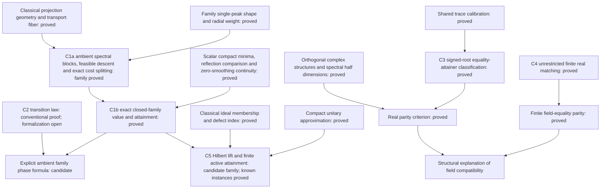

# Publication core: spectral penalties, field compatibility and ideals

Assessment begun at mathematical checkpoint `ff3c1657d`, updated 27 October 2026.
The real equality checkpoint passed 21,427 jobs with warnings as errors.
The closed-family exact value/attainment theorem and all consumers passed
21,463 jobs with warnings as errors after `lake exe cache get` and `lake build`.
The log is `/tmp/dkps-unification/family-closed-full.log`. The preceding
ambient structural checkpoint passed 21,453 jobs.
The success criterion is a coherent central theory and defensible attribution,
not completion of the research backlog. This assessment is research planning;
the proposed abstract below is not a manuscript edit.

## Central thesis and present decision

**Spectral penalties determine optimal phase selection; the scalar field
determines compatibility constraints on those phases; and operator-ideal
geometry determines infinite-dimensional feasibility and attainment.**

The newly completed real equality-attainer theorem makes this a structural
statement at the nuclear endpoint: the same signed-root certificate works
over both fields, while its real solvability is an even-multiplicity condition.
The complex strict-Schatten and Charbonnier classifications explain two regular
phase-selection regimes. Finite real matching explains how real compatibility
changes the value when complex phases cannot be realized.

The finite-dimensional organizing theorem is now proved for the entire
closed smoothed-power family. It derives the exact unrestricted complex
minimum from a common ambient decomposition, without invoking the old
Schatten or Charbonnier optimum theorems. The next central proof is the full
shared scalar phase-selection law C2. A family-wide Hilbert lifting theorem
C5 remains a separate extension; the established infinite-dimensional
Schatten, nuclear and Charbonnier classifications already support the core.
The broader derivative-shape fragment is still conjectural.

## Five principal statements

### C1. Common ambient structure and exact minimum — proved

**C1a, positive smoothing.** Let E be a finite-dimensional complex Hilbert
space, `1<=p<=2`, `tau>0`, and U any local minimum of the literal family
spectral cost on the full fiber taking P_K to Q. Put J=2P_K-I, let G be its
actual phase gradient, H the positive gradient space and Z=ker G. There are
an orthonormal basis e_j of H, phases `alpha_j,beta_j in (0,pi)`, and a
self-adjoint unitary R on Z such that the isometric coordinates

\[
 d(x,y,z)=x+Jy+z,\qquad
 d^{-1}Ud=\operatorname{diag}\bigl(\operatorname{diag}(e^{i\alpha_j}),
                   \operatorname{diag}(e^{-i\beta_j}),R\bigr),
 \quad 0<(\alpha_j+\beta_j)/2\le\pi/2
\]

split the actual cost as

\[
 \mathcal F_{p,\tau}(U)=\sum_j\{\phi_{p,\tau}(\alpha_j)+\phi_{p,\tau}(\beta_j)\}
                           +\mathcal F_{p,\tau}(R).
\]

The theorem derives these actual invariant blocks from ambient local
minimality, including empty positive/kernel spaces and the maximal gradient
level. Its declaration is `SmoothedPowerTransport.spectral_decomposition_of_isLocalMinOn_transports`
in [SmoothedPowerSpectralDecomposition](../DavisKahan/FiniteDimensional/DirectRotation/SmoothedPowerSpectralDecomposition.lean),
with prefix `TauCeti.DavisKahan.FiniteDimensional`.

**C1b, the full closed family.** Let E be finite-dimensional complex Hilbert
space, K,L subspaces of equal rank, `1<=p<=2` and `tau>=0`. Define

\[
 \rho_{p,\tau}(s)=(\tau^2+s^2)^{p/2}-\tau^p,\quad
 \phi_{p,\tau}(t)=(\tau^2+2-2\cos t)^{p/2}-\tau^p,
\]
\[
 m_{p,\tau}(\theta)=\min_{0\le\delta\le\theta}
  \{\phi_{p,\tau}(\theta+\delta)+\phi_{p,\tau}(\theta-\delta)\}.
\]

Then the unrestricted minimum is attained and equals

\[
 \min_{UP_KU^*=P_L}\operatorname{Tr}\rho_{p,\tau}(|I-U|)
   =\sum_{j=1}^{\dim K}m_{p,\tau}(\theta_j).
\]

The source-indexed angles include zeros and right angles. An attainer is
constructed by independent minimizing phases in a canonical CS basis and
fixes unused common directions. Every ambient unitary transporter obeys
the lower bound, without any prescribed-plane hypothesis. The exact declaration
is `SmoothedPowerTransport.exists_unitary_minimizing_transport_principalAngles_of_nonneg`
in [SmoothedPowerBoundary](../DavisKahan/FiniteDimensional/DirectRotation/SmoothedPowerBoundary.lean),
with the same prefix as C1a. The literal CFC trace is identified with the
native Schatten power at zero smoothing by `displacementCost_zero_smoothing`.

For positive smoothing the proof uses C1a, the actual paired-angle trace,
and the common reflection comparison

\[
 \mathcal F_{p,\tau}(R)=\frac{\rho_{p,\tau}(2)}2\|I-R\|_1,\qquad
 2\sum\sin\theta_j\le\|I-R\|_1,\qquad
 m_{p,\tau}(\theta)\le\rho_{p,\tau}(2\sin\theta)
                              \le\rho_{p,\tau}(2)\sin\theta.
\]

The last bound is norm-power convexity along the augmented Hilbert line
`(tau,0)` to `(tau,2)`. Compact attainment transfers the local-minimum lower
bound to every competitor. Scalar minimum values and each fixed finite
unitary cost are continuous in smoothing; their right limits give the zero-
smoothing lower bound. A canonical construction directly attains that value.
No claim about entire optimizer sets is passed through this limit.

**Exact boundary.** C1b proves values and an attaining construction. C1a is
necessary local-minimum structure for positive smoothing. Neither is a
classification of all family optimizers or the full C2 minimizing-phase law.
The proof shares variation and spectral restriction mechanisms across the
family, rather than dispatching cases to the older optimum theorems.

**Wider shape conjecture.** The unverified manuscript fragment proposes a
convex C¹ penalty rho with rho(0)=rho'(0)=0, positive derivative on (0,2],
C² regularity away from zero, and a phase derivative increasing to one peak
and then decreasing with negative curvature. The family theorem does not
establish that broader assertion: generic differentiation and the required
phase/angle budget still need their own hypotheses and proof. No concrete
counterexample is claimed here.

### C2. One phase-transition surface for smoothed powers — derived scalar law

For `1<=p<=2`, tau>=0, define

\[
\rho_{p,\tau}(s)=(\tau^2+s^2)^{p/2}-\tau^p.
\]

In the regular subquadratic regimes (tau>0, `1<=p<2`, or tau=0,
`1<p<2`), the candidate complete scalar law is: for `0<theta<pi/2`
the minimizing absolute phase is unique; it is zero at and below the critical
angle and positive above it, where

\[
\cos\theta_c=
\frac{\tau^2+2-\sqrt{(\tau^2+2)^2-4p(2-p)}}{2p}.
\]

This formula is the correct curvature threshold. A common logarithmic-derivative
shape argument also supplies a conventional proof of the global scalar law;
the algebra and inequalities are in the
[unification note](spectral-transport-unification.md#the-smoothed-power-family-a-common-scalar-mechanism).
Thus the proposed transition is supported by more than a local curvature test.

At tau=0, p=1 the derivative-at-zero hypothesis fails and the nuclear optimum
is the boundary phase delta=theta. At p=2 the cost is quadratic for every tau:
zero phase is uniquely optimal at acute angles and every scalar phase is
optimal at a right angle. For p<2, the right-angle minimum is instead at
delta=pi/2. These boundary assertions agree with the existing proved formulas;
they are not an assertion that all endpoint optimizers are limits of interior ones.

**Status:** existing strict-Schatten, nuclear and Charbonnier scalar instances
are Lean-verified. For `tau>0`, the family first/second derivatives,
critical curvature surface and strict single-peak shape are now formally
proved in `SmoothedPowerPhase`; its zero-smoothing and quadratic critical
cosines are also proved. The full shared minimizing-phase uniqueness law,
including the critical angle, remains a conventional derivation awaiting
formalization. C1 is additionally needed to promote scalar optimality to an
unrestricted ambient optimum. Exact declarations and hypotheses appear in
the [common-mechanism record](spectral-transport-unification.md#formally-proved-common-phase-mechanism--27-october-follow-up).

### C3. Nuclear signed roots and exact real compatibility — formally proved

Let H be a complete real or complex Hilbert space, K,L orthogonally
complemented subspaces, Delta=P_K-P_L trace class, and D an actual isometric
equivalence of the crossed defects. Set S=|Delta|, J=2P_K-I, C the canonical
cosine, R the completed direct rotation and V its established nuclear dual.
Then **every** transporter attaining `||I-T||_1=||Delta||_1` corresponds
bijectively to a bounded operator A satisfying

\[
A=A^*,\quad |A|=S,\quad [A,VC]=0,\quad JAJ=-A.
\]

The relative unitary is `Z=C+VA`, and `T=RZ*`. Over the reals, the equality
fiber is nonempty iff each `0<s<1` has even source multiplicity
`dim_R(K ∩ ker(S-sI))`, equivalently `4 | dim_R ker(S-sI)`.
The full/half dimension identity is proved for actual eigenspaces. Right-angle
blocks require no extra parity; the zero block has no root freedom.
In the complex case these are all global nuclear optimizers. When real parity
fails, each real transporter has strictly larger cost than the finite bound;
a uniform gap for the infimum is not asserted.

**Evidence:** `nuclearSignedSineEquivProjectionBoundAttainers`,
`nuclear_eq_projection_sub_iff_certificate`,
`exists_real_nuclear_transport_eq_projection_sub_iff_even_source_multiplicity`
and `finrank_sine_eigenspace_eq_two_mul_source_side_real` in the polar modules.
No separability or finite-rank hypothesis is imposed.

### C4. Real matching and finite field dependence — formally proved

For finite-dimensional real H, equal-rank K,L and `1<=p<2`, the unrestricted
orthogonal Schatten-power minimum is the exact matching functional on the
accepted principal angles, with an actual ambient attainer. At p=1 its value
equals the complex lower value `2 sum sin(theta_j)` iff every strictly acute
positive angle multiplicity is even. The matching theorem concerns all
orthogonal competitors, including mixing and both determinant classes.

**Evidence:** `RealTransport.realTransportPowerMinimum_eq_matching`,
`exists_minimizing_real_schatten_transport_matching_of_one_le` and
`realTransportPowerMinimum_one_eq_sine_sum_iff_even_multiplicities`.
It is a value/attainment theorem, not an all-real-optimizer classification.
C3 now explains its parity by complex structures on spectral half-spaces.
A new literal equality between the finite labelled angle counts and C3's
intrinsic multiplicity has not yet been added; both exact formulations compile.

### C5. Finite-to-Hilbert lifting and the ideal boundary — partly formal

A useful reusable lower-bound principle is available in proof form: let f be
continuous, increasing and nonnegative on [0,2], f(0)=0, finite f-cost imply
compact displacement, and m(theta) be continuous with m(0)=0. If every finite
complex transport satisfies the angle-sum lower bound for (f,m), the same
lower bound holds for arbitrary Hilbert-space transports, including infinite
costs. This is not an assumption of the infinite-dimensional conclusion.

For finite-cost U, the existing finite-rank unitary approximants U_n converge
in operator norm and have displacement singular values pointwise bounded by
those of U. Restrict U_n to its existing finite reducing transport section,
apply the finite theorem to **moving targets** U_n K, pass each
finite angle prefix to the limit, and take the supremum of prefixes. The
approximants need not preserve the original target L. This resolves a genuine
gap in a naive fixed-fiber compression argument.

Attainment requires another construction. If the scalar canonical regime
contains `[0,theta_c]` with theta_c>0, compact Delta has only finitely many
active sectors. Balanced defects and the finite attainer give an actual finite
correction of R. At the nuclear endpoint theta_c=0, use infinite signed-root
assembly instead. Classification of every Hilbert optimizer additionally
requires tail rigidity; it does not follow just from a finite formula.

**Evidence/status:** the lower-bound, finite correction and full classification
instances for strict Schatten and Charbonnier are compiled. Their common
abstract lifting principle is not yet packaged as a Lean theorem. For the
family, tau>0 gives quadratic near-zero comparison and hence S_2 feasibility;
tau=0 gives S_p feasibility. Both require zero relative defect index. The
ideal criterion is classical; the general family application remains to be
certified after C1. Explicit comparison constants appear in the unification note.

## Dependency diagram

Solid mathematical dependencies are shown; status labels are part of each node.

## Closest published results and the contribution boundary

The [source-to-Lean map](spectral-transport-unification.md#source-to-lean-provenance-map)
contains exact declarations and authentication limits.

| Predecessor | Verified comparison | What could extend it here |
| --- | --- | --- |
| Jordan (1875), §§46–50; Davis (1958), Theorems 7.1, 7.3, 7.4 | Classical angular geometry and canonical operator/Hilbert--Schmidt/Schatten p>=2 extremal theory. | Exact subquadratic phase selection and its field compatibility, not invention of angles or direct rotation. |
| Davis–Kahan (1970), Propositions 4.3–4.4 and examples | Squared displacement, norm-scope failure and the printed real short-angle assertion. Original wording here relies on the repository's prior source audit. | Formal correction with exact scope, followed by an optimization theory beyond the false assertion. |
| Sun–Roth–Black (2010), §4; Barron (2019), equation (4) | The scalar generalized Charbonnier family itself, up to our subtraction at zero. | Constrained transport phase selection and operator structure; no claim to invent the penalty. Primary authentication is S13 in the provenance map. |
| Bolotnikov–Li–Rodman (2001), Problem 1.1; Theorems 3.1, 4.2, 4.5; Lemma 3.3 | The ambient distortion problem, Q-norm theory, complete Frobenius minimizers and a special subquadratic phase example. Theorem 4.5's chain compatibility condition is automatic for a single subspace pair. | The common closed-family finite complex minimum/attainment theorem C1b, necessary local structure C1a, and solved infinite-dimensional classifications. The optimization problem itself is prior art; exact extension priority is unresolved. |
| Qiu–Zhang–Li (2006), §5; Zhang–Qiu (2010), §4 p. 1615 | Grassmann/logarithmic objectives and explicit trace-norm nonminimality. | Exact extrinsic optimizer classifications, not a new discovery that direct rotation can fail for the trace norm. |
| Avron–Seiler–Simon (1994), Proposition 3.1; Kaftal–Loreaux (2017), Proposition 2.7(ii) | Relative index and exact proper-ideal restricted-unitary feasibility on separable complex Hilbert space. | Formal real/nonseparable scope and a penalty-specific optimizer solution above those classical ingredients. |

The BLR statements above were rechecked in the
[official primary paper](https://journals.uwyo.edu/index.php/ela/article/download/117/117/117).
Positive-smoothing costs are nonhomogeneous, so Q-norm minimality alone
does not supply their transport formula.
The exact matching, equality-attainer and classification claims remain
**potentially novel**, with no equivalent found in the sources actually examined.
This is not evidence of first priority. Authenticate Aubrun–Szarek Exercise B.12
and resolve the remaining exact predecessor comparisons before making a strong
novelty claim. Halmos and early Sz.-Nagy/Kato attributions retain the recorded
original-source authentication limitations.

## Proposed abstract, supported by the current proved core

We study unitary and orthogonal transport between spectral subspaces by
minimizing spectral penalties of the ambient displacement. For complex Hilbert
spaces of finite dimension we prove an exact reduction of the full closed
smoothed-power family to attained planar minima over principal angles. A
common ambient spectral decomposition derives this reduction without assuming
plane preservation by competitors. We also give exact infinite-dimensional
optimizer descriptions for subquadratic Schatten powers,
the nuclear endpoint and smoothed nuclear penalties. The regular regimes
select phases on a finite active angle spectrum, while nuclear equality
attainers admit an independent signed-root parametrization in arbitrary rank.
This parametrization works over both scalar fields. Over the reals its
solvability is equivalent to even multiplicity on every strictly acute
source-side sine eigenspace, explaining the parity condition in the finite
orthogonal matching problem. Operator-ideal membership and balanced crossed
defects specify finite-cost feasibility. The results connect penalty-dependent
phase selection, real compatibility and infinite-dimensional attainment within
one transport-fiber variational problem.

This abstract claims the proved finite family value/attainment reduction and
the established infinite-dimensional regimes. It does not claim the full C2
family phase law or C5 family-wide Hilbert extension.

## Theorem-level outline and the next proof decision

1. **Classical geometry and the variational fiber.** Definitions, angle data,
   Q-norm boundary, source correction, ideal feasibility and attribution.
2. **Penalty selection.** The proved C1a ambient decomposition and C1b
   closed-family value/attainment theorem, followed by explicit scalar laws
   in the established regimes. Add the full shared C2 law when proved.
3. **Field compatibility.** C3 nuclear equality geometry and C4 finite real
   matching; explain the real complex-structure obstruction.
4. **Infinite-dimensional assembly.** C5 lower-bound lift, finite active
   corrections and the different nuclear infinite-product mechanism.
5. **Consequences and boundaries.** Include only consequences needed to explain
   the theory; state real above-bound and endpoint set-limit limitations.

C1a and C1b now supply a family-wide organizing theorem with a precise,
complete finite-dimensional scope. Together with C3, C4 and the established
infinite-dimensional classifications, they support a coherent narrower paper.
Further unrestricted real classification, topology and broad stability are
not publication gates. The exact family transport theorem remains potentially
novel; the scalar family, ambient problem, CS geometry, trace bounds and
compactness principles are established ingredients. Historical comparison
still needs resolution, especially the authoritative Exercise B.12 statement.

**Reassessment at this checkpoint:** a paper claiming the displayed exact
finite family reduction needs no further proof of C1. A stronger paper claiming
one explicit phase-transition law across that family still needs C2; a
family-wide infinite-dimensional theorem needs C5. Prioritize C2 next because
it explains how the penalty selects the planar phase now known to govern the
unrestricted minimum. Use the shared logarithmic-ratio argument already
recorded in the unification note. Then assess whether packaging C5 materially
strengthens the central paper before starting that larger campaign. Defer
optional real topology, stability and exhaustive limiting classifications.
No claim of publication acceptance or settled first priority follows from
compiler verification.
