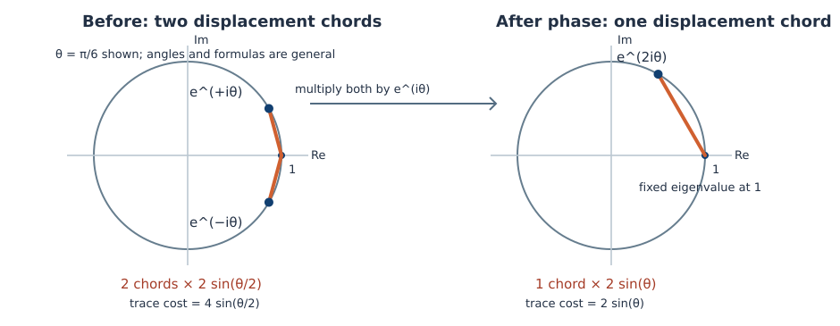

# Understanding the Davis–Kahan formalization and its displacement correction

*A mathematical companion for the lead author, 23 October 2026.* This is separate from the journal manuscript. A reader needs linear algebra and comfort with complex numbers, but no Lean syntax or operator theory. Theorems identified as **Lean-verified** occur in the uploaded source snapshot at Git commit `2b6aa58dcd30`. The new real rank-one and paired-angle statements in [the research note](REAL_TRANSPORT_MINIMIZATION_NOTES.md) have complete conventional arguments but no separately compiled Lean statements in this pass. The all-pairs complex trace formula is proved by a conventional CS-decomposition argument; current Lean theorems establish it on explicit finite principal-plane models and on instances given a suitable unitary coordinate equivalence.

## 1. The basic question: what does a spectral gap protect?

Consider the real symmetric matrix

\[
A_0=\begin{pmatrix}0&0\\0&\Delta\end{pmatrix},\qquad \Delta>0.
\]

The first eigenvector `e1=(1,0)` has eigenvalue `0` and the second eigenvector `e2=(0,1)` has eigenvalue `Delta`. Replace `A0` by

\[
A_\varepsilon=\begin{pmatrix}0&\varepsilon\\\varepsilon&\Delta\end{pmatrix}.
\]

Its eigenvectors rotate. Write `phi` for the acute angle between `e1` and the eigenvector corresponding to the smaller eigenvalue. Elementary diagonalization gives

\[
\tan(2\phi)=\frac{2|\varepsilon|}{\Delta},\qquad
\phi\simeq \frac{|\varepsilon|}{\Delta}
\quad\text{when }|\varepsilon|\ll\Delta.
\]

For example, if `Delta=10` and `epsilon=0.1`, the angle is approximately `0.01` radians; if `Delta=0.01` with the same perturbation, the eigenvector can rotate by a much larger angle. A bound on perturbation size alone cannot control the direction of an eigenvector when its eigenvalue is nearly tied with another one.

**What the denominator means.** In Davis–Kahan theory the spectral separation describes how far the trial eigenvalue region is from the *complementary* exact spectral region. Separation supplies the inverse scale for a Sylvester equation. The full theorem uses more careful interval/exterior or ordered-gap hypotheses than the heuristic “all eigenvalues are at least `Delta` apart.” These configurations ensure the correct operator-ideal estimate, including when spectra are unbounded.

### A two-by-two residual calculation

Use the trial vector `E0=e1` for `A_epsilon`, and trial scalar operator `A_trial=0`. Its residual is

\[
r=A_\varepsilon e_1- e_1\cdot0=(0,\varepsilon)^T,
\qquad\|r\|_2=|\varepsilon|.
\]

Let `f1` be the normalized eigenvector for the *other*, larger eigenvalue `lambda_plus`. With a consistent choice of signs, `f1=(sin phi,cos phi)`. Its overlap with the trial vector is `X=f1^*e1=sin phi`. Multiplying the residual by `f1^*` gives

\[
f_1^*r=\lambda_+ X-X\cdot 0=\lambda_+\sin\phi,
\]

and therefore `lambda_plus |sin phi| <= |epsilon|`. This is the one-dimensional Sylvester mechanism: the complementary eigenvalue is in the denominator. In the general theorem `X` is a rectangular bounded operator rather than a scalar, and the gap estimate requires a theorem about a Sylvester operator on an ideal of operators.

**Diagnostic check.** Why does the inequality involve the complementary exact eigenvalue rather than simply the difference between the two diagonal entries of the unperturbed matrix? Because it comes from the exact equation for the *perturbed* spectral complement; the unperturbed gap gives a convenient sufficient estimate but is not the only possible formulation.

## 2. Projections and principal angles

A line through the origin with unit direction `u` has orthogonal projector `P=uu^T`: every vector `x` maps to `(u^T x)u`. A second line with unit direction `v=(cos theta,sin theta)` has projector `Q=vv^T`. In the coordinates where `u=e1`, their difference is

\[
P-Q=
\begin{pmatrix}
\sin^2\theta &-\sin\theta\cos\theta\\
-\sin\theta\cos\theta&-\sin^2\theta
\end{pmatrix}.
\]

Its eigenvalues are `+sin theta` and `-sin theta`, so its two singular values are both `sin theta`. Consequently

\[
\|P-Q\|_{\mathrm{op}}=\sin\theta,\qquad
\|P-Q\|_1=2\sin\theta.
\]

The singular values of a matrix `T` are the nonnegative square roots of the eigenvalues of `T^*T`. The **operator norm** takes the largest singular value. The **trace/nuclear norm** sums them. The **Frobenius norm** squares them, sums the squares, then takes the square root. These are all *unitarily invariant*: left and right multiplication by orthogonal/unitary matrices leave them unchanged.

For two higher-dimensional subspaces, principal angles `theta_j` are obtained from the singular values `cos theta_j` of the overlap matrix of orthonormal frames. In the matched orthogonal principal two-planes, the projection difference has singular values

\[
\underbrace{\sin\theta_1,\sin\theta_1}_{\text{first plane}},
\underbrace{\sin\theta_2,\sin\theta_2}_{\text{second plane}},\ldots,
\]

plus zeros on common and exterior subspaces. The duplication is required when computing any full-space unitarily invariant norm.

### Why one pair of angles is not enough

Suppose two real 2D subspaces lie in `R^4`. Both principal angles might equal `theta`, but that does not force an orthogonal map carrying one subspace onto the other to rotate each principal plane independently. An admissible map may couple the two principal planes, or rotate a *different* two-plane in the four-dimensional space. This is precisely how Proposition 4.4 fails.

## 3. What a direct rotation optimizes

A **transporter** is an orthogonal or unitary matrix `W` with `WU=V`. It is not required to map a particular chosen orthonormal basis of `U` to a particular chosen basis of `V`. That freedom is crucial: it can rotate *within* `V` while still taking the subspace to the correct destination.

For one principal angle `theta`, the canonical direct rotation has matrix

\[
R_\theta=
\begin{pmatrix}\cos\theta&-\sin\theta\\
                \sin\theta&\cos\theta\end{pmatrix}.
\]

Its two eigenvalues over `C` are `e^{i theta}` and `e^{-i theta}`. Since each displacement eigenvalue has modulus `|1-e^{i theta}|=2sin(theta/2)`, both singular values of `I-R_theta` equal `2sin(theta/2)`:

\[
\|I-R_\theta\|_1=4\sin(\theta/2),\qquad
\|I-R_\theta\|_{\mathrm{op}}=2\sin(\theta/2).
\]

The direct rotation minimizes squared displacement in a very strong sense (Davis–Kahan Proposition 4.3). In particular it minimizes the Frobenius and operator norms of full displacement. Its failure to minimize the unsquared trace norm does not contradict those statements, because taking square roots of different singular-value distributions can reverse their ordering.

### A small vector demonstrates the norm distinction

Compare singular-value vectors `(1,1,1,1)` and `(1.9,1.9,0,0)`. Their trace norms are 4 and 3.8: trace norm prefers the more concentrated rank-two vector. Their Frobenius norms are 2 and approximately 2.687: Frobenius prefers the evenly distributed vector. Their operator norms are 1 and 1.9: operator norm again prefers the evenly distributed vector. The Davis–Kahan failure is a geometrically constrained realization of this conflict.

## 4. The complex phase adjustment

The displayed diagram represents eigenvalues on the complex unit circle. Each orange chord is measured from the point `1` to the indicated eigenvalue, because the eigenvalues of `I-W` are `1-lambda` when `W` is normal.

Over complex two-dimensional space, multiplying the canonical rotation by `e^{i theta}` changes eigenvalues

\[
 (e^{i\theta},e^{-i\theta})
 \quad\longmapsto\quad(e^{2i\theta},1).
\]

This produces singular-value lists

\[
 s(I-R_\theta)=\bigl(2\sin(\theta/2),2\sin(\theta/2)\bigr),
\qquad s(I-e^{i\theta}R_\theta)=(2\sin\theta,0).
\]

The second transporter has trace displacement `2sin theta`, which is less than `4sin(theta/2)` for every `0<theta<pi/2`. Both send the **complex source line** to the **same complex target line**, because multiplying a vector by a nonzero complex phase does not change its complex linear span. **Davis and Kahan already used this mechanism in their 1970 Example 4.2.**

### Why the real case takes four coordinates

Multiplication by `i` on `C` becomes a real quarter-turn on `R^2`,

\[
J=\begin{pmatrix}0&-1\\1&0\end{pmatrix}.
\]

Realifying a `2×2` complex matrix therefore gives a `4×4` real matrix. Realification repeats every complex singular value twice. The complex phase-adjusted transporter thus produces the real displacement spectra

\[
 s(I-R)=\bigl(a,a,a,a\bigr),\qquad
 s(I-W)=\bigl(2\sin\theta,2\sin\theta,0,0\bigr),
 \quad a=2\sin(\theta/2).
\]

The real trace values are

\[
\|I-R\|_1=8\sin(\theta/2),\qquad
\|I-W\|_1=4\sin\theta.
\]

Because `4sin theta=8sin(theta/2)cos(theta/2)`, the second is strictly smaller at every positive acute angle. The realification is an exact identification of matrices, rather than a superficial resemblance of examples.

### Worked numerical example: 45 degrees

At `theta=pi/4`, the two principal angles in `R^4` both equal `45°`. The canonical map has trace displacement `8sin(pi/8) ≈ 3.06147`. The phase-adjusted real map has trace displacement `4sin(pi/4)=2sqrt(2)≈2.82843`. It transports the same subspace. The difference is approximately `0.23304` in trace norm. Its nonzero singular values are larger individually, but there are only two of them instead of four.

The real map also has determinant `+1`. The failure remains if one restricts the competition to `SO(4)`, the orientation-preserving component. This prevents an incorrect explanation that the four-dimensional competitor merely exploited a reflection.

## 5. How the projection lower bound works

Let `P` and `Q` project onto `U` and `V`. An admissible unitary `W` satisfies `Q=WPW^*`, or equivalently `WP=QW`. Define the symmetry `J=2P-I`, satisfying `J^*=J` and `J^2=I`. Put `K=I-W`. Algebra gives

\[
2(P-Q)W=KJ-JK.
\]

For **every** unitarily invariant seminorm `N`, the triangle inequality and invariance under multiplication by the orthogonal/unitary matrices `J` and `W` give

\[
2N(P-Q)=N(KJ-JK)
 \le N(KJ)+N(JK)=2N(I-W).
\]

Therefore

\[
\boxed{N(P-Q)\le N(I-W).}
\]

This theorem needs no acute-angle assumption and works for arbitrary real or complex subspaces related by a unitary. It is **already proved in Lean** in `ProjectionDisplacement.lean`. Applying it to the trace norm tells us that every transporter pays at least the trace norm of the projection difference.

### An equivalent pinching viewpoint

With respect to `U⊕U^perp`, let `K` have four rectangular blocks. The operation `(K-JKJ)/2` removes its two diagonal blocks and keeps the off-diagonal blocks. Since it is an average of two matrices with the same unitarily invariant norm, this operation is contractive. The off-diagonal blocks encode the principal sines of `U,V` and hence have the same nonzero singular values as `P-Q`. This proves the lower bound by a different route. The lower bound is a consequence of matrix norm geometry, rather than an original perturbation-theoretic estimate.

## 6. Why the direct rotation is always within a sharp factor

On each principal plane, `I-R` has two singular values `2sin(theta_j/2)` and `P-Q` has two singular values `sin theta_j`. Thus

\[
 2\sin(\theta_j/2)
 =\sec(\theta_j/2)\sin\theta_j
 \le\sec(\alpha/2)\sin\theta_j,
\]

where `alpha` is the maximum principal angle, strictly less than `pi/2` for the canonical acute-pair formula. Since every unitarily invariant seminorm is monotone under domination of corresponding singular values,

\[
 N(I-R)\le\sec(\alpha/2)N(P-Q)
             \le\sec(\alpha/2)N(I-W).
\]

There are two different mathematical statements here. The inequality is valid for **every** unitarily invariant seminorm. Its factor is **optimal as one common coefficient for the entire class**, because trace norm and the real `R^4` example attain it at each positive angle. It does **not** say the factor is optimal for each particular norm: for Frobenius and operator norm, factor one is already available.

At `alpha=pi/3`, the coefficient is `2/sqrt(3)≈1.1547`. As `alpha` tends to `pi/2` from below it tends to `sqrt(2)≈1.4142`. The original Proposition 4.4 asked for factor one for *all* norms under `alpha<=pi/3`; the four-dimensional trace example shows that factor one is false, but the corrected angle-dependent comparison remains valid.

### The older construction and what it does—and does not—settle

The canonical intertwining unitary can be expressed via the two projections:

\[
T=QP+(I-Q)(I-P),\qquad
R=T\bigl(I-(P-Q)^2\bigr)^{-1/2}.
\]

Kato's *Perturbation Theory for Linear Operators* (first edition 1966, Chapter I §4.6) contains this normalized projection construction, with antecedents credited to Sz.-Nagy. Murphy's 1990 textbook gives a `sqrt(2)` operator-norm estimate from the same formula. The sharp all-norm secant comparison can be deduced by applying functional calculus to this established construction and combining it with the universal projection lower bound. This reduces the case for independent mathematical novelty of the inequality, even though its exact source-correction formulation is useful. See `PROPOSITION_4_4_LITERATURE_MAP.md` for precise source access and limitations.

## 7. The new real rank-one theorem and dimension threshold

The accompanying conventional research note proves an **exact minimization result** for two real lines or for two real hyperplanes in *any* dimension. Let their sole nonzero principal angle be `theta` and put `a=2sin(theta/2)`. For every unitarily invariant norm,

\[
\min_{W(U)=V}N(I-W)=
\min\bigl\{N(\mathrm{diag}(a,a,0,\ldots)),
           N(\mathrm{diag}(2,0,\ldots))\bigr\}.
\]

The first candidate is the usual direct rotation, with determinant `+1`; the second is a reflection, with determinant `−1`. Here is why these exhaust the best possibilities **without** enumerating all orthogonal matrices:

* Any orientation-preserving real orthogonal matrix has nonreal eigenvalues in complex-conjugate pairs; any `−1` eigenvalues occur with even multiplicity. Its two largest displacement singular values are therefore equal. Mapping a source direction (or normal) to the target forces the largest to be at least `a`, so both are at least `a`.
* Any orientation-reversing real orthogonal matrix has an eigenvalue `−1`, hence a displacement singular value 2. A single reflection achieves that value and has all other displacement singular values zero.

Fan dominance proves the formula for *every* unitarily invariant norm. In the trace norm it becomes `min{4sin(theta/2),2}`. Thus the direct rotation is universally optimal for a real line/hyperplane when `theta<=pi/3`; in dimensions two or three there is no other proper, nonzero, equal-rank subspace configuration. The formalized `R^4` example establishes four as the minimum real ambient dimension for a counterexample at arbitrarily small positive angles. This proof has not yet been encoded and compiled as Lean.

The note also proves a sufficient condition for **real** trace-norm equality with the projector lower bound: if each positive principal angle occurs with even multiplicity, pair equal-angle principal planes and realify the complex phase correction on every pair. The trace displacement then equals `2sum sin(theta_j)`. Even multiplicity is not a necessary condition once right angles are permitted, so this is a sufficient condition rather than a characterization.

## 8. The complex exact trace minimum—and the remaining formalization boundary

Over a complex space each nonzero principal angle can be corrected by its own complex phase, without doubling the number of real coordinates. In an orthogonal direct sum of principal planes the trace displacement becomes `2sum sin(theta_j)`, exactly the projection lower bound. Conventional finite-dimensional CS decomposition then proves

\[
\min_{W\in U(n):\,WU=V}\|I-W\|_1
 =\|P-Q\|_1=2\sum_j\sin\theta_j
\]

for equal-dimensional complex subspaces, including right-angle pairs. The existing Lean files prove the planar phase unitary, finite orthogonal sums, prescribed finite principal-plane models, and transport under a *supplied* unitary coordinate equivalence. A theorem that automatically produces the required coordinates for *every arbitrary pair* is the missing formal step. Do not describe the entire complex all-pairs formula as kernel-checked until that link is compiled.

Nor has this analysis characterized *all* minimizers: writing down one optimal phase on each plane proves existence and the minimum value, while characterizing every minimizer requires equality analysis in a trace-norm contraction.

## 9. A full-scope sine-theta proof: where the operators live

The original Davis–Kahan sine-theta theorem concerns a trial subspace represented by an isometric coordinate map `E0:F→E` and an exact subspace represented by an isometry `F0:H→E`. The orthogonal complement is represented by an isometry `F1:G→E`, with

\[
F_0F_0^*+F_1F_1^*=I_E,\qquad F_0^*F_1=0.
\]

An ambient (possibly unbounded) self-adjoint operator `A` acts on `E`, a trial operator `A0` acts on `F`, and a complementary spectral block `Lambda1` acts on `G`. The residual relation is

\[
A E_0x-E_0A_0x=Rx,\qquad x\in\operatorname{dom}(A_0),
\]

where `E0 x∈dom(A)` and `R:F→E` is a **bounded** residual extension. The exact complement intertwines `A F1=F1 Lambda1` on `dom(Lambda1)`; the self-adjoint reducing-subspace structure supplies the corresponding adjoint/domain compatibility required to form the next expression legally.

Put `X=F1^*E0`. On `dom(A0)` the projected residual becomes the Sylvester equation

\[
 F_1^*R=\Lambda_1 X-XA_0.
\]

Under the repository's permitted interval/exterior or ordered half-infinite spectral-gap alternatives, the appropriate Sylvester estimate gives

\[
 \delta N(X)\le N(F_1^*R)\le N(R).
\]

The second inequality uses contraction by the adjoint of an isometry (and its operator-ideal membership assumptions). The relation to the sine angle operator is

\[
B=(I_E-F_0F_0^*)E_0=F_1X,
\qquad |B|=(B^*B)^{1/2}=|X|.
\]

Thus the positive trial-coordinate sine operator is `|X|` (equivalently `|B|`), so `N(sin Theta0)=N(X)` when the corresponding ideals and gauges are defined. The full inequality follows. The source-facing Lean theorem `sinTheta_unbounded_formGap_whereDefinedUIN_rclike` packages these hypotheses, the ideal-membership conditions, and the scalar-field interfaces. The detailed dependency map remains in `papers/what_it_takes_to_prove_davis_kahan/cases/sine_theta.md`.

### Why an unbounded operator has a domain

Take `H=ell²(N)` and define `(Ax)_n=n x_n`. Then

\[
\operatorname{dom}(A)
 =\left\{x\in\ell^2:\sum_{n=1}^\infty n^2|x_n|^2<\infty\right\}.
\]

The sequence `x_n=1/n` belongs to `ell²` because `sum 1/n²` converges, but `Ax=(1,1,1,...)` does **not** belong to `ell²`. Declaring `A` defined on *all* of `ell²` would produce an expression that fails to be a vector of the Hilbert space. An operator equality involving `A E0` must therefore specify which trial vectors lie in the ambient domain. The bounded `R` is valuable because after establishing its equality on `dom(A0)`, its norm is meaningful on the full trial space.

### Why spectral separation needs exact hypotheses

In a finite matrix one can invert `lambda-mu` entry by entry if an eigenvalue difference is nonzero. For a **unitarily invariant operator ideal**, however, the operator norm of the inverse Sylvester map need not be controlled by just the smallest pairwise spectral distance when the two spectra interlace. The source's interval/exterior and ordered half-infinite alternatives are the configurations for which its constant-one gap estimate is established. In an infinite-dimensional problem, compactness, ideal membership, existence of domain-carrying products, and the type of spectral gap must be audited separately.

## 10. Understanding checks

Before consulting the worked answers in the next section, try answering these questions in two or three sentences each. Each asks for a reason, not a definition.

1. In the two-by-two example, what happens to the eigendirection if `epsilon` stays fixed but `Delta` decreases sharply?
2. Why is `||P-Q||op=sin theta` for two lines, rather than `2sin(theta/2)`?
3. Two orthogonal maps both send `U` to `V`. What freedom allows different values of `||I-W||1`?
4. Why can the nuclear norm prefer a rank-two displacement over a rank-four one?
5. State the exact real-space claim that is false in Davis–Kahan Proposition 4.4. Does it also refute their sine-theta theorem?
6. What changes when an admissible complex map is multiplied by a common scalar phase? Why is the target *line* unchanged?
7. What makes realification occupy four real coordinates?
8. State the projector-distance lower bound and identify the identity involving `J=2P-I` on which its proof rests.
9. Why does the secant-factor proof need to compare the *doubled* singular values, not just the distinct positive principal angles?
10. Does the sharp factor mean that direct rotation is suboptimal by `sec(alpha/2)` for every unitarily invariant norm?
11. Why does `theta<=pi/3` really suffice for pairs of real lines while failing for pairs of real two-planes in `R^4`?
12. What distinguishes an optimizer that has been explicitly constructed from a characterization of *all* optimizers?
13. Which statements about the complex trace minimum have Lean proofs in the uploaded checkout, and which connection is still absent?
14. What domain restriction makes `(Ax)_n=n x_n` a genuine operator on `ell²`?
15. Where does the complementary operator `Lambda1` enter the sine-theta proof, and why must the projected Sylvester equation be interpreted on its proper domain?

## 11. Worked answers

1. The angle increases: `tan(2phi)=2|epsilon|/Delta` grows as the gap shrinks. When eigenvalues are nearly tied, a small off-diagonal perturbation can rotate their eigendirections substantially.
2. Projectors depend on *lines*, with eigenvalues of their difference `±sin theta`. The half-angle chord `2sin(theta/2)` is the singular value of the displacement of a particular rotating **map**; these are different matrices.
3. Only the *image subspace* is fixed. A map may rotate vectors inside the source or target, and may act on orthogonal complements differently, while satisfying the same `WU=V` constraint.
4. Nuclear norm adds singular values. Concentrating motion into two larger singular values can make their sum smaller than four moderately sized values, even though Frobenius and operator norms rank them oppositely.
5. The printed proposition says the real canonical direct rotation minimizes `N(I-W)` for every unitarily invariant norm if the maximal principal angle is at most `pi/3`. The `R^4` trace-norm counterexample has arbitrarily small positive angles. It does not contradict the separate sine-theta or squared-displacement results.
6. The eigenvalues of the unitary rotate by a common phase, so their chord lengths from 1 change. A nonzero complex scalar does not change the complex subspace spanned by a vector.
7. Each complex scalar is a real two-dimensional action; a complex 2-space is a real 4-space. Its singular values each occur twice after realification.
8. `N(P-Q)<=N(I-W)` for `Q=WPW*`. Set `K=I-W`, `J=2P-I`: then `2(P-Q)W=KJ-JK`. Apply the triangle inequality and unitary invariance.
9. A full-space unitarily invariant norm uses every singular value with multiplicity. In each nontrivial principal plane, both `P-Q` and `I-R` have two singular values, even if the angle list has one entry for that plane.
10. No. It is a valid and uniformly optimal *common* upper bound across dimensions, norm classes, and both scalar fields. Frobenius and operator norm already admit a factor of one.
11. In a real line or hyperplane case, proper orthogonal transport must displace at least two singular directions by the half-angle chord, and improper orthogonal transport has a singular value 2. Up to `pi/3`, direct rotation dominates both candidates under all unitarily invariant norms. In `R^4`, two equal-angle planes can be coupled via realified complex phases, producing a cheaper trace-norm map in `SO(4)`.
12. An explicit optimizer proves the minimum is attained at a particular point. A complete classification proves every minimizer has a described structure, and it needs additional equality-case analysis.
13. The Lean proof files construct the complex planar minimizer, direct-sum models, and transport under a supplied unitary equivalence. A general theorem constructing those coordinates automatically from arbitrary equal-dimensional complex subspaces is absent in this snapshot.
14. Require `sum n²|x_n|²<infinity`. Otherwise there exist vectors in `ell²` whose formal images fail to lie in `ell²`; the operator would have an invalid codomain on those vectors.
15. The spectral block of the *exact orthogonal complement* appears in `F1*R=Lambda1 X-XA0`. It is the second operator of the Sylvester equation and supplies the separated spectrum. With unbounded blocks, the equation holds on specified domains and cannot be manipulated as a product of everywhere-defined bounded matrices.

## 12. Reading path and references

Read sections 1–4 first, then section 7 for the exact real low-dimensional optimization; work sections 5–6 only after the singular-value lists feel familiar. Sections 8–9 are the bridge to the full formalization. Answer the questions independently before checking section 11. The companion does not imply the lead author has mastered a result merely by reading it.

The historical source is Chandler Davis and W. M. Kahan, “The Rotation of Eigenvectors by a Perturbation. III,” *SIAM Journal on Numerical Analysis* 7 (1970), 1–46, [DOI](https://doi.org/10.1137/0707001), especially §4. The closest optimization work is V. Bolotnikov, C.-K. Li, and L. Rodman, “Minimal Distortion Problems for Classes of Unitary Matrices,” *Electronic Journal of Linear Algebra* 8 (2001), 26–46, [DOI](https://doi.org/10.13001/1081-3810.1058). For singular-value dominance consult R. Bhatia, *Matrix Analysis*, Theorem IV.2.2, [DOI](https://doi.org/10.1007/978-1-4612-0653-8). For the older polar intertwiner consult T. Kato, *Perturbation Theory for Linear Operators*, first ed. 1966, Ch. I §4.6, [DOI](https://doi.org/10.1007/978-3-662-12678-3), and G. J. Murphy, *C*-Algebras and Operator Theory* (1990), Lemma 6.2.1, [DOI](https://doi.org/10.1016/C2009-0-22289-6). The permanent repository evidence record is `PROPOSITION_4_4_LITERATURE_MAP.md`; the separate rigorous rank-one proof is `REAL_TRANSPORT_MINIMIZATION_NOTES.md`.
