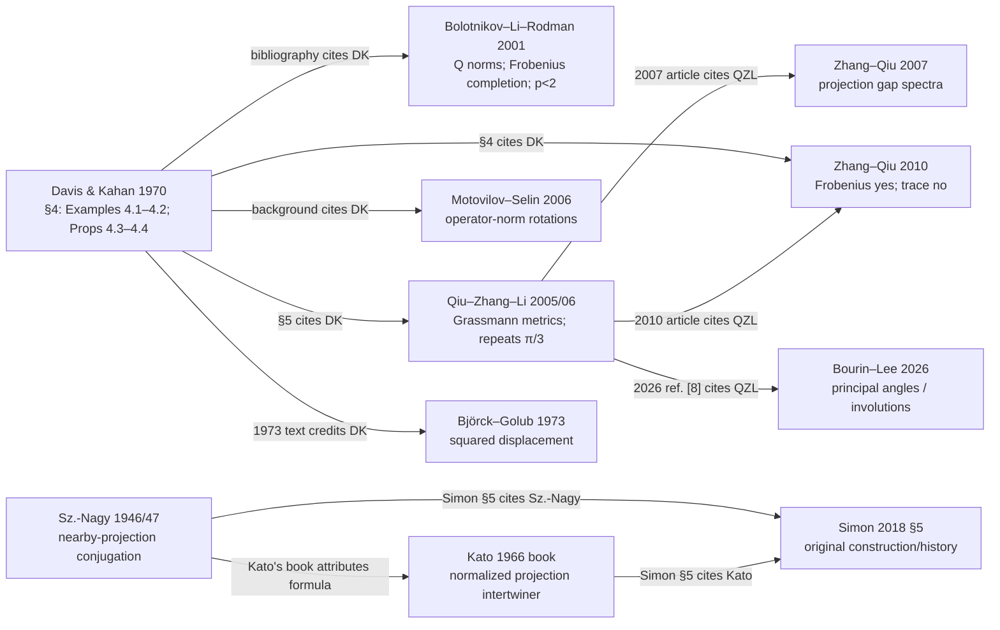

# Davis–Kahan Proposition 4.4: primary-source literature map and novelty audit

**Investigation:** 23 October 2026, with a second primary-source deepening pass on the same date. **Repository:** `AIQ-Kitware/aiq-dkps-formalization` (public main revision inspected: `a5c18e931d02656a3e859bbd9dd68691529fa97c`, 23 October 2026 UTC). **Target path:** `papers/dk_formalization_journal/PROPOSITION_4_4_LITERATURE_MAP.md`. **Status:** research record, not a change to the manuscript or to Lean. **Primary research question:** historical and mathematical priority for the real short-angle refutation of Davis–Kahan (1970), Proposition 4.4, and for sharp replacement bounds and exact trace-norm minima.

**Formalization update (23 October 2026, snapshot `b00c5c8c35e1`):**
The original source-archive status descriptions below refer to earlier stages
of the project. Subsequent Lean modules `ComplexCrossedDefects.lean`,
`ComplexPhaseTrace.lean`, `TraceSine.lean`, and
`ComplexTracePrincipalAngles.lean` prove the **unconditional** finite-dimensional
complex equal-rank trace minimum and its explicit principal-angle sum:
`min_W ||I-W||_1 = ||P_U-P_V||_1 = 2 sum_j sin(theta_j)`, including right
angles, without supplying a principal-plane chart. The two-projection
trace decomposition works over real and complex scalars with unequal ranks.
This update changes **formalization status**, not the old-phase mathematical
priority assessment. The listed literature investigation has not established
first-publication priority of the exact formula. The separate real low-rank
and equality-classification problems remain open in Lean.

**Evidence convention.** `[LIT-001]` etc. refer to the durable source-location ledger in §G. `[DER-1]` etc. refer to proofs independently supplied in §D. The word **inspected** means that actual article text, rather than merely an abstract, was read; *publisher metadata* and *indexed excerpt only* are recorded separately. PDF-page indices, where given, start at zero; **printed page** numbers are authoritative for citation. Exact-claim novelty is not inferred from the absence of a string-search hit.

## A. Executive summary

**Third-pass discovery: the exact canonical projection unitary predates Murphy (1990).** In the directly inspected text of **Tosio Kato, *Perturbation Theory for Linear Operators*, Chapter I §4.6, equations (4.33)–(4.42)**, the intertwiner is exactly

`R=[QP+(I−Q)(I−P)][I−(P−Q)^2]^(−1/2)`;

for orthogonal projections with `||P−Q||op<1` the same map is proved **unitary** in **I §6.8, Theorem 6.32** (printed p.56), and `RPR*=Q`. We inspected the accessible **1980 second-edition reprint**; Springer verifies the original **1966** edition, and the second-edition preface describes revisions limited to different sections. Kato's note explicitly associates the **same map, in a different expression**, with **Béla Sz.-Nagy (1946/47)** and with Kato's own **1955 report**. Barry Simon's detailed, directly inspected **2018** historical account (§5) independently reconstructs the map and traces the Hilbert-space conjugacy result to Sz.-Nagy's **1947 paper** and a **1942 Hungarian-language precursor**. **The 1942, 1947 and 1955 originals were not directly read**, so only the Kato book has been verified at exact-formula level. **Neither source establishes the all-UIN sharp secant comparison in print.** [LIT-025–029]

**Second-pass clear operator-norm estimate:** **Gerard J. Murphy (1990), Lemma 6.2.1, printed p. 178**, already constructs precisely the polar unitary `R=(I−P−Q+2QP)|I−P−Q+2QP|^{-1}` from nearby projections and proves `||I−R||op < √2 ||P−Q||op`, recording the functional-calculus identity needed for the sharp angle-dependent refinement. Dana P. Williams (lecture notes dated 14 February 2024), Lemma 5.16, pp. 97–98, reproduces the same construction, now with a non-strict bound. **Neither inspected source states the arbitrary-UIN, competitor-quantified, sharp `sec(α/2)` inequality.** The latter remains a direct consequence, *not* a verbatim old theorem. [LIT-018, LIT-019; DER-6]

**Other newly verified boundaries:** Bolotnikov–Li–Rodman (2001), **Problem 1.1, printed p. 26**, asks the **exact ambient-subspace-constrained optimization problem** for every UIN, but its solutions for Frobenius and particular `Q`-norm cases are not a general Schatten-one formula. Björck–Golub (1973, p. 583) already restated the *squared*-displacement minimality. Larotonda's arXiv preprint dated **22 October 2026** treats all-UIN **intrinsic length minimization on homogeneous Grassmann spaces**, not ambient `N(I−W)`. These require explicit differentiation in the novelty matrix. [LIT-002, LIT-020, LIT-021]

1. **The failure of full-displacement trace-norm minimality is established prior art**; already Davis and Kahan's own *complex* Example 4.2 (1970, printed pp. 22–23) gives it. Bolotnikov–Li–Rodman (2001) show why the distinction between squared-displacement / `Q`-norm minimization and Schatten exponents below two matters. Zhang–Qiu (2010, p. 1615) explicitly state that canonical direct rotations do **not** generally minimize `||I-W||_1`. These are distinct historical statements. [LIT-001, LIT-002, LIT-005]
2. **The project does refute the *real-space*, short-angle assertion actually printed as Proposition 4.4.** Its four-real-dimensional construction has *two* principal angles equal to every prescribed `0 < θ < π/2`, and `||I-Wθ||_1 = 4 sin θ < 8 sin(θ/2) = ||I-Rθ||_1`. In particular `0 < θ <= π/3` is available, and arbitrarily small angles work. The corresponding parameterized small-angle theorem is Lean-verified. **A mathematical priority qualification is essential:** the repository's explicit matrices are *exactly* a realification of the 1970 complex phase mechanism (see [DER-4]). Thus the real contradiction is an immediate **consequence** of that old example once realification is observed. We did **not** locate a prior publication explicitly identifying the resulting error in the *real* Proposition 4.4. [LIT-001, LIT-008, DER-4]
3. **The projection-distance lower bound is an elementary, valid all-seminorm inequality**, not an independent discovery of a new deep matrix inequality: for any orthogonal projections `P,Q=WPW*` and any finite-dimensional unitarily invariant seminorm `N`, `N(P-Q) <= N(I-W)`. The short proof is a reflection-commutator identity and the triangle inequality [DER-1]. The older gap-metric literature already records the projection-difference singular values (Zhang–Qiu 2007, p. 165) and the Ky Fan dominance machinery (Bolotnikov–Li–Rodman, Proposition 2.1). **No earlier source containing precisely the displayed commutator bound was located during this search**, which is not a first-discovery claim. [LIT-002, LIT-004]
4. **The sharp approximation inequality is mathematically correct as a direct consequence of these classical ingredients:** for the canonical direct rotation `R` between an equal-dimensional acute pair with maximal principal angle `α`, `N(I-R) <= sec(α/2) N(P-Q) <= sec(α/2) N(I-W)`. This holds over both fields, for every finite-dimensional unitarily invariant seminorm, without a `π/3` restriction; the proof is just the termwise comparison `2 sin(θ_j/2) = sec(θ_j/2) sin θ_j` in the CS/principal-plane decomposition [DER-2]. **Sharpness at every fixed `0<α<π/2` is attained in the trace norm** by the real 4D family (or the original complex phase construction). The optimality is for *one constant valid for all such norms and dimensions*, **not** for each fixed norm individually: Frobenius, operator, and `Q`-norm cases already have constant one. No earlier paper was found that states this uniform sharp `sec(α/2)` bound verbatim. **Classification:** known consequence of existing ingredients; potentially distinct sharp presentation/correction, but presently weak evidence for a *new underlying mathematical phenomenon*. [LIT-001–LIT-005, DER-1–DER-4]
5. **The global real-family minimum follows rigorously**: `min_W ||I-W||_1 = 4 sin θ`, since the exhibited competitor meets the universal lower bound `||P-Q||_1=4 sin θ`. A witness of nonminimality and a proof of global optimality are different claims; the latter is the new deduction [DER-3]. The older public-revision `counterexample.tex` discussed a witness only; the newer manuscript includes the global minimum in `sharp_displacement.tex`. The uploaded snapshot has `TraceOptimality.lean` and `SharpDisplacement.lean`, with source-level verified theorem declarations documenting real-family global optimality and the sharp comparison.
6. **For arbitrary equal-dimensional complex subspaces there is a general exact trace-norm minimum** `min_W ||I-W||_1=||P-Q||_1=2∑_j sin θ_j`. Each principal 2-plane admits a rank-one complex phase correction `W_j=e^{iθ_j}R_j`, whose displacement singular values are `(2sin θ_j,0)`; taking the direct sum saturates the lower bound [DER-5]. This is a mathematically straightforward extension of the phase example already printed in 1970, not safely described as an original phenomenon. We found **no directly inspected published source stating the complete general formula or all trace-norm minimizers**. Do not conflate the formula with Bolotnikov–Li–Rodman's **Frobenius** global-minimizer theorem or its conditional **Q-norm** theorem.
7. **Best submission emphasis:** a source-faithful, machine-checked correction to one of the 29 original Davis–Kahan result targets; a small-angle family and an exact explanation of the invalid Ky Fan sum step; and a concise sharp quantitative replacement that remains valid for arbitrary unitarily invariant norms. Present priority claims about the replacement and exact trace minima as *corollaries with explicit derivations*, unless a stronger search independently establishes a defensible originality claim. Keep the 29 original-result census separate from all additional repair and sharpness declarations.

**Three highest-value references for the original error:** (i) Davis–Kahan 1970, Section 4, pp. 20–23; (ii) Bolotnikov–Li–Rodman 2001, Theorem 3.1, Lemma 3.3, Theorems 4.2 and 4.5, pp. 33, 36, 39–45; (iii) Qiu–Zhang–Li 2005/online 2006, Section 5 (repeated `π/3` assertion), together with Zhang–Qiu 2010 p. 1615 (explicit acknowledgment of trace-norm nonminimality). The directly inspected Zhang–Qiu 2007 p. 165 is especially useful for deriving the new quantitative bound. See §J and [LIT-001–LIT-005].

## B. Research scope and repository snapshot

### Access and verification boundary

**Repository-first reconciliation, 23 October 2026.** The expanded source check used the user-supplied archive `aiq-dkps-formalization-source-2026-10-23T174228-5-2b6aa58dcd30.tar.gz`, whose embedded Git HEAD is `2b6aa58dcd30af28a14fe7cea05d73f235d3c7bd` (see [LIT-030]). The public GitHub main revision consulted during earlier historical research was `a5c18e931d02656a3e859bbd9dd68691529fa97c`. **The archive is a checked-in snapshot, not proof that the author's separate `~/code` checkout is at the same revision.** Its actual theorem modules, manuscript inputs, bibliography, and existing literature audit were opened. No `lake` or pinned Lean compiler was installed in this audit environment. Existing owner-verified theorem compilations retain that status; inspecting a Lean source file is not a substitute for a new compilation.

| Source file(s), at the uploaded snapshot revision | Observation from source | Lean status for this map |
|---|---|---|
| `SmallAngleCounterexample.lean`, `TraceRatio.lean` | Parameterized real four-dimensional counterexample, and exact trace ratio `cos_half_mul_directTrace_eq_competitorTrace`. | **Previously compiled and verified**, according to project owner. |
| `ProjectionDisplacement.lean` | `projectionDifference_uiNorm_le_displacement` and a Ky Fan refinement. | **Previously compiled and verified**. |
| `SharpDisplacement.lean` | `cos_half_arcsin_projectionGap_mul_uiNorm_directRotation_le_displacement`, fixed-angle sharpness, `2/sqrt(3)` and `sqrt(2)` comparisons. | Accepted existing Lean theorem declarations in the 23 October snapshot, documented as verified by its project history/manuscript. No compiler rerun here. |
| `TraceOptimality.lean` | `Wequiv_traceMinimizer`, `exists_traceMinimizer`, `directTrace_sharpRatio`: **global** optimum, not merely an improved witness. | Existing Lean source includes the result; the manuscript treats it as verified. No new compilation in this audit. |
| `ComplexTraceOptimality.lean`, `ComplexTraceAssembly.lean`, `ComplexTraceFiniteModel.lean` | Phase unitary, two-plane assembly, finite principal-plane model, fixed orthogonal complement, unitary-equivalence transport. | Earlier models remain verified; **subsequent** `ComplexPhaseTrace.lean` and `ComplexTracePrincipalAngles.lean` establish the all-pairs theorem without requiring an explicit CS-realization theorem. |
| `PrincipalPlanes/Spectrum.lean`, `paper.tex`, `counterexample.tex`, `sharp_displacement.tex`, `references.bib`, `submission/LITERATURE_AUDIT.md` | Canonical displacement spectrum, source correction, formalized sharp results; the old checked manuscript retained a provisional complex box. | At the `b00c5c8` snapshot, `sharp_displacement.tex` now states the unconditional complex result as verified mathematics; only the proposed real line/hyperplane theorem remains red-framed. |
| `papers/what_it_takes_to_prove_davis_kahan/` | Historical research plan, existing sine-theta case outline, and reusable provenance tools. | Separate historical/mathematical research, not an additional Davis–Kahan source target. |

The original **29** Davis–Kahan source-result inventory is unchanged: 28 proved and printed Proposition 4.4 refuted. Every sharp/minimization result above is additional, not another original-source result. This update changes research documentation only; proposed rank-one and paired-angle theorems [DER-9, DER-10] remain **conventional mathematical proofs without Lean compilation**.

### Notation and scope

Throughout, `H` is a finite-dimensional real or complex inner-product space; `P=P_U`, `Q=P_V` are the orthogonal projectors onto **equal-dimensional** subspaces unless otherwise stated; `W` is orthogonal/unitary with `WU=V`, equivalent to `Q=WPW*`; `R` is the **canonical direct rotation**, normalized to fix the joint orthogonal complement and with the usual principal-plane blocks; `θ_1,...,θ_r` are principal angles, with zero angles permitted, and `α=max θ_j`; `N` is a finite-valued unitarily invariant norm or seminorm on endomorphisms. `||X||_1=tr|X|`; `||X||_F` and `||X||_op` denote Frobenius and spectral norms. A `Q`-norm is a norm for which `N(X)^2=M(X*X)` for a unitarily invariant norm `M` on the squared-displacement argument. A **global minimizer** of the entire ambient transformation is not the same as a best choice of two orthonormal frames or a shortest geodesic between subspaces.

## C. Claim-by-claim novelty matrix

**Confidence** assesses the **specific evidence conclusion**, not a probability that a theorem was first discovered here. Mathematical proofs independently reconstructed in §D are distinguished from verified Lean compilation.

| Claim | Mathematical status | Lean status | Closest prior result | Novelty classification | Confidence | Evidence |
|---|---|---|---|---|---|---|
| **A.** Failure of trace-norm minimality | **True**, complex already 1970, real examples exist | Concrete + small-angle verified | Davis–Kahan Example 4.2; BLR Lemma 3.3; Zhang–Qiu 2010 | **Established prior art** | **High** | [LIT-001, 002, 005], §D.A |
| **B.** Real `R^4`, arbitrarily-small-angle counterexample to *printed* Prop. 4.4 | **True**; exact realification of original complex construction | **Verified** small-angle family | Davis–Kahan 1970 Example 4.2 plus realification [DER-4]; erroneous Prop. 4.4 | **Known consequence** of prior example **and formalization contribution** for explicit source-level contradiction | **High** mathematically; **unresolved** first explicit recognition | [LIT-001, 008], §§D.B, D.G |
| **C.** `N(P-Q)<=N(I-W)` | **True** for real/complex finite-dimensional UI seminorms | **Verified**; `ProjectionDisplacement.lean` inspected | Reflection-commutator and pinching; Fan dominance; projection gap spectrum | **Known consequence; formalization contribution** | **High** proof, medium historical placement | [DER-1], [LIT-002, 004, 007, 030] |
| **D.** Sharp common `sec(α/2)` comparison | **True** for acute pairs, sharp across norm classes (not separately for each norm) | **Verified**; `SharpDisplacement.lean` including fixed-angle sharpness | Kato 1966 normalized intertwiner; Murphy 1990 identity; CS spectra | **Known consequence**, distinct source-level sharp synthesis | **High** mathematical validity; direct-priority still open | [DER-2, 6], [LIT-001–005, 018, 025, 030] |
| **E.** Real-`R⁴` exact trace minimum `4sinθ` | **True** via matching projector lower bound | **Verified**; `TraceOptimality.lean` and `TraceRatio.lean` | Phase realification of DK Example 4.2 + commutator bound | **Known consequence; formalization contribution** | **High** proof, direct-publication priority unresolved | [DER-1, 3, 4], [LIT-001, 030] |
| **F.** All-pairs complex exact trace minimum `2∑sinθ_j` | **True** by CS or paired nonacute phases | **Formally verified for every finite-dimensional equal-rank complex pair**, including right angles; explicit principal-angle sum in `ComplexTracePrincipalAngles.lean` | DK complex phase 1970, CS and projection spectra; BLR Problem 1.1 | **Known consequence**, direct source/equality-classification unresolved | **Mathematical priority open; Lean result now complete** | [DER-1, 5], [LIT-001, 002, 004, 030] |
| **G.** Phase mechanism and realification | **True**; exact algebraic identity shown below | Family and its matrices verified; explicit Lean realification theorem uninspected | Davis–Kahan Example 4.2 | **Established prior art** for phase; **known consequence** for realification; source-correction **formalization contribution** | **High** mathematics, **unresolved** published recognition | [LIT-001, 008], [DER-4] |

The columns are deliberately independent: an identity can be **mathematically valid and Lean-verified** while **already known**; a potentially fresh phrasing is not automatically a new theorem; a source's historical acknowledgment is not equivalent to its actual proof.

## D. Detailed mathematical comparisons and independent proofs

### D.0. Sources for principal-angle spectra and the meaning of 'same result'

The canonical principal-plane decomposition gives, for each positive principal angle `θ_j`, a two-dimensional real rotation block (also a complex 2-plane under complexification) with eigenvalues `e^{±iθ_j}` and displacement singular values `(2sin(θ_j/2),2sin(θ_j/2))`. Meanwhile the projector difference `P-Q` has singular values `(sin θ_j,sin θ_j)` on that plane. Blocks for `θ_j=0` contribute zero; an identity on the unused complement contributes zero. These formulas are printed in modern projection/gap literature; Zhang–Qiu (2007, printed p. 165, PDF index 2) explicitly lists the projection-difference singular values, even for unequal-dimensional subspaces (which have extra unit singular values), [LIT-004]. The corresponding direct-rotation normal form appears in Qiu–Zhang–Li (Section 2, and Section 5) and Zhang–Qiu (2010, §4); the public Lean `PrincipalPlanes/Spectrum.lean` computes the direct-rotation displacement list. [LIT-003, 005, 008]

Because **arbitrary** unitarily invariant norms are symmetric gauges of the full singular-value list, one must compare **full, doubled** lists, not a single undoubled `r`-tuple with an independently normalized gauge. If singular-value vectors satisfy entrywise `a_j<=b_j`, all symmetric gauges and Ky Fan sums respect that order. If `s(A)≺_w s(B)` (each top-`k` partial sum dominated), Fan dominance gives `N(A)<=N(B)` for all UI norms. BLR (2001) Proposition 2.1 p. 29 states the finite-dimensional norm/majorization comparison; Zhang–Qiu (2007) p. 164 recalls it. [LIT-002, 004]

### D.A. Broad failure of direct-rotation trace-norm minimality (A)

**Question.** May `R` fail to minimize the trace/nuclear norm of `I-W` over unitary or orthogonal `W` carrying one fixed subspace onto another? **Yes.** Already Davis–Kahan Example 4.2, pp. 22–23, takes a complex planar direct rotation and multiplies it by a **complex scalar phase**, obtaining strictly smaller sum of displacement singular values. The same paper's Proposition 4.3 minimizes the UI norm of the **squared displacement** `(I-W*) (I-W)` (an operator of squared singular values); the paper expressly notes that passing from its result to arbitrary **unsquared** UI norms is invalid, and points to Example 4.2. This is the decisive distinction. [LIT-001]

BLR (2001), Lemma 3.3 (printed p. 36), considers a specific complex two-by-two block unitary completion with a *right angle* and shows failure of the `Q`-norm minimization conclusion for Schatten `1<=p<2`; the exact local minimizers in that lemma satisfy a phase-cancellation condition. **It is not a real four-dimensional counterexample satisfying the `α<=π/3` hypothesis.** Theorem 3.1 (p. 33) has a `Q`-norm hypothesis, not an arbitrary UIN. [LIT-002]

Zhang–Qiu (2010, printed p. 1615) specifically contrast Frobenius minimality, generally false trace-norm minimality, and nonuniqueness for the operator norm. This is an explicit later recognition of **A**, not an explicit published admission that real short-angle Proposition 4.4 is false. [LIT-005]

**Class:** established prior art (complex failure since 1970). Date of *first* real-space explicit notice remains unresolved, but the real example is a short mathematical deduction of the 1970 one.

### D.B. Precise real short-angle refutation (B)

**Statement printed in 1970.** Davis–Kahan Proposition 4.4 (printed p. 22, conclusion/proof continuing on p. 23) asserts minimization of `||I-V||` by the canonical direct rotation `U` **for every unitarily invariant norm**, in a **real** space with the upper bound on the largest principal angle `α<=π/3`. The original paper's notation uses `P` and `Q` for the relevant subspaces/projections and `U` for the canonical rotation; translate them carefully to `U,V,R,W` here. The online OCR renders some mathematical glyphs poorly; verify the inequality sign and notation directly against a typeset scan when finalizing a verbatim quotation. Our counterexample uses `θ<π/3` as well, so either strict/non-strict endpoint makes no mathematical difference. [LIT-001]

**The verified family.** Put `J=[[0,-1],[1,0]]`, `c=cosθ`, `s=sinθ`, `C_θ=cI_2+sJ`, `H=(1/√2)[[I_2,I_2],[I_2,-I_2]]`, and take `U=R²⊕{0}`. The source manuscript sets

```
Rθ = [[c I₂, s J], [s J, c I₂]],
Wθ = H diag(C_{2θ}, I₂) Hᵀ
   = [[c² I₂+sc J, -s² I₂+sc J],
      [-s² I₂+sc J, c² I₂+sc J]],
Vθ = Wθ U.
```

The principal frames `X=[I₂;0]` and `Y=[cI₂;sJ]` satisfy `XᵀY=cI₂`; hence both principal angles are `θ`, with `0<θ<π/2`. The canonical direct rotation is precisely `Rθ`. The singular values of `I-Rθ` are `(2sin(θ/2))^×4`, whereas those of `I-Wθ` are `(2sinθ,2sinθ,0,0)`. Thus `||I-Wθ||_1=4sinθ<8sin(θ/2)=||I-Rθ||_1`. The operator-norm comparison goes the other way: `2sinθ>2sin(θ/2)`. At `θ=π/4`, `4sinθ=2√2` and `8sin(θ/2)=4√(2−√2)`. For arbitrary epsilon choose `0<θ<min(epsilon,π/3)`. [LIT-008]

**Proof defect.** The 1970 derivation invokes displayed inequality **(4.3)** to sum the singular-value contributions of separate principal planes in a direction unsupported when the image spaces under `I-W` overlap. The domain principal planes are mutually orthogonal, but their **images under a single competitor** need not be. This is the error, **not** a refutation of their Proposition 4.3 and not an error in the general sin- or tan-theta spectral perturbation theorems. The public `counterexample.tex` demonstrates the failure of this Ky Fan step with concrete principal planes at `θ=π/4`. [LIT-001, LIT-008]

**Historical qualification.** The preceding is an explicit contradiction of the printed *real* statement. It is **not** evidence that no mathematician could have deduced it earlier: §D.G proves `Wθ` is the **exact realification** of Example 4.2's complex phase-adjusted direct rotation. Our literature search did **not** reveal a corrected edition, a published erratum naming Proposition 4.4, or an older paper presenting this specific real short-angle contradiction. Nor does Zhang–Qiu (2010) name the defect. Mark first explicit published recognition **unresolved**, while treating the core mechanism as 1970 prior art. [LIT-001, 005]

### D.C. Universal projection-distance lower bound (C) — [DER-1]

**Theorem.** Let `P` be any real/complex orthogonal projector on a finite-dimensional `H`, let `W` be any orthogonal/unitary map, set `Q=WPW*`, and let `N` be any UI seminorm. Then

```
                         N(P-Q) <= N(I-W).                 (C)
```

No acuteness, equal-dimension *assumption separate from Q=WPW* (which enforces it)*, small angle, norm definiteness, or determinant/orientation restriction is needed.

**Proof.** Put `J=2P−I`, so `J*=J` and `J²=I`. Let `X=I−W`. Since `(P−Q)W=PW−WP`,

```
  2(P−Q)W = JW−WJ = XJ−JX.
```

Right-unitary invariance, homogeneity, the seminorm triangle inequality, and invariance under left/right multiplication by `J` give

```
  2 N(P−Q) = N(XJ−JX) <= N(XJ)+N(JX) = 2N(I−W).
```

This is a *direct proof*, not a theorem attributed to the cited authors. It is the usual commutator contractivity for conjugation by a symmetry. Applying it separately with the Ky Fan `k`-norms yields the **stronger-to-state singular-value formulation**

```
                 s(P−Q) ≺_w s(I−W).                        (C-KF)
```

Here `≺_w` is weak majorization and the vector lengths are ambient dimension `n`. This is also the exact form from which all UI *norm* inequalities follow by Fan dominance; the direct triangle argument covers arbitrary UI *seminorms*, including degenerate ones, without additional representation theory. [LIT-002, 004, 007]

**Nearest historical evidence.** Two-projection theory is substantially older (Afriat 1957; Davis 1958; Halmos as surveyed by Böttcher–Spitkovsky 2010), and Zhang–Qiu (2007) explicitly defines UI gap metrics as `N(P-Q)` and computes the spectrum. BLR Proposition 2.1 supplies Fan dominance. These sources provide the **ingredients**, but the examined pages do **not** visibly state the exact inequality `(C)` with an arbitrary conjugating `W`. It should be called a *classical-method corollary*, not attributed verbatim to a source that was not found. [LIT-002, 004, 007, 010]

### D.D. Sharp universal direct-rotation approximation (D) — [DER-2]

**Precisely scoped theorem.** Let `U,V` be equal-dimensional subspaces of `F^n`, `F∈{R,C}`, with every principal angle in `[0,α]` and `α<π/2`; let `R` denote the canonical direct rotation (identity outside principal planes). For each UI seminorm `N` and each orthogonal/unitary `W` taking `U` to `V`,

```
 N(I−R) <= sec(α/2) N(P_U−P_V) <= sec(α/2) N(I−W).       (D+)
```

The non-strict endpoint `α=π/2` can also be handled in finite dimensions for a *chosen canonical CS rotation*, with constant `√2`, though uniqueness of a canonical rotation may require care in right-angle configurations. State the acute theorem as proposed, to avoid accidentally importing a uniqueness claim at a nonacute endpoint.

**Proof.** In the shared principal-plane coordinates, pad singular-value vectors with zeros. On the `j`th plane,

```
 s(I−R):   2sin(θ_j/2), 2sin(θ_j/2)
 s(P−Q):     sin θ_j,     sin θ_j.
```

Since `sin θ_j = 2sin(θ_j/2) cos(θ_j/2)` and `θ_j<=α`, each first entry is at most `sec(α/2)` times the corresponding second. Symmetric-gauge monotonicity (or weak majorization / Fan dominance) gives the first inequality in `(D+)`. The second is [DER-1]. No approximation theorem about unitary extensions is required. In particular, the same reasoning yields

```
 s(I−R) ≺_w sec(α/2) s(I−W),
```

and `(D+)` is valid for every Schatten, Ky Fan, or other UI seminorm. [LIT-002, 003, 004, 005, 008]

**Numerical constants and asymptotics.** For `α=π/3`, `sec(α/2)=2/√3`; for `α↑π/2`, the factor tends to `√2`. For small `α`, `sec(α/2)=1+α²/8+O(α⁴)`. These facts are trigonometric evaluations of `(D+)`, **not** independent historical matches for unrelated papers using `2/√3` or `√2`.

**Sharpness, with the quantifiers stated correctly.** Fix any `α∈(0,π/2)` and consider the real 4D family from §D.B with `θ=α` and `N=||·||_1`. By §D.E, the competitor `Wα` actually **minimizes** trace displacement, and

```
          ||I−Rα||_1 / min_{W:WU=V}||I−W||_1
             = [8sin(α/2)]/[4sin α] = sec(α/2).
```

Thus no smaller **constant uniform over all dimensions, real/complex subspaces and all UI norms** works at that fixed `α`. **Do not say:** "`sec(α/2)` is best possible for *each individual* UI norm." This is false: `||·||_op` and `||·||_F` (and the `Q`-norm class under the valid hypotheses) have optimal factor **one** because the direct rotation is already minimizing. Davis–Kahan Proposition 4.3, BLR Theorems 3.1/4.5, and Zhang–Qiu 2010 p. 1615 make this point. [LIT-001, 002, 005]

**Closest actually located results, with precise differences.**

* **Davis–Kahan (1970), Propositions 4.3–4.4, pp. 21–23:** Prop. 4.3 minimizes squared displacement in all UI norms; Prop. 4.4 attempts exact *full*-displacement minimization under real `α<=π/3` but is false. Neither gives a valid approximate-minimization `sec` factor. Prop. 4.3 **does** imply norm classes with a square-lift (`Q`-norms), but not all UI norms.
* **Bolotnikov–Li–Rodman (2001), Theorem 3.1, p. 33:** exact `Q`-norm minimization for a special unitary block-completion structure, with additional equality conditions for strictly increasing Schur-convex associate norms. Its hypothesis *excludes* trace norm. Theorem 4.2 pp. 39–40 gives **global Frobenius** minima and a description of all their minimizers. Theorem 4.5 p. 45 gives **conditional** `Q`-norm minima in a CS-decomposed chain mapping with an extra block-diagonal alignment condition. None states a sharp factor for **every** UI norm. [LIT-002]
* **Qiu–Zhang–Li (2005 / online 2006), §2, Eqs. (8)–(9) and Theorem 6 (§5):** principal-angle `sin θ` (gap) and `2sin(θ/2)` (Hausdorff) metrics on the *Grassmann space*, with frame-alignment infima; Theorem 6 gives minimal `N(log W)` among subspace-mapping unitaries. These compare different **objectives**: a frame distance, an intrinsic/logarithmic metric, or the ambient chordal displacement. Its §5 item 3 repeats the wrong `π/3` full-displacement assertion, so **cannot** be cited as proof of `(D+)`. [LIT-003]
* **Zhang–Qiu (2007), printed p. 165:** gap `N(P-Q)` and its repeated-sine singular spectrum, including unequal ranks. Crucial *ingredient* for `(D+)`, not itself an optimization over ambient `W`. [LIT-004]
* **Zhang–Qiu (2010), §4, p. 1615:** states exact **Frobenius** minimality and general **trace-norm** failure; provides principal-plane normal form and product-of-rotation formulas, not the sec-factor approximation. [LIT-005]
* **Motovilov–Selin (2006), §2, Lemma 2.19 and Remark 2.20 (arXiv version):** `||I−R||_op=2sin(α/2)` and *operator-norm* optimality. This solves one norm class with constant one, not the all-UIN sharp estimate. Its perturbation bounds additionally impose spectral gaps/off-diagonal perturbations, unlike `(D+)`. [LIT-009]
* **Lankeit–Neff–Nakatsukasa (2014):** optimality of a **unitary polar factor for matrix logarithm** objectives under arbitrary UI norms; the constraint is an unconstrained polar approximation to a nonsingular matrix, **not** `WU=V` and `N(I-W)`. No implication to the proposed universal sec factor was identified. [LIT-013]
* **Massey–Rios–Stojanoff (2018):** local/global UI-norm minima on **unitary conjugacy orbits of Hermitian matrices**; not the set of ambient unitaries mapping one subspace to another. [LIT-014]
* **Bourin–Lee (2026):** principal-angle decomposition derived from non-selfadjoint involutions; no ambient-chordal constrained minimization in its inspected theorem statements. Recent and mathematically adjacent, but no duplicate bound. [LIT-015]

**Earlier precise formula, Kato (1966).** Kato I §4.6 (4.33)–(4.42) already constructs the same normalized `QP+(I−Q)(I−P)` unitary. See [LIT-025–029]. **Later transparent formulation, Murphy's 1990 projection unitary.** The explicit polar factor of `I−P−Q+2QP` used in [DER-6] **is printed verbatim as a formula and proved** in Murphy's Lemma 6.2.1 (1990, p. 178). This predates Williams's independently verified 2024 presentation and is substantially closer to the proposed `(D+)` than an abstract metric analogy: it is exactly the same canonical unitary and contains the key identity for `|I−R|`. The original concludes only an **operator-norm `√2`** estimate, not a general UI seminorm inequality with a fixed-angle sharp factor or a competitor `W`. Distinguish the 1990 *construction and weaker bound* from the additional deductions [DER-1, DER-6]. The latter is not explicitly attributed to Murphy. [LIT-018, 019]

**Priority determination.** The *full universal sharp formula* was **not directly located** in the examined sources or mathematical-expression searches. Nevertheless [DER-1] plus the classical `sin θ`/`2sin(θ/2)` spectra make it an almost immediate deduction, while [DER-4] supplies the sharpness family from a 1970 mechanism. Therefore classify the underlying inequality as a **known consequence** and its sharp all-norm package as **potentially distinct in formulation and application**, not as established first-discovered new mathematics. The high-risk priority question is whether an earlier author wrote `(D+)` or a more general majorization/metric comparison verbatim; see §K.

### D.E. Explicit real four-dimensional global trace optimizer (E) — [DER-3]

The `R⁴` family in §D.B has **two** principal angles `θ`. The projector-difference singular values are thus `(sinθ,sinθ,sinθ,sinθ)`, and

```
    ||P_U−P_Vθ||_1 = 4sinθ.
```

By [DER-1], every orthogonal `W` with `WU=Vθ` obeys `||I-W||_1>=4sinθ`. The explicit real `Wθ` has two nonzero singular values `2sinθ`, hence `||I-Wθ||_1=4sinθ` and **achieves** that lower bound. Consequently

```
 min_{W∈O(4), WU=Vθ} ||I−W||_1 = 4sinθ,
 ||I−Rθ||_1 = 8sin(θ/2),
 ||I−Rθ||_1 / min ||I−W||_1 = sec(θ/2).
```

This proves global optimality **without** searching the orthogonal group or differentiating the objective. The **earlier public-revision** `counterexample.tex` only asserted the explicit witness, so this is a genuine **logical strengthening of the documented statement** but not compelling evidence of a historically novel optimization technique. No prior article directly solving the same `R⁴` family was found. In the later uploaded `2b6aa58` snapshot, `TraceOptimality.lean` supplies `Wequiv_traceMinimizer` and `exists_traceMinimizer`; the checked manuscript also explicitly states this global theorem. This changes the old public-only status note; no new build was run in this literature audit.

### D.F. Complex exact trace-norm minimization (F) — [DER-5]

**Theorem (mathematically deduced here).** Let `U,V⊂C^n` have the same dimension and principal angles `θ_1,...,θ_r∈[0,π/2]`. Then

```
  min_{W∈U(n), WU=V} ||I−W||_1
    = ||P_U−P_V||_1 = 2∑_{j=1}^r sin θ_j.                  (F)
```

**Lower bound:** [DER-1] with the trace norm and the doubled principal-sine spectrum.

**Attainment:** Use orthogonal principal two-planes for each `0<θ_j<=π/2`, with orthonormal basis `(u_j,f_j)` and `v_j=cosθ_j u_j+sinθ_j f_j`. Let `R_j=[[cosθ_j,−sinθ_j],[sinθ_j,cosθ_j]]`. Over **complex** scalars, define `W_j=e^{iθ_j}R_j`. Then `W_j` is unitary and sends `u_j` to `e^{iθ_j}v_j`, so it carries the **subspace** correctly; its two eigenvalues are `1` and `e^{2iθ_j}`, so the singular values of `I−W_j` are `(0,2sinθ_j)`. Take `W=⊕_j W_j ⊕ I` on common and unused parts. Its displacement trace norm is exactly `2∑sinθ_j`, matching the lower bound. This also works at `θ_j=π/2` as a *unitary*, even though a unique canonical rotation may fail in some nonacute conventions. [LIT-001, 004]

**Do not transfer this theorem verbatim to real spaces.** The multiplication `e^{iθ_j}` does not define a real orthogonal map of the *same* 2-real-dimensional plane. One isolated nonzero principal angle in a real 2-plane has canonical rotation with trace displacement `4sin(θ/2)` and reflection options of trace displacement `2`; at `0<θ<π/3`, neither reaches the projector lower bound `2sinθ`. Pairing equal real angles into a 4D realification changes the feasible set and permits saturation. A blanket real equality `min ||I-W||_1=||P-Q||_1` is **false**, notwithstanding the universal inequality.

**Prior-art comparison.** The exact **optimization problem** was already posed for arbitrary UINs as BLR Problem 1.1 (2001, printed p.26), and the formula below it, Eq.(1.6), reduces the feasible fiber to block unitary completion. Posing the problem is established prior art, irrespective of the presently unresolved priority of this trace-norm *answer*. A single-block construction is literally Davis–Kahan's complex phase Example 4.2 pushed to the endpoint phase `β=θ`; the direct sum and [DER-1] supply the global theorem. BLR (2001) formulates **exactly the same feasible set and objective** (Problem 1.1, its single-subspace case), but its Theorem 4.2 solves it for **Frobenius**, not Schatten one, and Theorem 4.5 solves a **Q-norm** case. In the papers inspected, **the exact general nuclear/trace-norm formula (F) and a classification of every minimizer were not located**. They may appear under minimal unitary extension / completion / phase-matching language; §K records further search targets. Do not claim a complete minimizer characterization: the construction establishes a nonempty family of minimizers, not necessity. [LIT-001, 002, 003, 004]

### D.G. Exact realification of the old complex phase construction (G) — [DER-4]

The four-real-dimensional mechanism is **not merely analogous** to the 1970 complex example; there is an explicit equality of matrices. Identify `R²` with `C` so that the real `J=[[0,-1],[1,0]]` represents multiplication by `i`, and identify `R⁴=R²⊕R²` with `C²`. In this identification the matrix

```
 Rθ = [[c I₂, s J], [s J, c I₂]]
```

is the complex 2-by-2 unitary `[[c,is],[is,c]]` and has eigenvalues `e^{±iθ}`. Multiplication by the common complex phase `e^{iθ}` is the **real** orthogonal block diagonal `diag(C_θ,C_θ)`, where `C_θ=cI₂+sJ`. Direct multiplication gives

```
  diag(C_θ,C_θ) Rθ
   = [[c²I₂+csJ, -s²I₂+csJ],
      [-s²I₂+csJ, c²I₂+csJ]]
   = Wθ.
```

Moreover, in the real orthogonal `H=(1/√2)[[I,I],[I,−I]]` eigenbasis,

```
 Hᵀ Rθ H = diag(C_θ,C_{−θ}),
 Hᵀ Wθ H = diag(C_{2θ},I₂).
```

Therefore the exact phase-adjustment `Wθ=e^{iθ}Rθ` in `C²` becomes the repository's real orthogonal `Wθ` in `R⁴`. The original 1970 example treats the **complex** instance and then asserts the real restriction in Prop. 4.4; realification is a mathematical deduction from the original work, **not** an explicitly discovered historical correction in that publication. [LIT-001, 008]

**Impact on priority:** it would be incorrect to call the phase trick, or even its four-dimensional matrix realization considered without context, a newly discovered optimization mechanism. The defensible distinct contribution is the **identification of the false printed real proposition, the exact error in its proof step, the arbitrarily-small-angle source-level refutation, and its machine-checked documentation**. We have not verified a published precursor expressly making that connection, which remains a meaningful but unresolved priority question.


### D.H. Historical projection polar factor and a stronger operator-function theorem — [DER-6]

**The normalized intertwiner was already present before the 1970 paper.** Kato's *Perturbation Theory for Linear Operators*, Chapter I §4.6, equations (4.33)–(4.42), prints `U=[QP+(I−Q)(I−P)][I−(P−Q)^2]^(−1/2)` and `Q=UPU^(-1)`. In §6.8, Theorem 6.32 (printed p.56), he proves it unitary for orthogonal projections with `||P−Q||op<1`. Hence the map and normalizing square-root operator are genuinely *old*; this investigation contributes the sharper all-UIN comparison **derived** from it, not the construction. Kato links his formula to Sz.-Nagy (1946/47) and his 1955 report. [LIT-025–029]

**A transparent later source:** Murphy, *C*-Algebras and Operator Theory*, **Lemma 6.2.1 (printed p.178)**, considers projections `P,Q` in a unital C*-algebra with `||P−Q||op<1`. It defines

```
       B = I − P − Q + 2QP,
       R = B |B|^{-1},
       B*B = BB* = I − (P−Q)^2,
       Re(R) = |B| = sqrt(I − (P−Q)^2),
       Q = R P R*.
```

It proves **only** `||I−R||op < √2 ||P−Q||op` (with equality possible at the trivial `P=Q` if the displayed `<` is read literally; in any event the safe bound is `<=√2`). Dana P. Williams (2024), Lemma 5.16, printed pp.97–98 (PDF pages 103–104), reproduces the exact polar formula and states `<=√2`. No claim is made that Williams originated the 1990 proof. [LIT-018, LIT-019]

**Independent strengthening of the 1990 identity (not asserted verbatim by Murphy).** In finite dimensions the same positive functional calculus gives an **identity of positive operators**, not merely an operator-norm estimate:

```
  |I−R|² = (I−R)*(I−R) = 2(I−Re(R))
         = 2(I−sqrt(I−(P−Q)²)),

  |I−R| = g(|P−Q|),
  g(t)   = sqrt(2(1−sqrt(1−t²)))
         = t sqrt(2/(1+sqrt(1−t²))),   0 <= t < 1.
```

Put `alpha=arcsin(||P−Q||op)<π/2` (the greatest principal angle). Since `sqrt(1−t²) >= cos(alpha)` on the spectrum of `|P−Q|`, and `sqrt(2/(1+cos(alpha)))=sec(alpha/2)`, functional calculus gives the **Loewner comparison**

```
        0 <= |I−R| <= sec(alpha/2) |P−Q|.               (FC)
```

This is a *stronger intermediate inequality* than the requested UIN bound, and it implies the **pointwise singular-value comparison**

```
        s_k(I−R) <= sec(alpha/2) s_k(P−Q)    for all k.  (FC-SV)
```

Together with [DER-1], `s(P−Q) ≺_w s(I−W)` for *every* `W` with `WPW*=Q`, it follows that

```
        s(I−R) ≺_w sec(alpha/2) s(I−W).                (STRONG-D)
```

The final inequality implies **every** UI norm and seminorm inequality in D. The displayed **Loewner** bound must not be asserted between `|I−R|` and `|I−W|`: the latter does *not* generally commute with `|P−Q|`, and only weak majorization was deduced between those two displacements. All statements in this paragraph are **our deductions** from Murphy's *printed* polar identity, not theorems we attribute verbatim to his textbook. The 1970 CS proof in [DER-2] is an independent route to the same strong comparison. **Sharpness of (STRONG-D) as a factor uniform over all symmetric gauges** follows from the real 4D trace ratio, but (FC-SV) need not be sharp for each individual singular-value index. [DER-1, DER-2, DER-3; LIT-018, 019]

**Priority significance.** Kato (1966; with an older Sz.-Nagy lineage), Murphy (1990), and Williams (2024) construct the same canonical intertwiner; its existence and polar normalization are not new. Murphy and Williams give explicit operator-norm `√2` bounds. The residual potentially distinct content is (a) the *all-UIN* angle-dependent refinement, (b) **global uniform sharpness via the realification family**, and (c) identifying this as a valid substitute for the particular false printed Davis–Kahan statement. We did not locate a source printing `(FC)` or `(STRONG-D)` in that form. It remains a classical-method consequence until contrary historical evidence is found.

### D.I. Dimensional, orientation, and Schatten-exponent stress tests — [DER-7] and [DER-8]

**Real 2D model: why `π/3` looked plausible [DER-7].** Let `U=span(e₁)`, `V=span((cosθ,sinθ))` in `R²`, with `0<θ<π/2`. Every orthogonal `W` mapping *the line* `U` onto `V` is one of the two rotations taking `e₁` to `±(cosθ,sinθ)` or one of two reflections. The two rotation trace displacements are `4sin(θ/2)` and `4cos(θ/2)`; a planar reflection always has singular values `(2,0)` for `I−W`, hence trace displacement `2`. As `θ<π/2`, `sin(θ/2)<cos(θ/2)`, so

```
    min_{W∈O(2): WU=V} ||I−W||₁
      = min{4sin(θ/2), 2}.
```

Thus the direct rotation **is** trace-minimizing in the *single real principal plane* up to and including `θ=π/3` and loses to a reflection only for `θ>π/3`. The threshold is therefore meaningful in **dimension 2** but does **not** generalize to arbitrary real configurations. Our `R⁴` witness uses **two** equal principal angles, and the cheaper orthogonal `Wθ` has `det(Wθ)=det(C_{2θ})=+1`: the counterexample persists even if competitors are restricted to the identity component `SO(4)`. This is an independent extension of the §D.B comparison, **not** an assertion about the original authors' reasoning. The situation is consistent with Davis–Kahan's Example 4.1 (real-plane behavior) and the *phase* mechanism of Example 4.2. [LIT-001, LIT-008]

**The same witness is not uniformly small-angle nonminimal for every Schatten `p<2` [DER-8].** Its *complete singular-value* data are, for every `0<θ<π/2`,

```
    s(I−Rθ) = (2sin(θ/2), 2sin(θ/2), 2sin(θ/2), 2sin(θ/2)),
    s(I−Wθ) = (2sinθ, 2sinθ, 0, 0).
```

Consequently, for `1<=p<∞`,

```
     ||I−Rθ||p / ||I−Wθ||p
         = 2^(1/p−1) sec(θ/2).                           (S-p)
```

For `p=1`, this is `sec(θ/2)>1` **for every** `θ>0`. For `1<p<2`, this ratio is initially **below one** near `θ=0` and crosses one exactly when

```
     θ = 2 arccos(2^(1/p−1)) ∈ (0,π/2).
```

For `p>=2`, this particular `Wθ` does **not** beat the direct rotation anywhere in the acute range. Thus **do not extrapolate** the arbitrarily-small-angle trace-norm refutation to all Schatten exponents `p<2`. Bolotnikov–Li–Rodman's Lemma 3.3 proves `p<2` failure in a *different right-angle configuration*; that does not entail the same small-angle threshold. The expressions in (S-p), the orientation determinants, and the threshold were also independently sanity-checked numerically at multiple angles and p-values using ephemeral `numpy` calculations (not Lean, and not a replacement for these displayed analytic proofs).

**Non-examples and feasible-set discipline.** Cape's 2020 orthogonal Procrustes objective `min_{Q∈O(r)}||X−YQ||` aligns *frames* rather than seeking `min_{W∈O(n):WU=V}||I−W||` for an ambient group. Lankeit–Neff–Nakatsukasa's 2014 universal polar-factor formula minimizes `||Z−Q||` over **all** unitaries for a *fixed nonsingular matrix* `Z`; Larotonda (2026), Theorem 1.1, minimizes **intrinsic lengths of projected group curves** for arbitrary UINs, not the ambient chord `N(I−W)`. These are significant nearby optimization problems, but none directly implies D or F without further mathematical arguments. [LIT-013, LIT-020, LIT-022]

### D.J. Complete real rank-one/hyperplane optimization and dimension threshold — [DER-9]

**Independent new conventional theorem, not Lean-verified or asserted historically first.** For real ambient dimension `n>=2`, let `U,V` be lines or hyperplanes and let their unique possibly nonzero principal angle be `0<=θ<=π/2`. Put `a=2sin(θ/2)`, `D=diag(a,a,0,...,0)`, and `H=diag(2,0,...,0)`. For **every** real unitarily invariant norm `N`,

```
 min_{W in O(n): WU=V} N(I-W) = min{N(D), N(H)}.        (RANK1)
```

The first candidate is attained in `SO(n)` by the canonical planar rotation acting identically outside the source-target span. To prove it is optimal in **that determinant class**, note that real orthogonal eigenvalues are conjugate paired away from `±1`, and determinant `+1` forces an even number of `−1` eigenvalues. Thus the **two largest displacement singular values coincide**. Since `Wx=±y` for unit source vectors/normals `x,y` satisfying `x·y=cosθ`, `||I-W||op>=||x-Wx||>=2sin(θ/2)=a`. Consequently `s(I-W)>=(a,a,0,...)` term by term and Fan dominance yields `N(I-W)>=N(D)`.

For determinant `−1`, an orthogonal matrix has at least one eigenvalue `−1`, giving one singular value 2 of `I-W`, so `N(I-W)>=N(H)`. The Householder reflection in `x-y` sends `x` to `y` (and hence transports both the line and its orthogonal hyperplane), attaining `N(H)`. If `x=y`, a reflection fixing `x` exists because `n>=2`. This proves (RANK1) and attainment in each determinant component.

For Schatten-one, the formula becomes `min{4sin(θ/2),2}`. Since `(a,a)≺_w(2,0)` holds if and only if `θ<=π/3`, the canonical rotation minimizes **every** UIN for a line or hyperplane when `θ<=π/3` (for `θ>π/3`, Schatten-one prefers the reflection). Every pair of proper, nonzero, equal-dimensional real subspaces in ambient dimension `n<=3` is of this type. Hence the *smallest possible real ambient dimension for failure of the printed short-angle statement is exactly four*, using the verified example in `SO(4)` for attainment of this lower dimension. The explicit proof and qualifiers are retained in `REAL_TRANSPORT_MINIMIZATION_NOTES.md`. Prior source-level novelty beyond classical tools remains **unresolved**. [LIT-001, LIT-002, LIT-030]

### D.K. Paired positive principal angles suffice for real trace saturation — [DER-10]

**Independent new conventional theorem, not Lean-verified.** Suppose equal-dimensional **real** subspaces `U,V` have the property that **every positive principal-angle value has even multiplicity**; allow arbitrary zero-angle multiplicity and right angles. Pair the real principal planes for each equal positive angle. Two real 2-planes form the realification of one complex 2-space. The old complex phase competitor `e^{iθ}Rθ`, after realification, takes the original real 2-dimensional source block onto its target and has displacement spectrum `(2sinθ,2sinθ,0,0)`, of trace `4sinθ`. The projection difference on that 4-dimensional block has `sinθ` repeated four times. An orthogonal sum of these phase transporters, with identity on common or unused summands, attains `||I-W||1=||P-Q||1=2∑ sinθ_j`. The universal projection bound [DER-1] proves optimality. **This is a sufficient condition**, not an all-real minimization formula or a characterization: a single real right-angle principal plane achieves equality using a reflection despite odd multiplicity. Full proof is in `REAL_TRANSPORT_MINIMIZATION_NOTES.md`. No prior source was identified with exactly this sufficient condition, but it directly combines the old phase construction with CS decomposition; first-publication priority remains **unresolved**. [LIT-001, LIT-004, LIT-030]

## E. Historical chronology and what each date establishes

**1942 (uninspected precursor): Sz.-Nagy's Hungarian perturbation paper.** *Perturbációk a Hilbert-féle térben, I*, *Matematikai és Természettudományi Értesítő* **61** (1942), pp.755–775 according to a 1956 bibliographic account; Simon (2018) prints 755–774. No original proof text inspected. [LIT-029]

**1946/47 (historically attributed precursor): Béla Sz.-Nagy.** *Perturbations des transformations autoadjointes dans l'espace de Hilbert*, *Commentarii Mathematici Helvetici* **19**, 347–366, DOI `10.1007/BF02565964`. Kato and Simon specifically credit Sz.-Nagy with the **same conjugating unitary** (by a different expression) for sufficiently close orthogonal projections. Do not attribute the exact Kato formula or a unitarily invariant displacement estimate to Sz.-Nagy without examining the 1946/47 original. [LIT-026, 028]

**1948: Dixmier's two-subspace work.** Jacques Dixmier published *Position relative de deux variétés linéaires fermées dans un espace de Hilbert*, *Revue Scientifique* **86**, pp.387–399 (1948). This exact bibliographic datum also appears in the bibliography of Dixmier's 1949 article, providing a near-contemporaneous citation; subsequent Grassmann-geometry authors credit the classic work with the canonical angle/canonical intertwining background. **The 1948 primary text was not retrieved for theorem-level verification**, so it is **not** credited with the specific 1990 polar formula or modern UIN bounds. The historical relationship is attributed by later sources, not reconstructed by reading a missing 1948 proof. [LIT-024]

**1951–1958: matrix norms, principal angles, and two-projection geometry.** Ky Fan's eigenvalue inequalities and Fan–Hoffman's 1955 metric inequalities supplied tools for comparisons of unitarily invariant norms. Afriat (1957) studied projectors and the invariants of pairs of subspaces, and Davis (1958) treated separation of subspaces. **Relationship:** these are mathematical antecedents and/or citations in the later literature; this investigation has not demonstrated that any of them considered the *ambient* nuclear norm of a subspace-mapping orthogonal operator. Afriat's full theorem text was inaccessible, and Fan–Hoffman's was available only in search excerpts. [LIT-006, LIT-007, LIT-011]

**1955 (uninspected historical link): Kato's report.** *Notes on Projections and Perturbation Theory*, Berkeley Mathematics Technical Report **No. 9**, 24 pp., is listed in Google Books and identified by Simon and Kato as proving the identity with Sz.-Nagy's earlier mapping. The report text was not obtained. [LIT-027]

**1966 (formula read in a later printing): Tosio Kato.** *Perturbation Theory for Linear Operators*, Chapter **I §4.6**, equations (4.33)–(4.42) (printed pp.33–34) displays the normalized projection intertwiner; **I §6.8, Theorem 6.32** (p.56) proves it unitary for close orthogonal projections. Kato's own note credits Sz.-Nagy for the same map in another representation. The **1980 reprint** was directly inspected; the original 1966 edition date is publisher-verified and its Chapter I is not listed among sections revised in 1976. This is the **earliest directly inspected primary-source formula**, much closer than Murphy (1990), but it states no all-UIN secant competitor bound. [LIT-025]

**1970: Davis and Kahan.** In *The Rotation of Eigenvectors by a Perturbation. III*, §4 introduces the canonical direct rotation and proves its relevant squared-displacement extremality (Proposition 4.3). Example 4.1 describes real-plane behavior beyond the short-angle range; Example 4.2 introduces a **complex scalar phase modification** beating the direct rotation in the trace norm for small angles. Proposition 4.4 then asserts the stronger full-displacement extremality over **real** spaces below a `π/3` maximum-angle threshold. That last assertion is false, not merely its proof. **Relationship:** exact primary textual succession; the 4D realification [DER-4] is our *retrospective mathematical deduction*, not an error acknowledgment appearing in the original publication. [LIT-001]

**1973: Björck–Golub explicitly propagates the valid squared-displacement theorem.** In *Numerical Methods for Computing Angles Between Linear Subspaces*, *Mathematics of Computation* **27**, pp.579–594, **printed p.583** (their equation (15) and immediately following discussion), Björck and Golub define the CS-based direct rotation and explicitly say it minimizes each UI norm of `(I−W)^*(I−W)` among subspace-mapping unitaries, citing their earlier reference to Davis–Kahan. This is **not** a statement of minimality for `N(I−W)`. It is an independently checked post-1970 example of the *correct* squared assertion being transmitted, and an early negative check for conflation with Proposition 4.4. [LIT-021]

**1976–1995: further textbook treatments.** Kato's 1976 second edition, inspected in its 1980 reprint, preserves the older Chapter I projection intertwiner; Stewart–Sun's *Matrix Perturbation Theory* (1990) is important background, but its corresponding pages were not examined for this audit. Do not attribute our all-UIN secant bound to either without an exact supporting source passage. [LIT-012, 017, 025]

**1980: positive-operator nearest-unitary literature.** Aiken, Erdos and Goldstein, *Unitary approximation of positive operators*, *Illinois J. Math.* **24**(1), 61–72 (**1980**), addresses approximation of a **fixed positive operator** by arbitrary unitaries. This is part of the polar/nearest-unitary branch, *not* directly the fiber `WPW*=Q`. A bibliographic warning: BLR's printed list can be read as **1981**, whereas the original journal record gives **1980**; use the original metadata. Main theorem text not inspected. [LIT-023]

**1990: Murphy's explicit projection intertwiner.** *C*-Algebras and Operator Theory*, **Lemma 6.2.1, p.178**, prints the unitary `R=(I−P−Q+2QP)|I−P−Q+2QP|^{-1}`, its exact polar/real-part identities, and an operator-norm `√2` comparison. This is the **closest located older primary source for the functional-calculus mechanism behind D**, even though it does not give an all-UIN sharp comparison nor optimize over competing `W`. Williams's 2024 Lemma 5.16 repeats the same construction; do not misdate its origin. [LIT-018, 019; DER-6]

**1998–1999: orthogonality-constrained geometry.** Edelman–Arias–Smith studied computational geometry on Stiefel/Grassmann manifolds. **Relationship:** optimization-neighborhood predecessor, but geodesic/intrinsic or frame distances must not be substituted for the ambient chordal `N(I−W)` problem. Direct source text not inspected in this audit. [LIT-016]

**2001: Bolotnikov–Li–Rodman.** Their precise constrained-unitary minimization framework establishes `Q`-norm principles and Frobenius minimizers for block-completion problems. Their Lemma 3.3 shows failure of the corresponding rule for Schatten `p<2` in a 2D **right-angle** configuration with complex phases; their introduction says their methods also apply in the real setting, but does not construct the needed short-angle real 4D case. **Relationship:** strong explicit mathematical predecessor for *general nonminimality and norm-class separation*, **not** a located acknowledgment of the *real, `α<=π/3`* contradiction, and **not** a theorem stating the all-norm `sec(α/2)` factor. We inspected the primary journal PDF, including Theorems 3.1, 4.2, 4.5 and Lemma 3.3. [LIT-002]

**2005 issue / 2006 online: Qiu–Zhang–Li.** Their SIAM Grassmann metric article studies principal-angle and logarithmic metrics. Its §5 list of direct-rotation properties, attributed to Davis–Kahan, **repeats** the real short-angle full-displacement minimality assertion, while its own logarithm-distance minimum has another objective. The publisher's issue record is marked 2005 and online publication is 31 July 2006; retain both dates rather than reclassifying every reference as “2006.” **Relationship:** explicitly cited reproduction of the 1970 statement; no independently established proof of the false statement was identified. Their acknowledgement of assistance from Chandler Davis concerns an alternative proof of **their Theorem 1**, not endorsement of the problematic §5 assertion. [LIT-003]

**2004 preprint / 2006 journal: Motovilov–Selin.** They establish sharp **operator-norm** perturbation/direct-rotation estimates with spectral assumptions; the direct-rotation displacement spectral formula is an antecedent to the `s(I−R)` half-angle component. **Relationship:** norm-restricted related result, not the all-UIN comparison theorem. [LIT-009]

**2007: Zhang–Qiu.** Their article gives explicit singular values for `P_U−P_V` in terms of principal angles (including additional ones under dimension mismatch) and develops angular metrics. **Relationship:** direct source-level ingredient for [DER-2], not a located minimization over `W` with `WU=V`. [LIT-004]

**2010: Zhang–Qiu.** Section 4, printed p. 1615, states that direct rotations minimize Frobenius displacement but **not in general trace-norm displacement**. **Relationship:** explicit later recognition of Claim A, citing Davis–Kahan theory. The paragraph does not, in the passages inspected, announce that *Proposition 4.4 is false under its real `π/3` hypothesis*. Mathematical overlap with Claim B does not establish the latter historical priority. [LIT-005]

**2010: Böttcher–Spitkovsky survey.** A comprehensive two-projection reference with principal-angle and operator-algebra connections, useful for tracing alternate terminology. **Relationship:** nearby mathematical lineage. Full paper not opened from an accessible primary copy in this session. [LIT-010]

**2014: Lankeit–Neff–Nakatsukasa.** Shows minimization properties for a **matrix-logarithm/polar-factor** objective. **Relationship:** false positive for an “all unitarily invariant norms” search if one omits the actual optimization variable and objective; not evidence for or against the constrained ambient chordal bound. [LIT-013]

**2020: Cape's norm-dependent frame Procrustes problem.** Cape, *A note on the orthogonal Procrustes problem and norm-dependent optimality*, *Electronic Journal of Linear Algebra* **36**, pp.158–168, minimizes `||X−YQ||` for two column-orthonormal **frame matrices** and right orthogonal `Q`. This does not search ambient `W` with `WU=V`, despite shared principal-angle/singular-value vocabulary. The journal metadata and theorem-setting excerpt, rather than a complete locally retrieved journal PDF, were inspected. [LIT-022]

**2018: Massey–Rios–Stojanoff.** Investigates local minima for unitarily invariant norms on Hermitian unitary-conjugacy orbits. **Relationship:** different feasible set/objective, with potential methodological relevance; no direct implication to Claims D–F found. [LIT-014]

**2026: Bourin–Lee.** Revisits principal angles through involutions; their inspected decomposition statements support the persistence of the two-subspaces technical neighborhood, but not a located new unitary-completion theorem. **Relationship:** later mathematical treatment citing Qiu–Zhang–Li, rather than a documented correction of Prop. 4.4. [LIT-015]

**2024: Williams's explicit modern projection lemma.** The Dartmouth C*-algebra notes, revised 14 February 2024, **Lemma 5.16, pp.97–98**, print the same polar factor and `√2` operator-norm comparison as Murphy 1990, together with `Re(R)=sqrt(I−(P−Q)^2)`. It is an accessible modern proof, **not** independent mathematical priority over the 1990 textbook. [LIT-019]

**22 October 2026: Larotonda's all-UIN intrinsic metric theorem.** *Short curves in homogeneous spaces of the unitary group for unitarily invariant norms*, arXiv:2610.31535v1, Theorem 1.1, proves local length minimality of lifted one-parameter paths on `U(n)/U(A)`, including Grassmannians. **Not** a minimization of the extrinsic matrix displacement `N(I−W)`; include because an “all UIN Grassmann minimality” title could otherwise seem to subsume D. Published online one day before this investigation; **publication DOI unavailable at audit date**. [LIT-020]

**October 2026: project formalization and this audit.** The updated source-snapshot manuscript documents 28 original source results formalized and Proposition 4.4 refuted, plus separately counted extra formalization results. The project owner confirms compilation of the arbitrary-small-angle counterexample, projection-displacement lower bound, and trace ratio; the later `b00c5c8` source snapshot additionally contains sharp bound, trace optimality, and the unconditional complex all-pairs principal-angle formula. This map records the existing verified results and separately develops [DER-1]–[DER-10] as mathematical comparisons, including the new conventional [DER-9/10] deductions. **Relationship:** contemporary verified artifact and additional deductions, not an inference of historical priority from being formally checked. [LIT-008]

## F. Citation graph and literature neighborhoods

A solid arrow in the **documented-citation** diagram points **from an earlier cited source to a later citing source**, and means *the later source's bibliography or text explicitly cites the earlier source*. It does **not** mean the later theorem logically depends on the exact earlier theorem or that a correction was known. A dashed arrow in the separate *mathematical implication* list denotes a deduction made **in this audit**, not a historical citation. Only verified edges are drawn; the absence of an edge means it was not recorded, not that there was no citation.



**Earlier documented historical trail:** Kato's book directly credits Sz.-Nagy for an equivalent construction, and Simon explicitly cites Kato and Sz.-Nagy in his 2018 §5 historical account [LIT-025, 026, 028]. A separate primary bibliographic cross-check is Kato's 1952 paper, *On the Perturbation Theory of Closed Linear Operators* (J. Math. Soc. Japan **4**, 323–337), which already lists Sz.-Nagy 1946/47 as reference [16]; this verifies early **citation**, not the formula in Sz.-Nagy's inaccessible original. [Online publisher bibliography](https://www.jstage.jst.go.jp/article/jmath1948/4/3-4/4_3-4_323/_article/-char/en) (accessed 23 October 2026).

**Backward branches:** BLR's bibliography cites Davis–Kahan, Davis (1958), Afriat (1957), Fan–Hoffman (1955), Stewart–Sun (1990), and other unitary-completion work [LIT-002]. These were followed at least to accessible bibliographic records and mathematical subject matter; only the inspected full texts support theorem-level comparisons. Qiu–Zhang–Li's bibliography and acknowledgement connect Davis–Kahan, geometric/Grassmann metrics, and the 1990s numerical-matrix geometry line [LIT-003].

**Forward branches:** Zhang–Qiu (2007) and (2010) explicitly belong to the Qiu–Zhang–Li citation lineage. Bourin–Lee (2026) lists Qiu–Zhang–Li in its reference list. Index/database records additionally suggest more papers in the BLR neighborhood (polar logarithms, local unitary-orbit minima), but an index “cited by” association without confirmed full bibliography is **not** displayed as a solid citation edge. [LIT-003–LIT-005, LIT-015]

**Newly checked but deliberately not asserted as historical-citation arrows:** Dixmier's 1948 article is cited bibliographically in Dixmier (1949) and acknowledged retrospectively in recent Grassmann geometry; Björck–Golub (1973) explicitly points back to Davis–Kahan for *squared* displacement, and Murphy (1990) predates the same polar construction recorded by Williams (2024). The last relation is **formula-level equivalence**, not a verified `Williams → Murphy` bibliographic citation. Larotonda (2026) cites Grassmann length literature rather than the chordal minimization statement: it is not an arrow proving dependence on D. [LIT-018–021, 024]

**Mathematical dependency graph, deliberately *not* a citation claim:**

```
DK 1970: Example 4.2 (complex phase)
  + complex-to-real identification [DER-4]
       → real 4D small-angle contradiction B
       → sharpness example for D, and attainment in E

Murphy 1990: B=I−P−Q+2QP, R=B|B|^{-1} [LIT-018]
       + exact functional calculus [DER-6]
          → 0 <= |I−R| <= sec(α/2)|P−Q|
          → termwise singular-value comparison for I−R

Projector reflection commutator [DER-1]
       → C (all UI seminorms)
       + doubled principal-sine spectrum (Zhang–Qiu 2007)
       + doubled half-chord spectrum (Davis–Kahan 1970, Lean)
          → D: N(I−R) <= sec(α/2)N(P−Q) <= sec(α/2)N(I−W)
       + real 4D competitor → E: exact real minimum
       + complex principal-plane phases → F: exact complex minimum
```

**Neighborhood coverage and traps:**

| Literature neighborhood | Strongest source actually examined | Exact relevance | Nonimplication / trap |
|---|---|---|---|
| Canonical direct rotation; CS/principal planes | DK §4 [LIT-001]; Zhang–Qiu 2010 §4 [LIT-005] | Half-angle singular values | Doesn't establish full-displacement trace minimality. |
| UI norms / weak majorization | BLR Proposition 2.1 [LIT-002]; Fan–Hoffman metadata [LIT-006] | Fan dominance; double-sine comparison | A `Q`-norm hypothesis is not every UI norm. |
| Constrained ambient unitary maps | BLR **Problem 1.1** (exact feasible set and objective), Theorems 3.1, 4.2, 4.5 [LIT-002] | The **problem itself is prior art**; its general trace-one answer was not located | Wrong to substitute Schatten 1 for Frobenius 2. |
| Projection gap / angular metrics | Qiu–Zhang–Li §2 [LIT-003]; Zhang–Qiu p.165 [LIT-004] | `s(P−Q)` and gauge metrics | A norm on projections isn't a minimum over ambient `I−W`. |
| Sz.-Nagy–Kato projection intertwining | **Kato 1966 I §§4.6, 6.8 [LIT-025]** (original formula inspected in a later reprint); **Sz.-Nagy 1946/47 [LIT-026]** (attributed by Kato/Simon); **Kato 1955 [LIT-027]** (report uninspected); **Simon 2018 §5 [LIT-028]** | **Identical canonical mapping** `R=[QP+(I−Q)(I−P)][I−(P−Q)²]^(−1/2)` | No theorem found there that minimizes extrinsic chordal UI norm or gives its sharp secant approximation constant. |
| Projection polar conjugation | **Murphy 1990, Lemma 6.2.1** [LIT-018]; Williams 2024, Lemma 5.16 [LIT-019] | **Exactly** the polar factor and positive-square-root identity leading to [DER-6]; old `√2` op estimate | The sharper `sec(α/2)` factor and all UI seminorms are **derived**, not printed claims. |
| Operator-norm subspace rotations | Motovilov–Selin §2 [LIT-009] | Constant one in `||·||op` and half-chords | Spectral-angle bounds don't prove trace or all-norm factor. |
| Geodesic / logarithm distances | Qiu–Zhang–Li Theorem 6 [LIT-003]; Lankeit et al. [LIT-013]; **Larotonda 2026 Theorem 1.1 [LIT-020]** | Principal-angle logarithms | `N(log W)` and `N(I−W)` are different functions. |
| Frame Procrustes vs ambient rotation | Björck–Golub 1973 [LIT-021]; Cape 2020 [LIT-022] | Principal frames and norm-sensitive alignment problems | Right frame factor `Q` is not an ambient transformation `W`; 1973 repeats only **squared** ambient minimality. |
| Partial-isometry / unitary extensions | BLR Problems 1.1 and 4.1 [LIT-002] | Feasible sets and CS block completions | Minima/equality conditions depend on norm and block constraints. |
| Modern orbit norm optimization | Massey–Rios–Stojanoff [LIT-014] | Matrix norm calculus | Orbit of Hermitian matrices is not the map-completion fiber. |
| Two-projection structural reviews | Böttcher–Spitkovsky [LIT-010]; Bourin–Lee [LIT-015] | Alternate decomposition language | No located statement of the sec bound or exact minima. |

## G. Primary-source evidence ledger

These `LIT-###` identifiers are stable *within this file*; add new identifiers without renumbering. “Article inspected” means the relevant theorem/paragraph was read in the article itself; “publisher metadata only”, “abstract/excerpt only”, and “bibliography lead only” mean **do not** claim proof-level inspection. DOI links are stable retrievable locations, but a DOI resolving to an abstract is not a full-text inspection. Published page numbers and PDF viewer page indices are deliberately labeled separately.

| ID | Primary reference and permanent retrieval | Precisely checked location and finding | Access level; supported claims |
|---|---|---|---|
| **LIT-001** | Davis & Kahan (1970), DOI [10.1137/0707001](https://doi.org/10.1137/0707001), [SIAM publisher](https://epubs.siam.org/doi/10.1137/0707001), [scanned-publication OCR transcription](https://www.scribd.com/document/843296318/Davis-RotationEigenvectorsPerturbation-1970) | **Printed pp. 20–23, §4**, specifically Proposition 4.3 (squared displacement), Examples 4.1–4.2 (real large-angle vs complex phase), Proposition 4.4 and erroneous inequality (4.3). The original Prop. 4.4 is a **real** short-angle claim, `α<=π/3`. | **Original scan OCR/primary text inspected**, original-page mathematical typography not fully visually checked because screenshot retrieval failed; A, B, D, G; [DER-4]. |
| **LIT-002** | Bolotnikov, Li & Rodman (2001), DOI [10.13001/1081-3810.1058](https://doi.org/10.13001/1081-3810.1058), [publisher journal PDF](https://journals.uwyo.edu/index.php/ela/article/download/117/117/117) | **Printed p.26 Problem 1.1, Eq.(1.4)** asks precisely `min_{W:WU=V}N(I−W)` in the single-subspace case; **p.27 Eq.(1.6)** parametrizes it by block unitaries; **p.29 Proposition 2.1** Fan dominance; **p.33 Theorem 3.1** `Q`-norm unitary completion; **p.36 Lemma 3.3**, complex 2×2 right-angle Schatten `p<2` obstruction; **pp.39–40 Theorem 4.2**, exact Frobenius global minimizers; **p.45 Theorem 4.5**, conditional `Q`-norm mapping-minimization via CS structure; bibliography pp.45–46. | **Publisher full article inspected**, PDF viewer p0–20 correspond to printed pp.26–46. The authors say on PDF p.2 (printed p.28) that their methods also apply over real matrices, but Lemma 3.3 itself addresses a right-angle 2×2 case, not a short-angle 4×4 refutation; A, C, D, E, F, chronology. |
| **LIT-003** | Qiu, Zhang & Li (journal issue 2005; online 2006), DOI [10.1137/040607605](https://doi.org/10.1137/040607605); [publisher metadata](https://epubs.siam.org/doi/10.1137/040607605), [author manuscript PDF](https://cklixx.people.wm.edu/metric.pdf) | **Author PDF page 5 (zero-index), §2**, Eqs.(8)–(9) principal-angle/gap metrics; **author PDF page 19**, §5 item 3 repeats DK's `π/3` full-displacement claim; **§5 Theorem 6**, logarithm metric instead of chordal displacement; **author PDF page 21**, Davis assistance acknowledged for proof of **Theorem 1**, not Prop.4.4. | **Author full manuscript text inspected**; **printed** journal pp.507–531, but do not replace manuscript page numbers by guessed printed correspondence; A, B, D, G, chronology. |
| **LIT-004** | Zhang & Qiu (2007), DOI [10.1016/j.laa.2006.08.015](https://doi.org/10.1016/j.laa.2006.08.015); [author-hosted published PDF](https://eeqiu.people.ust.hk/wp-content/uploads/2021/04/On-the-Angular-Metrics-Between-Linear-Subspaces-1.pdf) | **Printed p.165** (PDF viewer page 2), explicit singular values of the difference of orthogonal projections: each `sin θ_j` twice, plus unit entries under unequal ranks. Metric on projections rather than minimization over `W`. | **Full article inspected**; C, D, F. |
| **LIT-005** | Zhang & Qiu (2010), DOI [10.1137/09074841X](https://doi.org/10.1137/09074841X); [published article author PDF](https://eeqiu.people.ust.hk/wp-content/uploads/2021/04/From-Subadditive-Inequalities-of-Singular-Values-to-Triangle-Inequalities-of-Canonical-Angles.pdf) | **Printed p.1615, §4** (PDF viewer p9): Frobenius-minimal direct rotation, explicit statement of *nonminimal trace displacement*, operator-norm nonuniqueness; pp.1616–1617 principal-plane unitary and product geometry. Does not explicitly say real `π/3` Proposition 4.4 is false. | **Full article inspected**; A, B, D, chronology. |
| **LIT-006** | Fan & Hoffman (1955), DOI [10.1090/S0002-9939-1955-0067841-7](https://doi.org/10.1090/S0002-9939-1955-0067841-7); [full-text mirror attempted](https://www.math.pku.edu.cn/teachers/yaoy/Fall2011/Fan_Hoffman1955.pdf) | Pp.111–116, foundational metric/orthogonal approximation. No specific result about `sec(α/2)` was verified. | **Publisher/bibliographic metadata and indexed excerpt only**; background C, D. |
| **LIT-007** | Afriat (1957), DOI [10.1017/S0305004100032916](https://doi.org/10.1017/S0305004100032916), [Cambridge publisher](https://doi.org/10.1017/S0305004100032916) | Printed pp.800–816, orthogonal/oblique projectors and characteristics of pairs of subspaces; cited by BLR. Exact theorem statements not obtained. | **Publisher metadata/abstract only**; background. |
| **LIT-008** | AIQ-Kitware public repository [SHA `a5c18e9...`](https://github.com/AIQ-Kitware/aiq-dkps-formalization/tree/a5c18e931d02656a3e859bbd9dd68691529fa97c); [counterexample.tex](https://github.com/AIQ-Kitware/aiq-dkps-formalization/blob/a5c18e931d02656a3e859bbd9dd68691529fa97c/papers/dk_formalization_journal/counterexample.tex); [SmallAngleCounterexample.lean](https://github.com/AIQ-Kitware/aiq-dkps-formalization/blob/a5c18e931d02656a3e859bbd9dd68691529fa97c/DavisKahan/FiniteDimensional/DirectRotation/SmallAngleCounterexample.lean); [PrincipalPlanes/Spectrum.lean](https://github.com/AIQ-Kitware/aiq-dkps-formalization/blob/a5c18e931d02656a3e859bbd9dd68691529fa97c/DavisKahan/FiniteDimensional/DirectRotation/PrincipalPlanes/Spectrum.lean); [prior audit](https://github.com/AIQ-Kitware/aiq-dkps-formalization/blob/a5c18e931d02656a3e859bbd9dd68691529fa97c/papers/dk_formalization_journal/submission/LITERATURE_AUDIT.md) | `counterexample.tex` theorem at lines 19–29, construction lines 32–93, priority caveat lines 198–230. `SmallAngleCounterexample.lean` `kyFanSum_lt` and `arbitrarilySmall_fullDisplacement_refuted`; `PrincipalPlanes/Spectrum.lean` `singularValues_directRotation_displacement` and Ky Fan chord formula. `paper.tex` and `references.bib` also inspected. | **Public source files inspected through GitHub API**; owner confirms compilation of counterexample, projection lower bound, and trace ratio. B–G, Lean status. |
| **LIT-009** | Motovilov & Selin (2006), DOI [10.1007/s00020-006-1437-1](https://doi.org/10.1007/s00020-006-1437-1), [author's arXiv manuscript](https://arxiv.org/pdf/math/0409558) | Preprint **§2, Lemma 2.19 and Remark 2.20** on spectral angle and direct rotation, operator-norm displacement and sharp perturbation bounds; journal pp.511–542. | **Full author manuscript inspected**; D, bibliography. |
| **LIT-010** | Böttcher & Spitkovsky (2010), DOI [10.1016/j.laa.2009.11.002](https://doi.org/10.1016/j.laa.2009.11.002); [publisher](https://www.sciencedirect.com/science/article/pii/S0024379509005722); [university copy attempted](https://scholarworks.wm.edu/cgi/viewcontent.cgi?article=2259&context=aspubs) | LAA **432**, pp.1412–1459; survey of two-projection structure. Exact statements about optimizing `N(I−W)` not checked. | **Publisher metadata/abstract only**, full text blocked in this session; nearby literature. |
| **LIT-011** | Davis (1958), “Separation of two linear subspaces,” *Acta Sci. Math. (Szeged)* **19**, 172–187; citation in BLR bibliography | Earlier projection/angle theory, exact pages/theorems unavailable in this investigation; DOI **not verified**. | **Bibliography lead only**; history. |
| **LIT-012** | Kato, *Perturbation Theory for Linear Operators*, Springer, second edition 1976 (corrected printing 1980, 1995 Classics edition) | Initial **uninspected** two-projection bibliography lead, now **superseded** by full-text inspection and page-level evidence [LIT-025] for Chapter I §§4.6, 6.8. Retained solely to preserve stable source identifiers. | **Superseded lead**; rely on [LIT-025] for theorem attribution and bibliography. |
| **LIT-013** | Lankeit, Neff & Nakatsukasa (2014), DOI [10.1016/j.laa.2014.02.012](https://doi.org/10.1016/j.laa.2014.02.012); [author-hosted publisher-form PDF](https://people.maths.ox.ac.uk/nakatsukasa/publishedpdf/pub15.pdf) | LAA **449**, pp.28–42. Unitary **polar factor** optimizes certain **matrix-logarithm** UI norms; not `min_{WU=V} N(I−W)`. | **Full published article inspected** via author-hosted publisher PDF (printed p.29, PDF p.1, Eq.(1)): nearest *unconstrained* polar unitary `min_{Q∈U(n)}N(Z−Q)=N(sqrt(Z*Z)−I)` for every UIN; different objective from constrained subspace chord. Main new theorems minimize matrix-logarithm norms; false-positive comparison D. |
| **LIT-014** | Massey, Rios & Stojanoff (2018), DOI [10.1016/j.laa.2018.07.022](https://doi.org/10.1016/j.laa.2018.07.022); [arXiv](https://arxiv.org/abs/1806.11436); [author-hosted PDF](https://www.mate.unlp.edu.ar/~demetrio/Papers/Papers%20en%20pdf/MRS%20-%20LAA%20-%20Local%20Lidskii%20aa.pdf) | LAA **557**, pp.34–61. Conjugacy-orbit minimization on Hermitian matrices; different feasible set. | **Primary abstract/indexed excerpts**, no claim that full theorem was inspected; D neighborhood. |
| **LIT-015** | Bourin & Lee (2026), DOI [10.1016/j.laa.2025.10.017](https://doi.org/10.1016/j.laa.2025.10.017); [full article author's arXiv copy](https://arxiv.org/pdf/2602.19599) | LAA **730**, pp.124–137 (journal dated 2026). **Proposition 1.1, Corollary 1.2, Theorem 2.1** decompose angles via involutions, **reference [8]** cites Qiu–Zhang–Li. Does not solve `min_{WU=V} N(I−W)` in inspected statements. | **Full article inspected**; D, forward citations. |
| **LIT-016** | Edelman, Arias & Smith (1999), DOI [10.1137/S0895479895290954](https://doi.org/10.1137/S0895479895290954), [SIAM](https://doi.org/10.1137/S0895479895290954) | *The Geometry of Algorithms with Orthogonality Constraints*, *SIAM J. Matrix Anal. Appl.* **20**, pp.303–353. Distinct Grassmann/Stiefel geometry, not the exact constrained chordal optimization identified here. | **Bibliographic/abstract comparison only**; background; year stated for print-volume indexing, inspect issue-year discrepancy if needed. |
| **LIT-017** | Stewart & Sun (1990), *Matrix Perturbation Theory*, Academic Press, ISBN 9780126702309 (bibliographic record; DOI not verified) | Monograph cited in BLR; canonical-angle and CS decomposition context. Exact relevant chapter/pages not inspected. | **Bibliography lead only**; background. |

| **LIT-018** | **Gerard J. Murphy** (1990), *C*-Algebras and Operator Theory*, Academic Press, ISBN 978-0-12-511360-1; [publisher book/DOI](https://doi.org/10.1016/C2009-0-22289-6), [full searchable digitization](https://djvu.online/file/bZRbbKQOxDFMG) | **Chapter 6, §6.2, Lemma 6.2.1, printed p.178**: `||P−Q||op<1`, `B=I−P−Q+2QP`, `R=B|B|^{-1}`, `Q=RPR*`, `B*B=I−(P−Q)^2`, `Re(R)=|B|`, and the `√2` **operator-norm** upper estimate; no arbitrary-UIN or competitor comparison is asserted. Closest located **pre-2000 full proof** behind [DER-6]. | **Book lemma and proof read directly** from a full book transcription; publisher ISBN, edition and DOI verified separately. Primary text transcription has some malformed glyphs; the formulas are cross-checked against [LIT-019]. D, C, history. |
| **LIT-019** | **Dana P. Williams** (notes revised 14 Feb 2024), *A (Very) Short Course on C*-Algebras*, [Dartmouth author PDF](https://math.dartmouth.edu/~dana/bookspapers/cstar.pdf) | **§5.2, Lemma 5.16, printed pp.97–98** (**PDF pages 103–104**, zero-based). Explicitly derives the *same* `B`/polar unitary and `Re(R)=sqrt(I−(P−Q)^2)`, and states `||I−R||op <= √2||P−Q||op`. There is no arbitrary-UIN sharp `sec` result. | **Complete author lecture-note theorem/proof text inspected**; PDF screenshot tool returned a cache-miss error, so not a verified photographic audit. D, C, [DER-6], historical repetition of 1990 geometry. |
| **LIT-020** | **Gabriel Larotonda** (22 Oct 2026), *Short curves in homogeneous spaces of the unitary group for unitarily invariant norms*, [arXiv:2610.31535v1 (full HTML)](https://arxiv.org/html/2610.31535v1), [arXiv abstract](https://arxiv.org/abs/2610.31535) | **Introduction, Theorem 1.1**, and §2.3 quotient metrics: for `U(n)/U(A)` and all UIN Finsler quotient metrics, a one-parameter curve from a minimal tangent lift of operator norm `<π/2` minimizes **intrinsic length**. Grassmannians are included. No `min_{WU=V} N(I−W)` chordal problem, and no stated sharp sec factor. | **Full arXiv HTML theorem and proof structure inspected**, v1 posted 22 Oct 2026, no published DOI assumed. D, F neighborhood, 2026 chronology. |
| **LIT-021** | **Åke Björck and Gene H. Golub** (1973), *Numerical Methods for Computing Angles Between Linear Subspaces*, *Mathematics of Computation* 27(123):579–594; DOI [10.1090/S0025-5718-1973-0348991-3](https://doi.org/10.1090/S0025-5718-1973-0348991-3) ([JSTOR stable identifier](https://doi.org/10.2307/2005662)); [full article transcription](https://paperzz.com/doc/8455468/between-linear-subspaces---american-mathematical-society) | **Printed p.583, after equation (15)**: CS direct rotation, explicitly says it minimizes every UIN of `(I−W)^*(I−W)` among admissible unitaries; credits Davis–Kahan. **Not** `N(I−W)` and not a trace-norm 4.4 correction. | **Complete article text in a reproduction of original AMS pages inspected**, DOI/journal metadata independently checked, original AMS PDF link returned 403; 1973 historical link, D. |
| **LIT-022** | **Joshua Cape** (2020), *A note on the orthogonal Procrustes problem and norm-dependent optimality*, *Electronic Journal of Linear Algebra* **36**, 158–168, DOI [10.13001/ela.2020.5009](https://doi.org/10.13001/ela.2020.5009); [publisher record](https://journals.uwyo.edu/index.php/ela/article/view/5009), [author manuscript repository](https://par.nsf.gov/servlets/purl/10303825) | **Eq.(1.1)** and introductory problem setting: optimize `min_{Q∈O(r)} ||X−YQ||` for given orthonormal frame matrices and consider norm-dependent optimality. Distinct right **frame action** and matrix dimensions from an ambient `W∈O(n)` with `WU=V`, `min||I−W||`. | **Bibliographic record and mathematical setting from indexed manuscript excerpts inspected**; full journal/NSF text retrieval encountered 502/503, so not a verified page-by-page comparison. Negative lead for D, F. |
| **LIT-023** | **John G. Aiken, John A. Erdos and Jerome A. Goldstein** (1980), *Unitary approximation of positive operators*, *Illinois Journal of Mathematics* **24**(1), 61–72, DOI [10.1215/ijm/1256047797](https://doi.org/10.1215/ijm/1256047797); [University of Memphis bibliographic record](https://digitalcommons.memphis.edu/facpubs/6069/) | Minimize the distance of a **given positive operator** to the unitary group, not the distance of the identity to a **subspace-constrained** group fiber. **Journal year is 1980**, despite an inconsistent **1981** year in some later bibliographies. | **Institutional bibliographic record/abstract inspected**, primary article's complete proof text not obtained. Polar-nearest-unitary historical lead, not evidence for D/F. |
| **LIT-024** | **Jacques Dixmier** (1948), *Position relative de deux variétés linéaires fermées dans un espace de Hilbert*, *Revue Scientifique (Revue Rose)* **86**, 387–399; [independent original 1949 article bibliography citing it](https://www.numdam.org/articles/10.24033/asens.970/) | Pre-1970 two-closed-subspace geometry predecessor; original article identified as ref. [1] in Dixmier's 1949 *Les anneaux d'opérateurs de classe finie*. Related modern Grassmannians retrospectively credit Dixmier with early conjugating-unitary constructions. **The full 1948 theorem text has not been examined**; do not attribute the specific Murphy polar formula, UI norm inequality or complex phase minimizers to it. No DOI for the 1948 article verified. | **Near-contemporaneous bibliographic citation and modern retrospective attribution checked**; original article unavailable for theorem-level review. Historical lead only; not a precise prior statement for D. |

**Archival retrieval update (23 October 2026):** ETH Zurich's [E-Periodica journal index](https://www.e-periodica.ch/digbib/vollist?UID=com-001&lang=en&var=true) explicitly lists Commentarii Mathematici Helvetici volume 19 as **1946–1947**. Opening the [volume viewer](https://www.e-periodica.ch/digbib/view?pid=com-001%3A1946%3A19) returned a cache-miss error; this is a new retrieval route, **not** direct inspection of Sz.-Nagy's 1947 theorem. Kato's **1952** *On the Perturbation Theory of Closed Linear Operators* [online publisher article](https://www.jstage.jst.go.jp/article/jmath1948/4/3-4/4_3-4_323/_article/-char/en) independently lists the 1946/47 Sz.-Nagy paper as **reference [16]**, predating the 1955 report. That corroborates historical contact with the paper, not identity of a specific formula.

**For future evidence additions:** preserve URL, retrieval date, scanned/publisher/author version, page-number convention, field, dimension, norm class, feasible maps, and whether the text *proves* the assertion or only attributes it. For any newly discovered reference assign the next unused `LIT-030` or higher; do not renumber entries [LIT-001] through [LIT-029].

**LIT-025 — Tosio Kato (1966, original edition; text checked in later printing).** *Perturbation Theory for Linear Operators*. Springer, Grundlehren der mathematischen Wissenschaften **132**, [publisher first-edition record and DOI 10.1007/978-3-662-12678-3](https://doi.org/10.1007/978-3-662-12678-3); [full searchable 1980 reprint of second edition](https://www.maths.ed.ac.uk/~v1ranick/papers/kato1.pdf). **Chapter I §4.6, printed pp.33–34, eqs. (4.33)–(4.42):** `D=(P−Q)^2`, `U'=QP+(1−Q)(1−P)`, `U=U'(1−D)^(−1/2)`, `Q=UPU^(-1)`. Its note after (4.45) explicitly identifies the same unitary in Sz.-Nagy's earlier paper and the equivalence proved in Kato's 1955 report. **Chapter I §6.8, printed p.56, Theorem 6.32:** when `P,Q` are orthogonal projections with `||P−Q||op<1`, this `U` is unitary. **The Kato text inspected is the 1980 reprint, not a scan of the 1966 edition**; the 1976 preface lists the rewritten sections and does not include Chapter I. PDF page index **55** for printed p.33, **78** for printed p.56. The `web.run` PDF screenshot retriever gave a cache-miss error on index 78; the complete textual extraction of §§4.6, 6.8 was read. **No all-UIN chordal secant comparison or global trace optimum is stated.** Supports historical construction underlying C, D, G.

**LIT-026 — Béla de Sz. Nagy / Béla Szőkefalvi-Nagy (1946–47).** “Perturbations des transformations autoadjointes dans l'espace de Hilbert.” *Commentarii Mathematici Helvetici* **19**, 347–366. DOI [10.1007/BF02565964](https://doi.org/10.1007/BF02565964); [ETH Zurich E-Periodica complete-volume listing, vol. 19 (1946–47)](https://www.e-periodica.ch/digbib/vollist?UID=com-001&lang=en&var=true) (vol. 19, archived viewer [direct link](https://www.e-periodica.ch/digbib/view?pid=com-001%3A1946%3A19)). **Exact underlying theorem attributed, not directly inspected:** Sz.-Nagy obtained a unitary conjugating sufficiently close orthogonal projections, with a formula later proven identical to Kato's. Attribution documented in Kato [LIT-025] note after (4.45), and Simon [LIT-028] §5. Sources vary between year **1946, 1946/47 and 1947** for this volume. **Full 1946/47 paper text not retrieved:** ETH Zurich E-Periodica confirms that volume 19 (1946–47) is publicly archived, but its volume/article viewer returned a cache-miss error in this environment; neither the mathematical article pages nor a formula were inspected. No page-specific formula or UIN result is credited. Historical predecessor only.

**LIT-027 — Tosio Kato (1955).** *Notes on Projections and Perturbation Theory*. Berkeley Department of Mathematics Technical Report **No. 9**, 24 pages; [University of Michigan-digitized Google Books catalogue](https://books.google.com/books/about/Notes_on_Projections_and_Perturbation_Th.html?id=ojnnAAAAMAAJ). Simon [LIT-028] §5 attributes the explicit normalized-projection algebra to this 1955 report and identifies it with Sz.-Nagy's operator; Kato's later book [LIT-025] says the equivalence was demonstrated there. **Full report not read, and no DOI verified; do not invent a theorem number or page.** Historical construction lead only.

**LIT-028 — Barry Simon (2018).** “Tosio Kato's Work on Non-relativistic Quantum Mechanics: Part 1.” *Bulletin of Mathematical Sciences* **8**(1), 121–232. DOI [10.1007/s13373-018-0118-0](https://doi.org/10.1007/s13373-018-0118-0); [full open-access publisher HTML](https://link.springer.com/article/10.1007/s13373-018-0118-0), [author's Caltech manuscript archive](https://authors.library.caltech.edu/records/ksy17-y1b09). **§5, Theorem 5.1, equations (5.2), (5.10)–(5.15), and two paragraphs following the first proof**: directly inspected complete normalized-projection-unitary derivation. The author says the self-adjoint case goes back to Sz.-Nagy (1947), that a Hungarian-language precursor appeared in 1942, and that Kato's 1955 report supplied the simpler expression and identification. **Directly inspected retrospective history and modern proof**, not a direct read of 1942/1947/1955 sources. Supports C/D source genealogy.

**LIT-029 — Béla Szőkefalvi-Nagy (1942).** “Perturbációk a Hilbert-féle térben, I.” *Matematikai és Természettudományi Értesítő* **61**, **755–775** per this [1956 near-contemporaneous biographical bibliography](https://dml.cz/bitstream/handle/10338.dmlcz/100190/CzechMathJ_06-1956-2_4.pdf), vs **755–774** in Simon [LIT-028]. Part II is listed for 1943, vol.62, pp.63–79. Historical linkage to the later French paper described in Simon; **neither Hungarian paper was directly inspected; neither has verified DOI**. Conflicting end page deliberately retained as a research question.


**New source-snapshot ledger ID:** **LIT-030** — User-supplied Git archive `aiq-dkps-formalization-source-2026-10-23T174228-5-2b6aa58dcd30.tar.gz`, HEAD `2b6aa58dcd30af28a14fe7cea05d73f235d3c7bd`. Directly inspected the exact `.lean` files in §B and the current `sharp_displacement.tex`, `paper.tex`, and prior audit. Contains the named projection lower bound, sharp uniform comparison, real trace global optimizer and finite complex models. **Access:** inspected source and historical Git commit log; **Lean compilation was not rerun**. Supports snapshot/verification distinctions C–F, rank-one and paired-angle research setting. Do not cite this local evidence item as a published historical priority source.

## H. Search methodology, negative-evidence log, and coverage limits

### H.1 Retrieval and comparison protocol actually performed

1. **Repository-first inspection.** Retrieved the AIQ-Kitware GitHub main source revision, and subsequently extracted and inspected user-supplied source archive `2b6aa58`; examined the primary Lean theorem declarations, the two manuscript sections, bibliography, prior dated literature audit, and the independent `what_it_takes_to_prove_davis_kahan` research plan. Earlier public-revision fetches of projection-distance and trace-ratio files returned 404; both files were later **directly read** in the provided archive, together with `SharpDisplacement`, `TraceOptimality`, and the complex-model proof files. The inspected Git SHA and exact path references are in §B. A GitHub mirror under `Erotemic/aiq-dkps-formalization` existed, but its last visible revision was from July 2026 and was **not** substituted for the current October public revision.
2. **Primary papers and section-level examination.** Read source text for the original 1970 §4 as available via primary-scan OCR transcription; directly opened the BLR publisher PDF; the complete Qiu–Zhang–Li author manuscript; both Zhang–Qiu author-hosted published PDFs; Motovilov–Selin's full arXiv version; and Bourin–Lee's full arXiv version. Made comparisons by field, feasible mapping class, target function, norm, angle range, and whether the conclusion was an inequality, a minimum, or *all* minimizers. Page/theorem anchors are in §G, with lower confidence clearly marked where source access was incomplete.
3. **Bibliographic verification.** Used publisher DOI pages for SIAM, Elsevier/ScienceDirect, Cambridge, Springer, AMS/DOI records, and ELA journal archive. The Qiu–Zhang–Li **issue-year / online-year distinction** was checked against SIAM metadata. Journal volume/page details for the main sources were compared with actual article pages. Crossref/DOI-style metadata searches and bibliographic aggregators were used for leads, but a DOI record was **not** treated as evidence of a theorem.
4. **Backward/forward traversal.** Read the BLR reference list and Qiu–Zhang–Li's references and cited statements, traced confirmed forward connections to Zhang–Qiu (2007, 2010), and inspected the 2026 Bourin–Lee reference list. Looked for the original 1970 paper and its named proposition in later work, as well as papers that discuss the *mathematical* failure without saying “Proposition 4.4.” The graph in §F distinguishes directly observed bibliography arrows from suggested bibliometric relationships.
5. **Broader scholarly search surfaces.** Queried publisher/author sites and scholarly search indexes through web search, including Google Scholar-oriented, Semantic Scholar, OpenAlex, zbMATH Open and MathSciNet queries, and arXiv author/preprint repositories. **Coverage limitation:** an indexed public search result is not an authenticated/exported forward-citation report from a restricted scholarly database. MathSciNet subscriber full records, complete Google Scholar citing lists, all Crossref work-to-work citations, and a comprehensive OpenAlex API export were **not** obtained. Claiming a complete bibliometric census would be wrong.
6. **Independent derivation / adversarial check.** Re-derived [DER-1]–[DER-5] without assuming they were new, verified that the real 4D family is an *exact realification* (not only an analog) of the complex phase, constructed the full complex trace-norm optimizer, and checked sharpness **only in the quantified uniform-over-norms sense**. Explicitly tested false transfers: all UI norms vs `Q` norms, one 2D real principal plane vs a 2D complex plane, intrinsic-log distance vs extrinsic displacement, and the right-angle BLR example vs `α<=π/3`.

**Deepening-pass source inspection and reproducibility details.** Followed an additional route from the exact polar formula `I−P−Q+2QP` through the 2024 Dartmouth notes to the **1990** Murphy book, verifying its Lemma 6.2.1 against both the full text transcription and official book metadata. Independently checked Björck–Golub 1973 (printed p.583) and original DOI records; BLR's **Problem 1.1 and Eq.(1.6)** (previously underspecified in the map); the 2014 **full published Lankeit–Neff–Nakatsukasa** article (p.29 Eq.(1)); and the **22 October 2026** Larotonda arXiv v1 theorem and intrinsic metric definition. Screen retrieval was attempted for the Williams, BLR and Lankeit PDFs but each screenshot service returned a cache-miss error; mathematical theorem text was available independently. The AMS-hosted Björck–Golub PDF returned 403, so the full page-numbered reproduction was used instead. New false-positive families examined included **frame Procrustes** (Cape 2020), **positive-nearest-unitary** (Aiken–Erdos–Goldstein 1980) and *projection constants for the trace class* (unrelated Banach-space projection objective). The 1948 Dixmier full paper was not obtained, though its bibliographic citation appears in a 1949 original article. Numerical angle/exponent checks of [DER-8] used ephemeral `numpy` calculations; they neither altered source files nor established Lean verification.

**Third-pass historical lineage search (actual checks).** Starting from Murphy's 1990 polar identity, searched the phrase `QP+(1−Q)(1−P)`, Kato's §4.6 and Theorem 6.32, and the Sz.-Nagy–Kato intertwiner. Inspected **Kato's complete 1980 textbook reprint pages 33–34 and 56**, including its note identifying the 1947 predecessor; verified the **1966 edition** via Springer; read **Simon (2018), §5 and bibliography references 324, 454, 453**; checked the 1955 report's university bibliographic catalogue and the original Swiss-journal volume contents for the 1946/47 source. Searched the French title, `10.1007/BF02565964`, 1946/47 publication variants, and Hungarian 1942 predecessor. **Original 1942, 1947, and 1955 text remained unavailable**, so their historical status is explicitly secondhand from identified references; none supports a directly attributed all-UIN sharp `sec` bound. [LIT-025–029]

### H.2 Substantive query families, and what was or was not found

These are reproducible **query families**, not an automated exhaustive database dump. Search engines differ in formula indexing, hyphenation, author spelling, and whether scanned formulas are OCR'd. Each negative result is bounded to sources accessible at the investigation date.

| Search neighborhood / representative queries | Useful findings | Exact-claim negative result and its meaning |
|---|---|---|
| `"Davis Kahan" "Proposition 4.4"`; `"Rotation of Eigenvectors" "Example 4.2"`; `"Davis Kahan" erratum corrigendum trace norm` | Located 1970 §4 wording, real `π/3` proposition and original complex phase. Repository prior audit and manuscript identify failed (4.3). [LIT-001, 008] | **No located primary erratum** naming the real short-angle error. Does not prove none was issued in other channels or review literature. |
| `"real" "dimension four" "direct rotation" trace norm`; `realification complex phase Davis Kahan`; `orthogonal counterexample small principal angles nuclear norm`; alternative sign-matrix queries | Real 4D project's matrices inspected; independent exact phase realification [DER-4]. [LIT-008] | No *earlier directly inspected* publication of the precise realification-plus-Prop4.4 contradiction. Because equivalence to a **1970** complex example is mathematical, matrix novelty alone is ruled out. |
| `"Bolotnikov" "Li" "Rodman" minimal distortion`; author-name and DOI search; `Theorem 3.1` `Lemma 3.3` `Theorem 4.2` `Theorem 4.5` | Full 2001 ELA article with distinct `Q`, `p<2`, and Frobenius claims. [LIT-002] | No all-UIN `sec(α/2)` displacement theorem in the sections inspected. The paper *does* contain the important closest feasible-set framework. |
| `"Qiu" "Zhang" "Li" "pi/3"`; `"Unitarily invariant metrics" "direct rotations"`; `Davis Kahan Chandler Davis correspondence` | SIAM/author text repeats real angle assertion in §5 and optimizes log distances in Theorem 6; exact acknowledgment scope checked. [LIT-003] | No source demonstration that the repeated `π/3` item is correct. It is contradicted by B, not independent evidence of a successful proof. |
| `"Zhang" "Qiu" "trace norm" direct rotation`; `"From Subadditive Inequalities"` | 2010 explicit trace-norm nonminimality on p.1615; 2007 projector singular-value spectrum. [LIT-004, 005] | No inspected passage explicitly announcing Proposition 4.4's real short-angle failure, despite clearly knowing general trace nonminimality. |
| `"projection" "unitary" "P-Q" "I-U"`; `"N(P-U P U*)" unitarily invariant`; `unitary orbit Lipschitz projection symmetric gauge` | Reflection-commutator deduction [DER-1]; projector-angle spectra, Fan dominance, two-projection literature. [LIT-002, 004, 010] | A direct citation for the **identical universal all-seminorm** bound C was not located. C is independently proved in three lines, so exact-phrase absence is weak originality evidence. |
| `"direct rotation" "sec" "unitarily invariant"`; `"principal angles" "sec(theta/2)"`; `"2/sqrt(3)" "sqrt(2)" subspaces`, `"sine" "chord" approximate minimizer`; `weak majorization unitary extension` | Half-chord and doubled-sine eigenvalue formulae located, with BLR as closest optimization source. Direct universal bound derived [DER-2]. [LIT-001–005, 009] | No **identical sharp all-UI-norm** theorem located. **However,** the theorem follows directly from standard ingredients: failure to locate the exact formula is not affirmative evidence of deep mathematical novelty. |
| `minimal distortion unitary Schatten 1 mapping subspaces`; `"minimum" "trace norm" "principal angles" unitary`; `nearest orthogonal completion nuclear norm`; `partial isometry unitary extension trace class distance` | 1970 complex phase; BLR 2001 completion and `p`-norm distinction. General exact complex formula derived [DER-5]. | No directly inspected pre-2026 source that **states the full exact complex trace minimum (F)** or classifies all minimizers. The **mathematics** is an immediate phase-and-projector deduction; priority of explicit formulation remains open. |
| `real 4x4 trace norm minimum principal angle`; `orthogonal group nuclear displacement two planes`; `one eigenangle doubled minimizer` | The real family’s competitor and projection lower bound match [DER-3]. | No earlier publication of this **specific global real-family optimizer** located. Equivalent examples up to orthogonal similarity or realification are already implied by 1970 mathematics. |
| `Grassmann metric unitary mapping log minimization`; `polar factor log unitarily invariant norms`; `Hermitian unitary orbit local minimization`; `involutions angles between subspaces` | Located Qiu–Zhang–Li, Lankeit et al., Massey et al., and Bourin–Lee. [LIT-003, 013–015] | Important **false positives**: logarithms, unconstrained polar approximation, and Hermitian conjugacy orbits do not solve the same ambient `I−W` minimum. |

**Additional searches from the 23 October deepening pass (new negative evidence, not claims of exhaustiveness):** `"P−UPU*" "I−U" unitarily invariant`, `"projection" "unitary" "trace norm" constrained`, `"1-p-q+2qp" unitary projection`, `"sec(alpha/2)" direct rotation`, `"unitary transformations" "mapping subspaces" "trace norm"`, `"Grassmann" "unitarily invariant" shortest curve`, `"orthogonal Procrustes" nuclear norm ambient rotation`, and the same concepts expressed as **symmetric gauges**, **weak majorization**, and **operator polar factors**. **Positive mathematical match**: Murphy's 1990 polar unitary and `√2` bound. **Positive problem match**: BLR Problem 1.1. **Unmatched extra content**: no examined source states the arbitrary-UIN *and competitor-quantified* `sec(alpha/2)` theorem or general complex Schatten-one exact minimum directly. **Known misleading hits**: Lankeit's nearest *unconstrained* polar factor, Larotonda's shortest *intrinsic path*, Cape's *Stiefel frame* Procrustes objective, and unrelated projection constants. The sources' concrete stated objectives, rather than their shared vocabulary, determined the exclusions. [LIT-002, 013, 018–023]

### H.3 Failure modes and access exceptions

* **Paywalls and incomplete scans.** A DOI and abstract for Afriat (1957) and the two-projections survey were located, but their complete relevant article texts could not be directly inspected. The Fan–Hoffman PDF mirror did not open reliably; index snippets are insufficient for theorem-level assertions. Original Davis–Kahan §4 was read via a scan/OCR transcription, but publisher-quality visual formula inspection was incomplete because PDF screenshot acquisition failed. These are real limits on definitive historical priority.
* **No claim of database completeness.** No manual page-by-page survey of every MathSciNet review mentioning `rotation`, every citation to BLR across all databases, or all older operator-ideal books was done. Index snippets for recent cross-neighborhood publications were screened but not promoted into verified direct theorem statements.
* **Formula search is lossy.** `sec(α/2)` may be printed as `(cos(α/2))^{−1}`, `2sin(α/2)/sin α`, `(2/(1+cosα))^{1/2}`, or as a symmetric-gauge majorization. The stronger intermediate inequality `(D+)` may be called a *gap-to-ambient unitary chord comparison*, not “minimal direct rotation.” The negative search is therefore bounded to the located papers and visible records.
* **Key semantic risk for corrections.** An author's observation that “trace norm fails in general” establishes A but not necessarily *knowledge that the real, `α<=π/3`* statement is false. Conversely, a paper with `α<=π/3` in an example does not prove the precise 1970 contradiction until field and hypotheses are checked. [LIT-001, 002, 005]
* **Repository freshness.** GitHub public main at the recorded SHA is a **snapshot**, not necessarily the local `~/code/...` checkout. Later local Lean global-sharpness declarations may already exist. The user has confirmed Lean compilation of three results not all published at the inspected SHA; no negative formalization claim is inferred from the public API result.

### H.4 What “not found” supports

For **B**, “not found” means the full texts explicitly inspected (1970/2001/2005–06/2007/2010/2006/2026) and the indexed erratum/realification searches did **not** show a prior **explicit identification** of the false printed *real* proposition. It does not mean the counterexample's **mathematical mechanism** is new; [DER-4] shows it is a consequence of DK's own Example 4.2.

For **D**, “not found” means none of the located theorem statements actually **states** the displayed all-UIN `sec` approximation with uniform sharpness. The derivations [DER-2, DER-6], using the **exact 1990 Murphy polar identity**, mean “not found” is **not** evidence that this requires a new proof method. Murphy states the weaker **operator-norm `√2`** upper bound, while the all-UIN `sec` bound and sharpness are explicit extra steps.

For **E**, “not found” means the inspected literature did not optimize the precisely named real 4D family. The result is [DER-1] plus an already displayed witness, so the omitted optimization step is elementary once C is known.

For **F**, “not found” means no retrieved direct statement of the **global** complex trace formula or all-minimizers characterization. Direct-sum phase saturation gives the formula, but says nothing about the uniqueness or complete geometry of minimizers; a genuine classification might offer mathematical depth beyond the formula.

## I. Publication recommendations and manuscript citation placement

### I.1 Safe priority and theorem language

Suggested source-faithful prose for a journal draft (edit to match final Lean declaration names):

> Davis and Kahan's Proposition 4.4 asserts full-displacement minimality of the canonical direct rotation under a real short-angle hypothesis. We give a Lean-verified construction of two-dimensional subspaces in four real dimensions disproving the proposition at every positive principal angle in the acute range, including arbitrarily small angles. The phenomenon of complex phase-induced trace-norm nonminimality was already present in Davis and Kahan's Example 4.2 and was discussed in later constrained-unitary norm literature; the present real example is its exact realification. Our contribution is therefore a machine-checked correction of the **printed real statement**, not the first discovery of trace-norm nonminimality. [LIT-001, 002, 005, 008]

> In place of exact minimality for all unitarily invariant norms, the direct rotation satisfies the sharp uniform comparison `N(I−R) <= sec(α/2) N(I−W)` for every subspace-mapping orthogonal/unitary competitor, where `α` is the largest principal angle. The estimate follows from the projector-conjugation lower bound and the classical principal-plane singular values. Its constant is sharp over the whole class of unitarily invariant norms by the trace-norm family, but is not claimed optimal for each norm separately. [LIT-001, 004, 005; DER-1–DER-4]

> The same lower bound identifies the global trace minimum `4sinθ` for the real four-dimensional family; in complex spaces, principal-plane phase choices give the exact global trace minimum `2∑sinθ_j`. These conclusions are explicit deductions from the projection bound and the earlier phase geometry. We do not claim priority over unlocated equivalent formulations in the extensive unitary-completion and projection-norm literature. [LIT-001, 002, 004; DER-3–DER-5]

**Strengthened attribution from the deepening pass:** Cite **Murphy (1990), Lemma 6.2.1 p.178**, alongside Davis–Kahan and projection-singular-value references when presenting the functional-calculus version of the bound. Murphy *constructs the exact unitary* and proves its `√2` operator-norm bound. The claimed `sec(alpha/2)` factor, pointwise singular-value strengthening, competitor majorization, and trace sharpness should be proved in the manuscript rather than attributed to the 1990 lemma. Also cite **BLR Problem 1.1**, which actually poses the entire optimization problem, not merely a similar one. If invoking 2026 Grassmannian length results, explicitly contrast intrinsic length with ambient chord. [LIT-002, 018–020; DER-6]

**Lean labeling:** Present the 29-result historical inventory as **28 source-level theorems formalized and one refuted**. The newly constructed small-angle family, projection displacement, trace ratio, universal `sec` bound, real-family global minimum, and the now-formalized arbitrary-pair complex trace optimum are **additional** results; the all-pairs proof uses paired nonacute phase transporters and no supplied principal-plane coordinate equivalence. Do **not** silently count them as original 1970 source theorem targets. The global real minimum and fixed-angle sharp comparison occur as theorem declarations in the inspected snapshot. [LIT-030] records their exact source and the separate compiler-access limitation. The unformalized rank-one/hyperplane and paired-angle results [DER-9/10] remain conventional proofs.

**Novelty labeling:** Never say the complex phase trick is new. Do not call the exact `sec` bound “first proved here” based on an unsuccessful full-text search. A safe substantive description is **“a sharp uniform replacement obtained from the projection gap inequality and the principal-angle spectrum.”** For F, say **“an exact minimization corollary”** until all-minimizer priority is settled. If publication reviewers ask whether D represents novel mathematics, directly disclose the short derivation and distinguish originality of *formulation, mathematical application and formal source correction* from originality of the underlying lemmas.

**Additional journal-safe historical wording:** “The projection-normalizing direct-rotation unitary is classical: the normalized intertwiner appears in Kato's 1966 book (I §4.6, eqs. (4.33)–(4.42)); Kato himself identifies an equivalent earlier Sz.-Nagy construction. The present comparison exploits this classical mapping and the singular-value geometry, but does not claim to originate the mapping or establish an earlier historical first.” Cite Kato [LIT-025] and Simon [LIT-028] at the *definition* of the canonical map; use Murphy [LIT-018] only as a concrete previously published `√2` **operator-norm** estimate, and distinguish its operator norm from the derived all-UIN `sec(α/2)` inequality. Reference the 1946/47 Sz.-Nagy article [LIT-026] only for the historical unitary-conjugation result pending original-proof inspection.

### I.2 Where to cite each paper

| Manuscript location | Recommended historical citation | Claim actually supported |
|---|---|---|
| Beginning of `counterexample.tex` / after statement of original Prop.4.4 | Davis–Kahan **§4, Proposition 4.4, pp.22–23**, [LIT-001] | Exact real-space `π/3` statement; no omitted assumptions. |
| Introduction of phase/nonminimality mechanism | Davis–Kahan **Example 4.2** [LIT-001]; BLR **Lemma 3.3** [LIT-002] | Prior complex phases and `p<2` obstruction, *not* direct prior recognition of the real proposition's falsity. |
| After source-level error and narrow correction | Qiu–Zhang–Li **§5 item 3**, [LIT-003]; Zhang–Qiu **2010 §4 p.1615**, [LIT-005] | Original assertion was repeated; general failure was expressly known by 2010. |
| `Q`-norm repair and the reason Schatten-one is excluded | Davis–Kahan **Prop.4.3**, BLR **Theorem 3.1 and 4.5** [LIT-001, 002] | Squared/Q-norm minimum, not all-UIN full-displacement minimum. |
| Direct projection-rotation polar identity / functional-calculus bridge | **Murphy 1990 Lemma 6.2.1, p.178** [LIT-018], optional modern readable **Williams 2024 Lemma 5.16, pp.97–98** [LIT-019] | The polar map, identity `|I−R|²=2(I−sqrt(I−(P−Q)²))`, and weaker **operator-norm** `√2` bound. All-UIN angle factor must be explicitly derived. |
| Projection lower-bound and gap spectrum | Zhang–Qiu **2007 p.165** [LIT-004]; BLR **Proposition 2.1** [LIT-002] | Duplicated principal-angle sines; Fan/symmetric gauge dominance. Cite commutator argument as supplied proof unless a direct historic statement is found. |
| Sharp `sec` replacement theorem | Davis–Kahan **principal-plane spectrum**, Zhang–Qiu 2007 [LIT-001, 004]; Motovilov–Selin **Lemma 2.19** [LIT-009] where operator-norm context matters | Ingredients and operator-norm comparison, not publication of a prior identical all-UIN `sec` theorem. |
| General optimization **problem statement** | **BLR 2001 Problem 1.1 and Eq.(1.6), printed pp.26–27** [LIT-002] | The **same unitary-fiber minimization problem** was explicitly posed long before this formalization; solution scope depends on norm. |
| Real trace **global** minimum and complex exact minimum | Davis–Kahan **Example 4.2** [LIT-001] + Zhang–Qiu projector spectrum [LIT-004]; optionally BLR optimization framing [LIT-002] | The paper should include the full deduction, rather than cite a source as if it stated the new corollary. |
| Orthogonality and historical boundary | **Björck–Golub 1973, p.583** [LIT-021]; **Murphy 1990** [LIT-018]; **Larotonda arXiv 2026 Theorem 1.1** [LIT-020] | 1973 propagated **squared** minimum; 1990 provides exact polar unitary; 2026 proves **intrinsic** length minimum. None prints all-UIN chordal competitor bound. |
| Geometric framing / related work | Qiu–Zhang–Li 2005/06 [LIT-003], Zhang–Qiu 2010 [LIT-005], Motovilov–Selin 2006 [LIT-009] | Grassmann metrics, CS decomposition, different norm objectives. |

The earlier literature-only pass modified no manuscript or BibTeX file. The subsequent handoff pass **did** update `sharp_displacement.tex`, `paper.tex`, and `references.bib`, adding explicit Kato (1966) and Murphy (1990) source citations and a separately switch-controlled, conventionally proved real-rank-one proposal. Its `paper_working.tex` wrapper includes that red-framed proposal alongside the previously proposed all-pairs complex trace theorem; that sentence describes the earlier manuscript. The current `paper.tex` includes the Lean-verified all-pairs complex theorem, and `paper_working.tex` has only the real rank-one proposal red-framed. The 2007 Zhang–Qiu and Motovilov–Selin entries are already present in this snapshot, as is the 2005/2006 journal-vs-online note for Qiu–Zhang–Li.

## J. Bibliography with verified vs tentative metadata

Entries are alphabetized by principal author and grouped here for transfer into `references.bib`. For every source actually **used as mathematical theorem evidence**, full paper author/title/venue/year/page/DOI details below were checked against the article and/or publisher. Sources used only as **search leads** remain explicitly designated, and uncertain bibliographic metadata is not upgraded to verified.

1. **Afriat, S. N.** (1957), “Orthogonal and oblique projectors and the characteristics of pairs of vector spaces,” *Proceedings of the Cambridge Philosophical Society* **53**(4), 800–816. DOI: [10.1017/S0305004100032916](https://doi.org/10.1017/S0305004100032916). **LIT-007; publisher bibliographic record/abstract**, not theorem-text inspection.
2. **Bolotnikov, Vladimir, Chi-Kwong Li, and Leiba Rodman** (2001), “Minimal distortion problems for classes of unitary matrices,” *Electronic Journal of Linear Algebra* **8**, 26–46. DOI: [10.13001/1081-3810.1058](https://doi.org/10.13001/1081-3810.1058). [Publisher full PDF](https://journals.uwyo.edu/index.php/ela/article/download/117/117/117). **LIT-002; article inspected.**
3. **Böttcher, Albrecht, and Ilya M. Spitkovsky** (2010), “A gentle guide to the basics of two projections theory,” *Linear Algebra and its Applications* **432**(6), 1412–1459. DOI: [10.1016/j.laa.2009.11.002](https://doi.org/10.1016/j.laa.2009.11.002). **LIT-010; publisher metadata inspected, full text inaccessible in this session.**
4. **Bourin, Jean-Christophe, and Eun-Young Lee** (2026), “Involutions and angles between subspaces,” *Linear Algebra and its Applications* **730**, 124–137. DOI: [10.1016/j.laa.2025.10.017](https://doi.org/10.1016/j.laa.2025.10.017). [Full arXiv manuscript](https://arxiv.org/pdf/2602.19599). **LIT-015; article inspected.**
5. **Davis, Chandler** (1958), “Separation of two linear subspaces,” *Acta Scientiarum Mathematicarum (Szeged)* **19**, 172–187. **LIT-011; BLR's bibliography, exact original source and DOI not inspected/verified.**
6. **Davis, Chandler, and W. M. Kahan** (1970), “The rotation of eigenvectors by a perturbation. III,” *SIAM Journal on Numerical Analysis* **7**(1), 1–46. DOI: [10.1137/0707001](https://doi.org/10.1137/0707001). [Publisher record](https://epubs.siam.org/doi/10.1137/0707001); [primary scan OCR transcription](https://www.scribd.com/document/843296318/Davis-RotationEigenvectorsPerturbation-1970). **LIT-001; §4 original-text transcription inspected; visual math typesetting check outstanding.**
7. **Edelman, Alan, Tomás A. Arias, and Steven T. Smith** (1999, bound-volume date; bibliographies may list 1998), “The geometry of algorithms with orthogonality constraints,” *SIAM Journal on Matrix Analysis and Applications* **20**(2), 303–353. DOI: [10.1137/S0895479895290954](https://doi.org/10.1137/S0895479895290954). **LIT-016; bibliographic/abstract lead, not theorem-level inspected.** Note year issue-date should be rechecked for target publisher style.
8. **Fan, Ky, and Alan J. Hoffman** (1955), “Some metric inequalities in the space of matrices,” *Proceedings of the American Mathematical Society* **6**(1), 111–116. DOI: [10.1090/S0002-9939-1955-0067841-7](https://doi.org/10.1090/S0002-9939-1955-0067841-7). [PDF mirror, open attempted](https://www.math.pku.edu.cn/teachers/yaoy/Fall2011/Fan_Hoffman1955.pdf). **LIT-006; bibliographic record/index excerpts, not a verified exact sec-factor theorem.**
9. **Kato, Tosio.** *Perturbation Theory for Linear Operators*, 2nd ed., Springer-Verlag, Berlin/Heidelberg, 1976; corrected 1980 printing; 1995 Classics in Mathematics reprint. **LIT-012 (superseded by LIT-025)**; the second-edition text and exact Chapter I theorem pages have since been inspected under LIT-025, but the edition-specific DOI was not separately verified. Cite an exact edition if added to the manuscript.
10. **Lankeit, Johannes, Patrizio Neff, and Yuji Nakatsukasa** (2014), “The minimization of matrix logarithms: On a fundamental property of the unitary polar factor,” *Linear Algebra and its Applications* **449**, 28–42. DOI: [10.1016/j.laa.2014.02.012](https://doi.org/10.1016/j.laa.2014.02.012); [arXiv manuscript](https://arxiv.org/abs/1308.1122). **LIT-013; original publisher-form full article inspected (Eq.(1), printed p.29), including its distinct unconstrained all-UIN nearest-unitary formula and logarithm objective.**
11. **Massey, Pedro G., Noelia B. Rios, and Demetrio Stojanoff** (2018), “Local Lidskii's theorems for unitarily invariant norms,” *Linear Algebra and its Applications* **557**, 34–61. DOI: [10.1016/j.laa.2018.07.022](https://doi.org/10.1016/j.laa.2018.07.022); [arXiv](https://arxiv.org/abs/1806.11436). **LIT-014; abstract/excerpt checked, not direct full theorem verification.**
12. **Motovilov, Alexander K., and Alexei V. Selin** (2006), “Some sharp norm estimates in the subspace perturbation problem,” *Integral Equations and Operator Theory* **56**(4), 511–542. DOI: [10.1007/s00020-006-1437-1](https://doi.org/10.1007/s00020-006-1437-1); [arXiv math/0409558](https://arxiv.org/pdf/math/0409558). **LIT-009; full author manuscript inspected.**
13. **Qiu, Li, Yanxia Zhang, and Chi-Kwong Li** (issue dated 2005; first online 31 July 2006), “Unitarily invariant metrics on the Grassmann space,” *SIAM Journal on Matrix Analysis and Applications* **27**(2), 507–531. DOI: [10.1137/040607605](https://doi.org/10.1137/040607605); [author manuscript](https://cklixx.people.wm.edu/metric.pdf). **LIT-003; complete author manuscript inspected**, printed page layout not assumed to match PDF.
14. **Stewart, G. W., and Ji-Guang Sun** (1990), *Matrix Perturbation Theory*, Academic Press, Boston, Mathematics in Science and Engineering **175**, ISBN **978-0-12-670230-9**. **LIT-017; monograph citation lead** from BLR, DOI and exact relevant pages not verified.
15. **Zhang, Yanxia, and Li Qiu** (2007), “On the angular metrics between linear subspaces,” *Linear Algebra and its Applications* **421**(1), 163–170. DOI: [10.1016/j.laa.2006.08.015](https://doi.org/10.1016/j.laa.2006.08.015). [Author-hosted full PDF](https://eeqiu.people.ust.hk/wp-content/uploads/2021/04/On-the-Angular-Metrics-Between-Linear-Subspaces-1.pdf). **LIT-004; primary article inspected.**
16. **Zhang, Yanxia, and Li Qiu** (2010), “From subadditive inequalities of singular values to triangle inequalities of canonical angles,” *SIAM Journal on Matrix Analysis and Applications* **31**(4), 1606–1620. DOI: [10.1137/09074841X](https://doi.org/10.1137/09074841X); [full publisher-form PDF at author site](https://eeqiu.people.ust.hk/wp-content/uploads/2021/04/From-Subadditive-Inequalities-of-Singular-Values-to-Triangle-Inequalities-of-Canonical-Angles.pdf). **LIT-005; article inspected.**

### J.1 Additional primary sources and verified bibliographic leads from the 23 October deepening

The following entries **supplement** the 16 preceding references; stable IDs [LIT-018–024] let a later researcher cite them without renumbering the original ledger. Distinguish *published book pages*, the page-based article reproduction, and author notes.

17. **Aiken, John G., John A. Erdos, and Jerome A. Goldstein** (1980). “Unitary approximation of positive operators.” *Illinois Journal of Mathematics* **24**(1), 61–72. DOI: [10.1215/ijm/1256047797](https://doi.org/10.1215/ijm/1256047797); [institutional publication record](https://digitalcommons.memphis.edu/facpubs/6069/). **LIT-023; metadata and abstract only.** Use **1980** for the journal year, regardless of erroneous later secondary lists.
18. **Björck, Åke, and Gene H. Golub** (1973). “Numerical methods for computing angles between linear subspaces.” *Mathematics of Computation* **27**(123), 579–594. DOI: [10.1090/S0025-5718-1973-0348991-3](https://doi.org/10.1090/S0025-5718-1973-0348991-3). Alternative stable DOI [10.2307/2005662](https://doi.org/10.2307/2005662). [Page-numbered article transcription](https://paperzz.com/doc/8455468/between-linear-subspaces---american-mathematical-society). **LIT-021; main source p.583 inspected.**
19. **Cape, Joshua** (2020). “A note on the orthogonal Procrustes problem and norm-dependent optimality.” *Electronic Journal of Linear Algebra* **36**, 158–168. DOI: [10.13001/ela.2020.5009](https://doi.org/10.13001/ela.2020.5009). [Publisher article record](https://journals.uwyo.edu/index.php/ela/article/view/5009); [NSF manuscript repository](https://par.nsf.gov/servlets/purl/10303825). **LIT-022; problem-setting excerpts and bibliographic record only; article server errors prevented full verification.**
20. **Dixmier, Jacques** (1948). “Position relative de deux variétés linéaires fermées dans un espace de Hilbert.” *Revue Scientifique (Revue Rose)* **86**, 387–399. **LIT-024; bibliographic record confirmed by an original 1949 Dixmier article** ([Numdam 1949 citation](https://www.numdam.org/articles/10.24033/asens.970/)); 1948 theorem text **not inspected**, DOI **not verified**.
21. **Larotonda, Gabriel** (2026). “Short curves in homogeneous spaces of the unitary group for unitarily invariant norms.” *arXiv* preprint **2610.31535v1**, posted **22 October 2026**. [Full author arXiv HTML](https://arxiv.org/html/2610.31535v1), [abstract/version history](https://arxiv.org/abs/2610.31535). **LIT-020; Theorem 1.1 and intrinsic quotient-distance setting directly inspected.** This is a **preprint**, not an assumed peer-reviewed publication, no journal DOI verified.
22. **Murphy, Gerard J.** (1990). *C*-Algebras and Operator Theory*. Boston: Academic Press, first ed., **296 pp.** ISBN **978-0-12-511360-1**; publisher book DOI [10.1016/C2009-0-22289-6](https://doi.org/10.1016/C2009-0-22289-6). [Publisher metadata](https://www.sciencedirect.com/book/monograph/9780080924960/c-algebras-and-operator-theory); [full book transcription](https://djvu.online/file/bZRbbKQOxDFMG). **LIT-018; §6.2 Lemma 6.2.1, p.178 and proof directly inspected.**
23. **Williams, Dana P.** (2024, revised 14 February). *A (Very) Short Course on C*-Algebras*. Dartmouth College, freely distributed course notes; [author PDF](https://math.dartmouth.edu/~dana/bookspapers/cstar.pdf). **LIT-019; Lemma 5.16, pp.97–98 (PDF viewer pp.103–104) directly inspected.** No journal volume/DOI: unpublished lecture notes. Williams explicitly says the notes developed from a course taught in 2011 and warns its theorem/page numbers may change.

**Internal artifacts, not bibliographic prior publications:** the project's public SHA, manuscript, proof files, and older audit are cataloged under **LIT-008**; cite them as *artifact provenance* rather than inventing a 1970–2026 journal entry. The independent derivations [DER-1]–[DER-5] belong in this report or the eventual manuscript as proofs and should not be misattributed to a paper that merely supplies their ingredients.

**Bibliography additions for the third-pass historical lineage.**

24. **Kato, Tosio** (1966). *Perturbation Theory for Linear Operators*, first edition, Grundlehren der mathematischen Wissenschaften **132**, Springer-Verlag, Berlin/Heidelberg. DOI [10.1007/978-3-662-12678-3](https://doi.org/10.1007/978-3-662-12678-3). Exact Chapter I formula and theorem inspected in [the 1980 second-edition reprint](https://www.maths.ed.ac.uk/~v1ranick/papers/kato1.pdf); first-edition text *not separately read*. **LIT-025.**
25. **Sz.-Nagy, Béla de Sz.** (1946/47). “Perturbations des transformations autoadjointes dans l'espace de Hilbert.” *Commentarii Mathematici Helvetici* **19**, 347–366. DOI [10.1007/BF02565964](https://doi.org/10.1007/BF02565964). Original paper not read; historical priority attributed by Kato and Simon. **LIT-026.**
26. **Kato, Tosio** (1955). *Notes on Projections and Perturbation Theory*. Mathematics Technical Report 9, University of California, Berkeley, 24 pp. [Bibliographic catalogue](https://books.google.com/books/about/Notes_on_Projections_and_Perturbation_Th.html?id=ojnnAAAAMAAJ). No verified DOI, report text not read. **LIT-027.**
27. **Simon, Barry** (2018). “Tosio Kato's Work on Non-relativistic Quantum Mechanics: Part 1.” *Bulletin of Mathematical Sciences* **8**(1), 121–232. DOI [10.1007/s13373-018-0118-0](https://doi.org/10.1007/s13373-018-0118-0). [Full HTML](https://link.springer.com/article/10.1007/s13373-018-0118-0), §5. **LIT-028.**
28. **Szőkefalvi-Nagy, Béla** (1942). “Perturbációk a Hilbert-féle térben, I.” *Matematikai és Természettudományi Értesítő* **61**, pp.755–775 (1956 account) or pp.755–774 (Simon 2018): unresolved bibliographic discrepancy. No DOI verified. **LIT-029.**


## K. Ranked unresolved research questions and tests that would settle them

1. **[Highest priority: D] Despite Murphy 1990, does an earlier theorem already assert the all-UIN sharp `sec(α/2)` quasi-optimality factor—or a stronger weak-majorization assertion?** Start from **Murphy 1990 Lemma 6.2.1**, then search UIN/symmetric-gauge *unitary conjugation of projections*, metric comparison among Grassmann lifts, nearest ambient unitary completions, and older matrix inequality monographs for formulations `s(I−R) ≺_w c s(I−W)` and `N(P−UPU*)<=N(I−U)`. **Settling evidence:** dated primary theorem with its exact `U,V`, real/complex, chordal objective, field, maximum-angle and sharpness hypotheses, plus an explicit implication proof if necessary. **Locations:** publisher/full-text links in [LIT-002–005, 009–010, 012, 017], additional MathSciNet review and OpenAlex/Semantic Scholar citing records; original Fan–Hoffman paper. A formula search alone is insufficient.
2. **[Highest priority: B/G] Did any earlier paper, erratum or review explicitly call the *real short-angle* 1970 Proposition 4.4 false, or spell out Example 4.2's realification?** **Settling evidence:** the author actually says “Proposition 4.4,” identifies the `R` constraint, or exhibits a real `4×4`/equivalent phase-realification example with `0<α<=π/3`. **Locations:** SIAM journal corrections/letters, MathSciNet and zbMATH reviews for the 1970 article, references and citing paragraphs around BLR 2001 and Zhang–Qiu 2010, Chandler Davis archival material if lawfully accessible. This is a claim about *explicit historical recognition*, not mathematical dependence.
3. **[High priority: F] Since BLR Problem 1.1 already poses precisely this constrained objective, is the complex formula `min_{WU=V} ||I−W||_1 = ||P−Q||_1` or the full set of nuclear-norm minimizers published in a general unitary-completion theorem?** **Settling evidence:** source theorem with ambient U(n) feasible set (rather than a frame/basis alignment), singular-value sum, and an equality-characterization distinguishing all minimizing phases/block couplings. **Locations:** BLR forward citations, earlier unitary-extension / partial-isometry matrix completion papers, operator-ideal texts, quantum information treatments of nearby phase-alignment problems. Even if formula known, a *classification of all minimizers* could be genuinely separate mathematics.
4. **[Completed in the formalization; mathematical priority remains open] Unconditional complex trace minimum.** The paired nonacute phase construction in `ComplexPhaseTrace.lean` proves an attained minimizer for every finite-dimensional equal-rank complex pair without supplying a principal-plane equivalence. `TraceSine.lean` and `ComplexTracePrincipalAngles.lean` identify its value as `2∑sinθ_j`, including zero and right angles. Further work may classify all minimizers, establish trace-class infinite-dimensional analogues, or identify an exact prior published formula. This item no longer requires a coordinate-existence proof for the global trace-optimality theorem.
5. **[Medium priority: E] Has the precise `R⁴` global trace minimum been published in another coordinate basis?** **Settling evidence:** identify both real principal angles `θ`, the orthogonal competitor's eigenangles `(0,0,2θ,−2θ)`, and proof of a global min (not just a cheaper witness). **Locations:** unitary/orthogonal Procrustes problems, nuclear norm matrix completion, CS decomposition extremal examples, BLR or its citations. Coordinate inequivalence without an invariant is not mathematical distinctness.
6. **[Medium priority: source accuracy] Verify direct photographic typography and any overlooked side conditions in 1970 Proposition 4.4 and equation (4.3).** **Settling evidence:** compare the SIAM-original printed pp.20–23 images with the `counterexample.tex` citation, especially the quantifier over UI norms, the angle bound and the domain/codomain map condition. Current scan OCR and the formalization's source reconstruction strongly support the interpretation but do not replace visual verification of operators and inequality symbols. **Location:** SIAM DOI [LIT-001], subscribed institutional archive / lawful scan.
7. **[Medium priority: bibliometric completeness] Finish forward-citation expansion under subscription-indexed databases.** **Settling evidence:** dated exported citing lists for DK1970, BLR2001, Qiu–Zhang–Li2005/06, Zhang–Qiu2010, with full-text inspection of any citation explicitly discussing minimality/angle ranges; reconcile duplicate conference/preprint/published records. **Locations:** MathSciNet (if institutional access), zbMATH Open, OpenAlex API, Semantic Scholar Graph, Crossref, publisher cited-by pages; no invented negative citation counts.
8. **[Lower priority: beyond F] Determine whether real trace-norm minimum for arbitrary principal-angle multiplicities has a clean closed formula and characterize equality cases for C.** The exact complex sum need not transfer to real spaces; an isolated real 2D angle is an obstruction, while paired equal angles admit realification. **Settling evidence:** theorem with correct angle multiplicities, block couplings, and a proof of global optimality or a counterexample to a naive pairing formula. This could be a *new independent mathematical problem*, not a prerequisite for publishing the current correction.

## L. What the next research agent needs to know

**Start from the evidence, not from a fresh literature search.** The latest supplied repository snapshot inspected is Git HEAD `2b6aa58dcd30af28a14fe7cea05d73f235d3c7bd`, from the October 23 source archive; an earlier public-revision comparison is preserved under [LIT-008]. The owner's separate live checkout may be newer. See [LIT-030] for exact source modules and status. Leave the original manuscript, bibliography, Lean modules, and `submission/LITERATURE_AUDIT.md` untouched until publication edits are separately requested.

**Third-pass historical correction:** **Kato 1966 I §4.6** directly prints the same canonical normalized unitary, and §6.8 verifies unitarity; **Murphy 1990 is not its first publication**. Kato points back to Sz.-Nagy 1946/47 and his own 1955 report; Simon 2018 recovers the 1942 antecedent. The original 1942, 1947, and 1955 texts remain **uninspected**; do not ascribe Kato's exact formula or any UIN theorem directly to those old works. [LIT-025–029] **Other deepening-pass evidence:** [LIT-018] Murphy **1990**, lemma 6.2.1, p.178, predates [LIT-019] Williams 2024 and exactly matches the direct-rotation polar formula; [LIT-021] Björck–Golub 1973 propagates **only squared norm minimality**; BLR **Problem 1.1, pp.26–27** already poses the precise constrained objective; [LIT-020] Larotonda, arXiv posted 22 Oct 2026, establishes *intrinsic curve* shortness and not `N(I−W)`; [LIT-022] Cape optimizes **frames**; [LIT-023] Aiken–Erdos–Goldstein optimizes the nearest unitary to a **positive operator**. These are source-level distinctions; don't combine or abbreviate them as generic prior art.

**Most important verified mathematical distinctions:**

* `A` is prior art (Davis–Kahan **Example 4.2**, BLR and Zhang–Qiu). `B` really contradicts the **real** short-angle Proposition 4.4, but `B/G` is an **exact realification** of the 1970 complex mechanism [DER-4]. No previously inspected author explicitly announces that exact real-proposition correction. Do **not** claim historical first priority on that negative evidence alone.
* The project-owner confirmed **Lean compilation** of the arbitrarily-small-angle counterexample, the universal projection-distance lower bound, and the exact trace ratio. Those are verified, even where October 23 public source inspection did not expose their newest local modules. The 29 original DK source targets are **28 proved and 1 refuted**, not the total theorem count.
* `C` follows from **reflections**: `2(P−Q)W=(I−W)(2P−I)−(2P−I)(I−W)`, with `Q=WPW*`. Symmetric-gauge/triangle invariance proves it for all finite-dimensional UI seminorms; weak majorization follows by Ky Fan dominance [DER-1].
* `D` is the valid and **uniformly sharp** `sec(α/2)` quasi-minimality bound: doubled singular values for the direct displacement are `2sin(θ_j/2)`; doubled singular values for the projection difference are `sinθ_j`. Take the maximal sec factor and use C [DER-2]. The **Kato 1966 normalized intertwiner**, preserved in Murphy 1990, supplies the stronger derived Loewner inequality `|I−R| <= sec(α/2)|P−Q|` and pointwise `s_k(I−R) <= sec(α/2)s_k(P−Q)` [DER-6]; **Murphy itself prints only the weaker op-norm `√2` estimate**. The constant equals `2/√3` at `α=π/3` and tends to `√2` as `α` approaches `π/2`. It is **not** optimal for every norm *separately*: Frobenius and operator norms have factor one. A prior verbatim `sec` theorem was **not located**, yet D is a short deduction from old ingredients—prefer **known consequence / potentially distinct sharp formulation** rather than proclaiming a new underlying theorem.
* The `R⁴` witness lives in **SO(4)**, so restricting to orientation-preserving maps does not restore the false proposition. In **real dimension two** the direct rotation *is* trace-minimizing precisely through `θ<=π/3` [DER-7]. For Schatten `1<p<2` the same `R⁴` witness fails only beyond an explicit **positive** angle threshold [DER-8]; do not claim arbitrarily-small-angle counterexamples for all `p<2`.
* `E` global real4 trace minimum `4sinθ` and `F` full complex global minimum `2∑sinθ_j` both follow from C plus explicit competitors [DER-3, DER-5]. Do not confuse **a nonminimality witness** with a proof of global minimum, or a displayed family of **minimizers** with a classification of **all** minimizers.
* `Q` norms and squared displacement are *not* all UI norms on `I−W`; the old Frobenius and log-metric optimization papers do **not** negate the trace counterexample or prove the new global formulas.

**Core historical sequence:** use [LIT-001] Davis–Kahan (1970) §4 pp.20–23; [LIT-002] Bolotnikov–Li–Rodman (2001) **Theorem 3.1 / Lemma 3.3 / Theorems 4.2, 4.5**; [LIT-003] Qiu–Zhang–Li (2005 issue, 2006 online) **§5 item 3**, which **repeats** the false `π/3` assertion; [LIT-004] Zhang–Qiu (2007) **p.165**, projector singular values; and [LIT-005] Zhang–Qiu (2010) **p.1615**, explicit general trace-norm nonminimality. Those five sources and URLs in §G are where to start checking exact statement priority.

**Priority work remains, in order:** (1) find/deny an earlier all-UIN `sec` majorization theorem at theorem-text level, (2) find an *explicit* prior real-`π/3` correction rather than general trace failure, (3) find any published **complex Schatten-one global minimum and full equality classification**, and (4) test whether the real extensions [DER-9/10] merit separate Lean development and classify equality cases of complex minimizers. An independent formal CS-coordinate theorem remains mathematically useful but is no longer required for the proven all-pairs complex trace optimum. Never use a database query with no hit as proof of discovery. For each new source, assign the next durable **`LIT-030` or higher** ID, record the full printed statement and hypotheses, its PDF vs printed page location, and clearly classify any deduction as your own.

**Prepared standalone proof route to port into a manuscript or Lean:** start with `J=2P−I`; prove [DER-1]. Express singular values in principal planes; apply gauge monotonicity for [DER-2]. Prove direct sharpness in the real 4D family and use the same lower bound for [DER-3]. For [DER-5], in each complex principal plane take `W_j=e^{iθ_j}R_j`. For historical attribution, cite **Kato 1966 I §4.6**, Sz.-Nagy via Kato and Simon 2018, and Murphy 1990 only as a later operator-norm comparison. Write the realification matrix identity [DER-4] explicitly: this is the mathematical connection that prevents overstating novelty while strengthening the source-level error diagnosis.

**End of expanded research record — 23 October 2026 (literature deepening and uploaded-snapshot reconciliation).**
