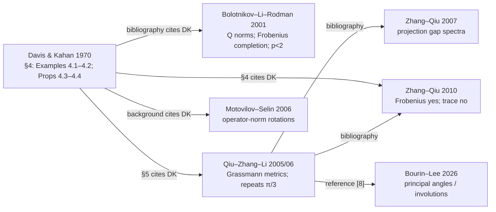

# Davis–Kahan Proposition 4.4: primary-source literature map and novelty audit

**Investigation:** 23 October 2026. **Repository:** `AIQ-Kitware/aiq-dkps-formalization` (public main revision inspected: `a5c18e931d02656a3e859bbd9dd68691529fa97c`, 23 October 2026 UTC). **Target path:** `papers/dk_formalization_journal/PROPOSITION_4_4_LITERATURE_MAP.md`. **Status:** research record, not a change to the manuscript or to Lean. **Primary research question:** historical and mathematical priority for the real short-angle refutation of Davis–Kahan (1970), Proposition 4.4, and for sharp replacement bounds and exact trace-norm minima.

**Evidence convention.** `[LIT-001]` etc. refer to the durable source-location ledger in §G. `[DER-1]` etc. refer to proofs independently supplied in §D. The word **inspected** means that actual article text, rather than merely an abstract, was read; *publisher metadata* and *indexed excerpt only* are recorded separately. PDF-page indices, where given, start at zero; **printed page** numbers are authoritative for citation. Exact-claim novelty is not inferred from the absence of a string-search hit.

## A. Executive summary

1. **The failure of full-displacement trace-norm minimality is established prior art**; already Davis and Kahan's own *complex* Example 4.2 (1970, printed pp. 22–23) gives it. Bolotnikov–Li–Rodman (2001) show why the distinction between squared-displacement / `Q`-norm minimization and Schatten exponents below two matters. Zhang–Qiu (2010, p. 1615) explicitly state that canonical direct rotations do **not** generally minimize `||I-W||_1`. These are distinct historical statements. [LIT-001, LIT-002, LIT-005]
2. **The project does refute the *real-space*, short-angle assertion actually printed as Proposition 4.4.** Its four-real-dimensional construction has *two* principal angles equal to every prescribed `0 < θ < π/2`, and `||I-Wθ||_1 = 4 sin θ < 8 sin(θ/2) = ||I-Rθ||_1`. In particular `0 < θ <= π/3` is available, and arbitrarily small angles work. The corresponding parameterized small-angle theorem is Lean-verified. **A mathematical priority qualification is essential:** the repository's explicit matrices are *exactly* a realification of the 1970 complex phase mechanism (see [DER-4]). Thus the real contradiction is an immediate **consequence** of that old example once realification is observed. We did **not** locate a prior publication explicitly identifying the resulting error in the *real* Proposition 4.4. [LIT-001, LIT-008, DER-4]
3. **The projection-distance lower bound is an elementary, valid all-seminorm inequality**, not an independent discovery of a new deep matrix inequality: for any orthogonal projections `P,Q=WPW*` and any finite-dimensional unitarily invariant seminorm `N`, `N(P-Q) <= N(I-W)`. The short proof is a reflection-commutator identity and the triangle inequality [DER-1]. The older gap-metric literature already records the projection-difference singular values (Zhang–Qiu 2007, p. 165) and the Ky Fan dominance machinery (Bolotnikov–Li–Rodman, Proposition 2.1). **No earlier source containing precisely the displayed commutator bound was located during this search**, which is not a first-discovery claim. [LIT-002, LIT-004]
4. **The sharp approximation inequality is mathematically correct as a direct consequence of these classical ingredients:** for the canonical direct rotation `R` between an equal-dimensional acute pair with maximal principal angle `α`, `N(I-R) <= sec(α/2) N(P-Q) <= sec(α/2) N(I-W)`. This holds over both fields, for every finite-dimensional unitarily invariant seminorm, without a `π/3` restriction; the proof is just the termwise comparison `2 sin(θ_j/2) = sec(θ_j/2) sin θ_j` in the CS/principal-plane decomposition [DER-2]. **Sharpness at every fixed `0<α<π/2` is attained in the trace norm** by the real 4D family (or the original complex phase construction). The optimality is for *one constant valid for all such norms and dimensions*, **not** for each fixed norm individually: Frobenius, operator, and `Q`-norm cases already have constant one. No earlier paper was found that states this uniform sharp `sec(α/2)` bound verbatim. **Classification:** known consequence of existing ingredients; potentially distinct sharp presentation/correction, but presently weak evidence for a *new underlying mathematical phenomenon*. [LIT-001–LIT-005, DER-1–DER-4]
5. **The global real-family minimum follows rigorously**: `min_W ||I-W||_1 = 4 sin θ`, since the exhibited competitor meets the universal lower bound `||P-Q||_1=4 sin θ`. A witness of nonminimality and a proof of global optimality are different claims; the latter is the new deduction [DER-3]. The public `counterexample.tex` explicitly did **not** yet claim the latter. The status of a newer private/local Lean minimization theorem could not be inspected.
6. **For arbitrary equal-dimensional complex subspaces there is a general exact trace-norm minimum** `min_W ||I-W||_1=||P-Q||_1=2∑_j sin θ_j`. Each principal 2-plane admits a rank-one complex phase correction `W_j=e^{iθ_j}R_j`, whose displacement singular values are `(2sin θ_j,0)`; taking the direct sum saturates the lower bound [DER-5]. This is a mathematically straightforward extension of the phase example already printed in 1970, not safely described as an original phenomenon. We found **no directly inspected published source stating the complete general formula or all trace-norm minimizers**. Do not conflate the formula with Bolotnikov–Li–Rodman's **Frobenius** global-minimizer theorem or its conditional **Q-norm** theorem.
7. **Best submission emphasis:** a source-faithful, machine-checked correction to one of the 29 original Davis–Kahan result targets; a small-angle family and an exact explanation of the invalid Ky Fan sum step; and a concise sharp quantitative replacement that remains valid for arbitrary unitarily invariant norms. Present priority claims about the replacement and exact trace minima as *corollaries with explicit derivations*, unless a stronger search independently establishes a defensible originality claim. Keep the 29 original-result census separate from all additional repair and sharpness declarations.

**Three highest-value references:** (i) Davis–Kahan 1970, Section 4, pp. 20–23; (ii) Bolotnikov–Li–Rodman 2001, Theorem 3.1, Lemma 3.3, Theorems 4.2 and 4.5, pp. 33, 36, 39–45; (iii) Qiu–Zhang–Li 2005/online 2006, Section 5 (repeated `π/3` assertion), together with Zhang–Qiu 2010 p. 1615 (explicit acknowledgment of trace-norm nonminimality). The directly inspected Zhang–Qiu 2007 p. 165 is especially useful for deriving the new quantitative bound. See §J and [LIT-001–LIT-005].

## B. Research scope and repository snapshot

### Access and verification boundary

The repository was inspected through the connected GitHub content API against the **public** `AIQ-Kitware/aiq-dkps-formalization` main revision `a5c18e931d02656a3e859bbd9dd68691529fa97c`. There was **no mounted** `~/code/aiq-dkps-formalization` working tree in the execution environment. Consequently this is a reproducible public-revision inspection, **not** an assertion that the user's local checkout was at that commit. A remote or public-revision file returning 404 does not establish that the file is absent locally. No Lean code was edited or compiled in this investigation.

| Repository location / artifact | Observation as of the public revision | Formalization information |
|---|---|---|
| `DavisKahan/FiniteDimensional/DirectRotation/SmallAngleCounterexample.lean` | Inspected, 522 lines. Has `arbitrarilySmall_fullDisplacement_refuted` and explicit singular-value/trace comparisons. | **Lean verified**, with project-owner confirmation of compilation of parameterized family. |
| `DavisKahan/FiniteDimensional/DirectRotation/PrincipalPlanes/Spectrum.lean` | Inspected, 554 lines. `singularValues_directRotation_displacement` and `kyFanSum_directRotation_displacement_eq_principalChords` give principal-plane displacement spectrum. | Available public Lean theorem; relevant foundation for D. |
| `DavisKahan/FiniteDimensional/DirectRotation/ProjectionDisplacement.lean` | **Not published at inspected public revision** (content fetch returned 404). | **Lean verified per project owner** for the universal projection-displacement lower bound; source text not available for this audit. Do not mark unverified merely because public fetch failed. |
| `DavisKahan/FiniteDimensional/DirectRotation/TraceRatio.lean` | **Not published at inspected public revision**. | **Lean verified per project owner** for the exact trace-ratio identity; source text not available for this audit. |
| `papers/dk_formalization_journal/sharp_displacement_unformalized.tex` | **Not published at inspected public revision**. | May exist in local checkout; uninspected. The word `unformalized` in a filename would not by itself prove current theorem status. |
| `papers/dk_formalization_journal/paper.tex` | Inspected, 747 lines. Source accounting explicitly **28 valid Davis–Kahan original results proved, 1 (Proposition 4.4) refuted**. | This is a **29-original-target** count, not a count of all later helper/replacement theorems. |
| `papers/dk_formalization_journal/counterexample.tex` | Inspected, 231 lines. Gives family matrices, `||I-Wθ||_1=4sinθ`, `||I-Rθ||_1=8sin(θ/2)`, source-proof error, and `Q`-norm repair. Says its competitor is a witness, **not** asserted globally minimizing. | Parameterized source and concrete witness formally proved, as recorded there. |
| `papers/dk_formalization_journal/references.bib` | Inspected; includes the four mandatory historical papers. | No changes made. |
| `papers/dk_formalization_journal/submission/LITERATURE_AUDIT.md` | Inspected, dated 20 October 2026: explicitly a *focused* audit, not exhaustive. | Historical baseline; this map extends rather than overwrites it. |
| `papers/what_it_takes_to_prove_davis_kahan/README.md`, `RESEARCH_PLAN.md` | Both exist and were inspected. They distinguish historical antecedents from formal reconstruction and refer to the 29-target source census. | Research-context record, not evidence for a particular new Lean result. |

Other relevant public modules include `DavisKahan/FiniteDimensional/DirectRotation/QNorm.lean`, `Majorization.lean`, and `ShortRotationCounterexample.lean`; the last two were identified in the directory listing but not independently line-audited for this map. The explicit source census remains `dev/davis-kahan-1970-formalization-result-inventory.json` / `dev/davis-kahan-1970-full-source-census.json` and should be used for source-target counting, not the number of declarations in the direct-rotation folder.

### Notation and scope

Throughout, `H` is a finite-dimensional real or complex inner-product space; `P=P_U`, `Q=P_V` are the orthogonal projectors onto **equal-dimensional** subspaces unless otherwise stated; `W` is orthogonal/unitary with `WU=V`, equivalent to `Q=WPW*`; `R` is the **canonical direct rotation**, normalized to fix the joint orthogonal complement and with the usual principal-plane blocks; `θ_1,...,θ_r` are principal angles, with zero angles permitted, and `α=max θ_j`; `N` is a finite-valued unitarily invariant norm or seminorm on endomorphisms. `||X||_1=tr|X|`; `||X||_F` and `||X||_op` denote Frobenius and spectral norms. A `Q`-norm is a norm for which `N(X)^2=M(X*X)` for a unitarily invariant norm `M` on the squared-displacement argument. A **global minimizer** of the entire ambient transformation is not the same as a best choice of two orthonormal frames or a shortest geodesic between subspaces.

## C. Claim-by-claim novelty matrix

**Confidence** assesses the **specific evidence conclusion**, not a probability that a theorem was first discovered here. Mathematical proofs independently reconstructed in §D are distinguished from verified Lean compilation.

| Claim | Mathematical status | Lean status | Closest prior result | Novelty classification | Confidence | Evidence |
|---|---|---|---|---|---|---|
| **A.** Failure of trace-norm minimality | **True**, complex already 1970, real examples exist | Concrete + small-angle verified | Davis–Kahan Example 4.2; BLR Lemma 3.3; Zhang–Qiu 2010 | **Established prior art** | **High** | [LIT-001, 002, 005], §D.A |
| **B.** Real `R^4`, arbitrarily-small-angle counterexample to *printed* Prop. 4.4 | **True**; exact realification of original complex construction | **Verified** small-angle family | Davis–Kahan 1970 Example 4.2 plus realification [DER-4]; erroneous Prop. 4.4 | **Known consequence** of prior example **and formalization contribution** for explicit source-level contradiction | **High** mathematically; **unresolved** first explicit recognition | [LIT-001, 008], §§D.B, D.G |
| **C.** `N(P-Q)<=N(I-W)` | **True** for all finite-dimensional UI seminorms, no angle assumption | **Verified per owner**; local source uninspected | Classic involution/commutator identity; Fan dominance; projection gap spectrum | **Known consequence** | **High** proof, **medium** historical placement | [DER-1], [LIT-002, 004, 007] |
| **D.** `N(I-R)<=sec(α/2)N(I-W)`; uniform sharp constant | **True** for acute pair; sharp **uniformly across norms**, not each norm separately | **Not independently established** for full theorem from inspected public source; foundational spectrum and C/ratio verified per owner | Davis–Kahan principal planes + Zhang–Qiu 2007 gap spectrum + [DER-1]; BLR `Q`-norm is narrower | **Known consequence**, with **potentially distinct sharp synthesis** | **High** derivation, **medium-low** exact-formula priority | [DER-2, 3, 4], [LIT-001–005] |
| **E.** Exact real-family `min ||I-W||_1=4sinθ` | **True** via matched lower bound | Exact ratio verified; **global minimum Lean status uninspected** | Davis–Kahan Example 4.2 under realification, plus [DER-1] | **Known consequence**; possible **formalization contribution** if new checked optimizer exists | **High** proof, **low** direct-publication priority | [DER-1, 3, 4], [LIT-001] |
| **F.** Complex `min ||I-W||_1=2∑sinθ_j` | **True**, constructive for all equal-dimensional complex pairs | **No verified Lean declaration established by this audit** | Direct-sum of 1970 phase blocks + projection gap spectrum | **Known consequence**, **unresolved** direct prior statement/all-minimizer classification | **High** proof, **low-medium** historical priority | [DER-1, 5], [LIT-001, 002, 004] |
| **G.** Phase mechanism and realification | **True**; exact algebraic identity shown below | Family and its matrices verified; explicit Lean realification theorem uninspected | Davis–Kahan Example 4.2 | **Established prior art** for phase; **known consequence** for realification; source-correction **formalization contribution** | **High** mathematics, **unresolved** published recognition | [LIT-001, 008], [DER-4] |

The columns are deliberately independent: an identity can be **mathematically valid and Lean-verified** while **already known**; a potentially fresh phrasing is not automatically a new theorem; a source's historical acknowledgment is not equivalent to its actual proof.

## D. Detailed mathematical comparisons and independent proofs

### D.0. Sources for principal-angle spectra and the meaning of 'same result'

The canonical principal-plane decomposition gives, for each positive principal angle `θ_j`, a two-dimensional real rotation block (also a complex 2-plane under complexification) with eigenvalues `e^{±iθ_j}` and displacement singular values `(2sin(θ_j/2),2sin(θ_j/2))`. Meanwhile the projector difference `P-Q` has singular values `(sin θ_j,sin θ_j)` on that plane. Blocks for `θ_j=0` contribute zero; an identity on the unused complement contributes zero. These formulas are printed in modern projection/gap literature; Zhang–Qiu (2007, printed p. 165, PDF index 2) explicitly lists the projection-difference singular values, even for unequal-dimensional subspaces (which have extra unit singular values), [LIT-004]. The corresponding direct-rotation normal form appears in Qiu–Zhang–Li (Section 2, and Section 5) and Zhang–Qiu (2010, §4); the public Lean `PrincipalPlanes/Spectrum.lean` computes the direct-rotation displacement list. [LIT-003, 005, 008]

Because **arbitrary** unitarily invariant norms are symmetric gauges of the full singular-value list, one must compare **full, doubled** lists, not a single undoubled `r`-tuple with an independently normalized gauge. If singular-value vectors satisfy entrywise `a_j<=b_j`, all symmetric gauges and Ky Fan sums respect that order. If `s(A)≺_w s(B)` (each top-`k` partial sum dominated), Fan dominance gives `N(A)<=N(B)` for all UI norms. BLR (2001) Proposition 2.1 p. 29 states the finite-dimensional norm/majorization comparison; Zhang–Qiu (2007) p. 164 recalls it. [LIT-002, 004]

### D.A. Broad failure of direct-rotation trace-norm minimality (A)

**Question.** May `R` fail to minimize the trace/nuclear norm of `I-W` over unitary or orthogonal `W` carrying one fixed subspace onto another? **Yes.** Already Davis–Kahan Example 4.2, pp. 22–23, takes a complex planar direct rotation and multiplies it by a **complex scalar phase**, obtaining strictly smaller sum of displacement singular values. The same paper's Proposition 4.3 minimizes the UI norm of the **squared displacement** `(I-W*) (I-W)` (an operator of squared singular values); the paper expressly notes that passing from its result to arbitrary **unsquared** UI norms is invalid, and points to Example 4.2. This is the decisive distinction. [LIT-001]

BLR (2001), Lemma 3.3 (printed p. 36), considers a specific complex two-by-two block unitary completion with a *right angle* and shows failure of the `Q`-norm minimization conclusion for Schatten `1<=p<2`; the exact local minimizers in that lemma satisfy a phase-cancellation condition. **It is not a real four-dimensional counterexample satisfying the `α<=π/3` hypothesis.** Theorem 3.1 (p. 33) has a `Q`-norm hypothesis, not an arbitrary UIN. [LIT-002]

Zhang–Qiu (2010, printed p. 1615) specifically contrast Frobenius minimality, generally false trace-norm minimality, and nonuniqueness for the operator norm. This is an explicit later recognition of **A**, not an explicit published admission that real short-angle Proposition 4.4 is false. [LIT-005]

**Class:** established prior art (complex failure since 1970). Date of *first* real-space explicit notice remains unresolved, but the real example is a short mathematical deduction of the 1970 one.

### D.B. Precise real short-angle refutation (B)

**Statement printed in 1970.** Davis–Kahan Proposition 4.4 (printed p. 22, conclusion/proof continuing on p. 23) asserts minimization of `||I-V||` by the canonical direct rotation `U` **for every unitarily invariant norm**, in a **real** space with the upper bound on the largest principal angle `α<=π/3`. The original paper's notation uses `P` and `Q` for the relevant subspaces/projections and `U` for the canonical rotation; translate them carefully to `U,V,R,W` here. The online OCR renders some mathematical glyphs poorly; verify the inequality sign and notation directly against a typeset scan when finalizing a verbatim quotation. Our counterexample uses `θ<π/3` as well, so either strict/non-strict endpoint makes no mathematical difference. [LIT-001]

**The verified family.** Put `J=[[0,-1],[1,0]]`, `c=cosθ`, `s=sinθ`, `C_θ=cI_2+sJ`, `H=(1/√2)[[I_2,I_2],[I_2,-I_2]]`, and take `U=R²⊕{0}`. The source manuscript sets

```
Rθ = [[c I₂, s J], [s J, c I₂]],
Wθ = H diag(C_{2θ}, I₂) Hᵀ
   = [[c² I₂+sc J, -s² I₂+sc J],
      [-s² I₂+sc J, c² I₂+sc J]],
Vθ = Wθ U.
```

The principal frames `X=[I₂;0]` and `Y=[cI₂;sJ]` satisfy `XᵀY=cI₂`; hence both principal angles are `θ`, with `0<θ<π/2`. The canonical direct rotation is precisely `Rθ`. The singular values of `I-Rθ` are `(2sin(θ/2))^×4`, whereas those of `I-Wθ` are `(2sinθ,2sinθ,0,0)`. Thus `||I-Wθ||_1=4sinθ<8sin(θ/2)=||I-Rθ||_1`. The operator-norm comparison goes the other way: `2sinθ>2sin(θ/2)`. At `θ=π/4`, `4sinθ=2√2` and `8sin(θ/2)=4√(2−√2)`. For arbitrary epsilon choose `0<θ<min(epsilon,π/3)`. [LIT-008]

**Proof defect.** The 1970 derivation invokes displayed inequality **(4.3)** to sum the singular-value contributions of separate principal planes in a direction unsupported when the image spaces under `I-W` overlap. The domain principal planes are mutually orthogonal, but their **images under a single competitor** need not be. This is the error, **not** a refutation of their Proposition 4.3 and not an error in the general sin- or tan-theta spectral perturbation theorems. The public `counterexample.tex` demonstrates the failure of this Ky Fan step with concrete principal planes at `θ=π/4`. [LIT-001, LIT-008]

**Historical qualification.** The preceding is an explicit contradiction of the printed *real* statement. It is **not** evidence that no mathematician could have deduced it earlier: §D.G proves `Wθ` is the **exact realification** of Example 4.2's complex phase-adjusted direct rotation. Our literature search did **not** reveal a corrected edition, a published erratum naming Proposition 4.4, or an older paper presenting this specific real short-angle contradiction. Nor does Zhang–Qiu (2010) name the defect. Mark first explicit published recognition **unresolved**, while treating the core mechanism as 1970 prior art. [LIT-001, 005]

### D.C. Universal projection-distance lower bound (C) — [DER-1]

**Theorem.** Let `P` be any real/complex orthogonal projector on a finite-dimensional `H`, let `W` be any orthogonal/unitary map, set `Q=WPW*`, and let `N` be any UI seminorm. Then

```
                         N(P-Q) <= N(I-W).                 (C)
```

No acuteness, equal-dimension *assumption separate from Q=WPW* (which enforces it)*, small angle, norm definiteness, or determinant/orientation restriction is needed.

**Proof.** Put `J=2P−I`, so `J*=J` and `J²=I`. Let `X=I−W`. Since `(P−Q)W=PW−WP`,

```
  2(P−Q)W = JW−WJ = XJ−JX.
```

Right-unitary invariance, homogeneity, the seminorm triangle inequality, and invariance under left/right multiplication by `J` give

```
  2 N(P−Q) = N(XJ−JX) <= N(XJ)+N(JX) = 2N(I−W).
```

This is a *direct proof*, not a theorem attributed to the cited authors. It is the usual commutator contractivity for conjugation by a symmetry. Applying it separately with the Ky Fan `k`-norms yields the **stronger-to-state singular-value formulation**

```
                 s(P−Q) ≺_w s(I−W).                        (C-KF)
```

Here `≺_w` is weak majorization and the vector lengths are ambient dimension `n`. This is also the exact form from which all UI *norm* inequalities follow by Fan dominance; the direct triangle argument covers arbitrary UI *seminorms*, including degenerate ones, without additional representation theory. [LIT-002, 004, 007]

**Nearest historical evidence.** Two-projection theory is substantially older (Afriat 1957; Davis 1958; Halmos as surveyed by Böttcher–Spitkovsky 2010), and Zhang–Qiu (2007) explicitly defines UI gap metrics as `N(P-Q)` and computes the spectrum. BLR Proposition 2.1 supplies Fan dominance. These sources provide the **ingredients**, but the examined pages do **not** visibly state the exact inequality `(C)` with an arbitrary conjugating `W`. It should be called a *classical-method corollary*, not attributed verbatim to a source that was not found. [LIT-002, 004, 007, 010]

### D.D. Sharp universal direct-rotation approximation (D) — [DER-2]

**Precisely scoped theorem.** Let `U,V` be equal-dimensional subspaces of `F^n`, `F∈{R,C}`, with every principal angle in `[0,α]` and `α<π/2`; let `R` denote the canonical direct rotation (identity outside principal planes). For each UI seminorm `N` and each orthogonal/unitary `W` taking `U` to `V`,

```
 N(I−R) <= sec(α/2) N(P_U−P_V) <= sec(α/2) N(I−W).       (D+)
```

The non-strict endpoint `α=π/2` can also be handled in finite dimensions for a *chosen canonical CS rotation*, with constant `√2`, though uniqueness of a canonical rotation may require care in right-angle configurations. State the acute theorem as proposed, to avoid accidentally importing a uniqueness claim at a nonacute endpoint.

**Proof.** In the shared principal-plane coordinates, pad singular-value vectors with zeros. On the `j`th plane,

```
 s(I−R):   2sin(θ_j/2), 2sin(θ_j/2)
 s(P−Q):     sin θ_j,     sin θ_j.
```

Since `sin θ_j = 2sin(θ_j/2) cos(θ_j/2)` and `θ_j<=α`, each first entry is at most `sec(α/2)` times the corresponding second. Symmetric-gauge monotonicity (or weak majorization / Fan dominance) gives the first inequality in `(D+)`. The second is [DER-1]. No approximation theorem about unitary extensions is required. In particular, the same reasoning yields

```
 s(I−R) ≺_w sec(α/2) s(I−W),
```

and `(D+)` is valid for every Schatten, Ky Fan, or other UI seminorm. [LIT-002, 003, 004, 005, 008]

**Numerical constants and asymptotics.** For `α=π/3`, `sec(α/2)=2/√3`; for `α↑π/2`, the factor tends to `√2`. For small `α`, `sec(α/2)=1+α²/8+O(α⁴)`. These facts are trigonometric evaluations of `(D+)`, **not** independent historical matches for unrelated papers using `2/√3` or `√2`.

**Sharpness, with the quantifiers stated correctly.** Fix any `α∈(0,π/2)` and consider the real 4D family from §D.B with `θ=α` and `N=||·||_1`. By §D.E, the competitor `Wα` actually **minimizes** trace displacement, and

```
          ||I−Rα||_1 / min_{W:WU=V}||I−W||_1
             = [8sin(α/2)]/[4sin α] = sec(α/2).
```

Thus no smaller **constant uniform over all dimensions, real/complex subspaces and all UI norms** works at that fixed `α`. **Do not say:** "`sec(α/2)` is best possible for *each individual* UI norm." This is false: `||·||_op` and `||·||_F` (and the `Q`-norm class under the valid hypotheses) have optimal factor **one** because the direct rotation is already minimizing. Davis–Kahan Proposition 4.3, BLR Theorems 3.1/4.5, and Zhang–Qiu 2010 p. 1615 make this point. [LIT-001, 002, 005]

**Closest actually located results, with precise differences.**

* **Davis–Kahan (1970), Propositions 4.3–4.4, pp. 21–23:** Prop. 4.3 minimizes squared displacement in all UI norms; Prop. 4.4 attempts exact *full*-displacement minimization under real `α<=π/3` but is false. Neither gives a valid approximate-minimization `sec` factor. Prop. 4.3 **does** imply norm classes with a square-lift (`Q`-norms), but not all UI norms.
* **Bolotnikov–Li–Rodman (2001), Theorem 3.1, p. 33:** exact `Q`-norm minimization for a special unitary block-completion structure, with additional equality conditions for strictly increasing Schur-convex associate norms. Its hypothesis *excludes* trace norm. Theorem 4.2 pp. 39–40 gives **global Frobenius** minima and a description of all their minimizers. Theorem 4.5 p. 45 gives **conditional** `Q`-norm minima in a CS-decomposed chain mapping with an extra block-diagonal alignment condition. None states a sharp factor for **every** UI norm. [LIT-002]
* **Qiu–Zhang–Li (2005 / online 2006), §2, Eqs. (8)–(9) and Theorem 6 (§5):** principal-angle `sin θ` (gap) and `2sin(θ/2)` (Hausdorff) metrics on the *Grassmann space*, with frame-alignment infima; Theorem 6 gives minimal `N(log W)` among subspace-mapping unitaries. These compare different **objectives**: a frame distance, an intrinsic/logarithmic metric, or the ambient chordal displacement. Its §5 item 3 repeats the wrong `π/3` full-displacement assertion, so **cannot** be cited as proof of `(D+)`. [LIT-003]
* **Zhang–Qiu (2007), printed p. 165:** gap `N(P-Q)` and its repeated-sine singular spectrum, including unequal ranks. Crucial *ingredient* for `(D+)`, not itself an optimization over ambient `W`. [LIT-004]
* **Zhang–Qiu (2010), §4, p. 1615:** states exact **Frobenius** minimality and general **trace-norm** failure; provides principal-plane normal form and product-of-rotation formulas, not the sec-factor approximation. [LIT-005]
* **Motovilov–Selin (2006), §2, Lemma 2.19 and Remark 2.20 (arXiv version):** `||I−R||_op=2sin(α/2)` and *operator-norm* optimality. This solves one norm class with constant one, not the all-UIN sharp estimate. Its perturbation bounds additionally impose spectral gaps/off-diagonal perturbations, unlike `(D+)`. [LIT-009]
* **Lankeit–Neff–Nakatsukasa (2014):** optimality of a **unitary polar factor for matrix logarithm** objectives under arbitrary UI norms; the constraint is an unconstrained polar approximation to a nonsingular matrix, **not** `WU=V` and `N(I-W)`. No implication to the proposed universal sec factor was identified. [LIT-013]
* **Massey–Rios–Stojanoff (2018):** local/global UI-norm minima on **unitary conjugacy orbits of Hermitian matrices**; not the set of ambient unitaries mapping one subspace to another. [LIT-014]
* **Bourin–Lee (2026):** principal-angle decomposition derived from non-selfadjoint involutions; no ambient-chordal constrained minimization in its inspected theorem statements. Recent and mathematically adjacent, but no duplicate bound. [LIT-015]

**Priority determination.** The *full universal sharp formula* was **not directly located** in the examined sources or mathematical-expression searches. Nevertheless [DER-1] plus the classical `sin θ`/`2sin(θ/2)` spectra make it an almost immediate deduction, while [DER-4] supplies the sharpness family from a 1970 mechanism. Therefore classify the underlying inequality as a **known consequence** and its sharp all-norm package as **potentially distinct in formulation and application**, not as established first-discovered new mathematics. The high-risk priority question is whether an earlier author wrote `(D+)` or a more general majorization/metric comparison verbatim; see §K.

### D.E. Explicit real four-dimensional global trace optimizer (E) — [DER-3]

The `R⁴` family in §D.B has **two** principal angles `θ`. The projector-difference singular values are thus `(sinθ,sinθ,sinθ,sinθ)`, and

```
    ||P_U−P_Vθ||_1 = 4sinθ.
```

By [DER-1], every orthogonal `W` with `WU=Vθ` obeys `||I-W||_1>=4sinθ`. The explicit real `Wθ` has two nonzero singular values `2sinθ`, hence `||I-Wθ||_1=4sinθ` and **achieves** that lower bound. Consequently

```
 min_{W∈O(4), WU=Vθ} ||I−W||_1 = 4sinθ,
 ||I−Rθ||_1 = 8sin(θ/2),
 ||I−Rθ||_1 / min ||I−W||_1 = sec(θ/2).
```

This proves global optimality **without** searching the orthogonal group or differentiating the objective. The public `counterexample.tex` only asserted the explicit witness, so this is a genuine **logical strengthening of the documented statement** but not compelling evidence of a historically novel optimization technique. No prior article directly solving the same `R⁴` family was found. The Lean proof status of *global optimality* is **unknown for the local checkout**, not contradicted: the public file does not contain it, and the owner has specifically confirmed the adjacent lower bound and trace identity.

### D.F. Complex exact trace-norm minimization (F) — [DER-5]

**Theorem (mathematically deduced here).** Let `U,V⊂C^n` have the same dimension and principal angles `θ_1,...,θ_r∈[0,π/2]`. Then

```
  min_{W∈U(n), WU=V} ||I−W||_1
    = ||P_U−P_V||_1 = 2∑_{j=1}^r sin θ_j.                  (F)
```

**Lower bound:** [DER-1] with the trace norm and the doubled principal-sine spectrum.

**Attainment:** Use orthogonal principal two-planes for each `0<θ_j<=π/2`, with orthonormal basis `(u_j,f_j)` and `v_j=cosθ_j u_j+sinθ_j f_j`. Let `R_j=[[cosθ_j,−sinθ_j],[sinθ_j,cosθ_j]]`. Over **complex** scalars, define `W_j=e^{iθ_j}R_j`. Then `W_j` is unitary and sends `u_j` to `e^{iθ_j}v_j`, so it carries the **subspace** correctly; its two eigenvalues are `1` and `e^{2iθ_j}`, so the singular values of `I−W_j` are `(0,2sinθ_j)`. Take `W=⊕_j W_j ⊕ I` on common and unused parts. Its displacement trace norm is exactly `2∑sinθ_j`, matching the lower bound. This also works at `θ_j=π/2` as a *unitary*, even though a unique canonical rotation may fail in some nonacute conventions. [LIT-001, 004]

**Do not transfer this theorem verbatim to real spaces.** The multiplication `e^{iθ_j}` does not define a real orthogonal map of the *same* 2-real-dimensional plane. One isolated nonzero principal angle in a real 2-plane has canonical rotation with trace displacement `4sin(θ/2)` and reflection options of trace displacement `2`; at `0<θ<π/3`, neither reaches the projector lower bound `2sinθ`. Pairing equal real angles into a 4D realification changes the feasible set and permits saturation. A blanket real equality `min ||I-W||_1=||P-Q||_1` is **false**, notwithstanding the universal inequality.

**Prior-art comparison.** A single-block construction is literally Davis–Kahan's complex phase Example 4.2 pushed to the endpoint phase `β=θ`; the direct sum and [DER-1] supply the global theorem. BLR (2001) formulates the correct *type of optimization problem* (Problem 1.1 with one subspace), but its Theorem 4.2 solves it for **Frobenius**, not Schatten one, and Theorem 4.5 solves a **Q-norm** case. In the papers inspected, **the exact general nuclear/trace-norm formula (F) and a classification of every minimizer were not located**. They may appear under minimal unitary extension / completion / phase-matching language; §K records further search targets. Do not claim a complete minimizer characterization: the construction establishes a nonempty family of minimizers, not necessity. [LIT-001, 002, 003, 004]

### D.G. Exact realification of the old complex phase construction (G) — [DER-4]

The four-real-dimensional mechanism is **not merely analogous** to the 1970 complex example; there is an explicit equality of matrices. Identify `R²` with `C` so that the real `J=[[0,-1],[1,0]]` represents multiplication by `i`, and identify `R⁴=R²⊕R²` with `C²`. In this identification the matrix

```
 Rθ = [[c I₂, s J], [s J, c I₂]]
```

is the complex 2-by-2 unitary `[[c,is],[is,c]]` and has eigenvalues `e^{±iθ}`. Multiplication by the common complex phase `e^{iθ}` is the **real** orthogonal block diagonal `diag(C_θ,C_θ)`, where `C_θ=cI₂+sJ`. Direct multiplication gives

```
  diag(C_θ,C_θ) Rθ
   = [[c²I₂+csJ, -s²I₂+csJ],
      [-s²I₂+csJ, c²I₂+csJ]]
   = Wθ.
```

Moreover, in the real orthogonal `H=(1/√2)[[I,I],[I,−I]]` eigenbasis,

```
 Hᵀ Rθ H = diag(C_θ,C_{−θ}),
 Hᵀ Wθ H = diag(C_{2θ},I₂).
```

Therefore the exact phase-adjustment `Wθ=e^{iθ}Rθ` in `C²` becomes the repository's real orthogonal `Wθ` in `R⁴`. The original 1970 example treats the **complex** instance and then asserts the real restriction in Prop. 4.4; realification is a mathematical deduction from the original work, **not** an explicitly discovered historical correction in that publication. [LIT-001, 008]

**Impact on priority:** it would be incorrect to call the phase trick, or even its four-dimensional matrix realization considered without context, a newly discovered optimization mechanism. The defensible distinct contribution is the **identification of the false printed real proposition, the exact error in its proof step, the arbitrarily-small-angle source-level refutation, and its machine-checked documentation**. We have not verified a published precursor expressly making that connection, which remains a meaningful but unresolved priority question.


## E. Historical chronology and what each date establishes

**1951–1958: matrix norms, principal angles, and two-projection geometry.** Ky Fan's eigenvalue inequalities and Fan–Hoffman's 1955 metric inequalities supplied tools for comparisons of unitarily invariant norms. Afriat (1957) studied projectors and the invariants of pairs of subspaces, and Davis (1958) treated separation of subspaces. **Relationship:** these are mathematical antecedents and/or citations in the later literature; this investigation has not demonstrated that any of them considered the *ambient* nuclear norm of a subspace-mapping orthogonal operator. Afriat's full theorem text was inaccessible, and Fan–Hoffman's was available only in search excerpts. [LIT-006, LIT-007, LIT-011]

**1970: Davis and Kahan.** In *The Rotation of Eigenvectors by a Perturbation. III*, §4 introduces the canonical direct rotation and proves its relevant squared-displacement extremality (Proposition 4.3). Example 4.1 describes real-plane behavior beyond the short-angle range; Example 4.2 introduces a **complex scalar phase modification** beating the direct rotation in the trace norm for small angles. Proposition 4.4 then asserts the stronger full-displacement extremality over **real** spaces below a `π/3` maximum-angle threshold. That last assertion is false, not merely its proof. **Relationship:** exact primary textual succession; the 4D realification [DER-4] is our *retrospective mathematical deduction*, not an error acknowledgment appearing in the original publication. [LIT-001]

**1976–1995: perturbation and projector reference tradition.** Kato's *Perturbation Theory for Linear Operators* and Stewart–Sun's *Matrix Perturbation Theory* (1990) established lasting reference treatments of projector geometry and spectral variation. **Relationship:** background literature cited by later authors; we did not inspect the relevant monograph pages and cannot attribute the present sharp approximation or trace minimum to them. [LIT-012, LIT-017]

**1998–1999: orthogonality-constrained geometry.** Edelman–Arias–Smith studied computational geometry on Stiefel/Grassmann manifolds. **Relationship:** optimization-neighborhood predecessor, but geodesic/intrinsic or frame distances must not be substituted for the ambient chordal `N(I−W)` problem. Direct source text not inspected in this audit. [LIT-016]

**2001: Bolotnikov–Li–Rodman.** Their precise constrained-unitary minimization framework establishes `Q`-norm principles and Frobenius minimizers for block-completion problems. Their Lemma 3.3 shows failure of the corresponding rule for Schatten `p<2` in a 2D **right-angle** configuration with complex phases; their introduction says their methods also apply in the real setting, but does not construct the needed short-angle real 4D case. **Relationship:** strong explicit mathematical predecessor for *general nonminimality and norm-class separation*, **not** a located acknowledgment of the *real, `α<=π/3`* contradiction, and **not** a theorem stating the all-norm `sec(α/2)` factor. We inspected the primary journal PDF, including Theorems 3.1, 4.2, 4.5 and Lemma 3.3. [LIT-002]

**2005 issue / 2006 online: Qiu–Zhang–Li.** Their SIAM Grassmann metric article studies principal-angle and logarithmic metrics. Its §5 list of direct-rotation properties, attributed to Davis–Kahan, **repeats** the real short-angle full-displacement minimality assertion, while its own logarithm-distance minimum has another objective. The publisher's issue record is marked 2005 and online publication is 31 July 2006; retain both dates rather than reclassifying every reference as “2006.” **Relationship:** explicitly cited reproduction of the 1970 statement; no independently established proof of the false statement was identified. Their acknowledgement of assistance from Chandler Davis concerns an alternative proof of **their Theorem 1**, not endorsement of the problematic §5 assertion. [LIT-003]

**2004 preprint / 2006 journal: Motovilov–Selin.** They establish sharp **operator-norm** perturbation/direct-rotation estimates with spectral assumptions; the direct-rotation displacement spectral formula is an antecedent to the `s(I−R)` half-angle component. **Relationship:** norm-restricted related result, not the all-UIN comparison theorem. [LIT-009]

**2007: Zhang–Qiu.** Their article gives explicit singular values for `P_U−P_V` in terms of principal angles (including additional ones under dimension mismatch) and develops angular metrics. **Relationship:** direct source-level ingredient for [DER-2], not a located minimization over `W` with `WU=V`. [LIT-004]

**2010: Zhang–Qiu.** Section 4, printed p. 1615, states that direct rotations minimize Frobenius displacement but **not in general trace-norm displacement**. **Relationship:** explicit later recognition of Claim A, citing Davis–Kahan theory. The paragraph does not, in the passages inspected, announce that *Proposition 4.4 is false under its real `π/3` hypothesis*. Mathematical overlap with Claim B does not establish the latter historical priority. [LIT-005]

**2010: Böttcher–Spitkovsky survey.** A comprehensive two-projection reference with principal-angle and operator-algebra connections, useful for tracing alternate terminology. **Relationship:** nearby mathematical lineage. Full paper not opened from an accessible primary copy in this session. [LIT-010]

**2014: Lankeit–Neff–Nakatsukasa.** Shows minimization properties for a **matrix-logarithm/polar-factor** objective. **Relationship:** false positive for an “all unitarily invariant norms” search if one omits the actual optimization variable and objective; not evidence for or against the constrained ambient chordal bound. [LIT-013]

**2018: Massey–Rios–Stojanoff.** Investigates local minima for unitarily invariant norms on Hermitian unitary-conjugacy orbits. **Relationship:** different feasible set/objective, with potential methodological relevance; no direct implication to Claims D–F found. [LIT-014]

**2026: Bourin–Lee.** Revisits principal angles through involutions; their inspected decomposition statements support the persistence of the two-subspaces technical neighborhood, but not a located new unitary-completion theorem. **Relationship:** later mathematical treatment citing Qiu–Zhang–Li, rather than a documented correction of Prop. 4.4. [LIT-015]

**October 2026: project formalization and this audit.** The public manuscript documents 28 original source results formalized and Proposition 4.4 refuted, plus separately counted extra formalization results. The project owner confirms Lean compilation of the arbitrary-small-angle counterexample, projection-displacement lower bound, and trace ratio. This map adds [DER-1]–[DER-5] to separate automatic mathematical consequences from historically distinct claims. **Relationship:** contemporary verified artifact and additional deductions, not an inference of historical priority from being formally checked. [LIT-008]

## F. Citation graph and literature neighborhoods

A solid arrow in the **documented-citation** diagram means *the later source's bibliography or text explicitly cites the earlier source*. It does **not** mean the later theorem logically depends on the exact earlier theorem or that a correction was known. A dashed arrow in the separate *mathematical implication* list denotes a deduction made **in this audit**, not a historical citation. Only verified edges are drawn; the absence of an edge means it was not recorded, not that there was no citation.



**Backward branches:** BLR's bibliography cites Davis–Kahan, Davis (1958), Afriat (1957), Fan–Hoffman (1955), Stewart–Sun (1990), and other unitary-completion work [LIT-002]. These were followed at least to accessible bibliographic records and mathematical subject matter; only the inspected full texts support theorem-level comparisons. Qiu–Zhang–Li's bibliography and acknowledgement connect Davis–Kahan, geometric/Grassmann metrics, and the 1990s numerical-matrix geometry line [LIT-003].

**Forward branches:** Zhang–Qiu (2007) and (2010) explicitly belong to the Qiu–Zhang–Li citation lineage. Bourin–Lee (2026) lists Qiu–Zhang–Li in its reference list. Index/database records additionally suggest more papers in the BLR neighborhood (polar logarithms, local unitary-orbit minima), but an index “cited by” association without confirmed full bibliography is **not** displayed as a solid citation edge. [LIT-003–LIT-005, LIT-015]

**Mathematical dependency graph, deliberately *not* a citation claim:**

```
DK 1970: Example 4.2 (complex phase)
  + complex-to-real identification [DER-4]
       → real 4D small-angle contradiction B
       → sharpness example for D, and attainment in E

Projector reflection commutator [DER-1]
       → C (all UI seminorms)
       + doubled principal-sine spectrum (Zhang–Qiu 2007)
       + doubled half-chord spectrum (Davis–Kahan 1970, Lean)
          → D: N(I−R) <= sec(α/2)N(P−Q) <= sec(α/2)N(I−W)
       + real 4D competitor → E: exact real minimum
       + complex principal-plane phases → F: exact complex minimum
```

**Neighborhood coverage and traps:**

| Literature neighborhood | Strongest source actually examined | Exact relevance | Nonimplication / trap |
|---|---|---|---|
| Canonical direct rotation; CS/principal planes | DK §4 [LIT-001]; Zhang–Qiu 2010 §4 [LIT-005] | Half-angle singular values | Doesn't establish full-displacement trace minimality. |
| UI norms / weak majorization | BLR Proposition 2.1 [LIT-002]; Fan–Hoffman metadata [LIT-006] | Fan dominance; double-sine comparison | A `Q`-norm hypothesis is not every UI norm. |
| Constrained ambient unitary maps | BLR Theorems 3.1, 4.2, 4.5 [LIT-002] | Closest **optimization problem**, exact Frobenius and `Q` cases | Wrong to substitute Schatten 1 for Frobenius 2. |
| Projection gap / angular metrics | Qiu–Zhang–Li §2 [LIT-003]; Zhang–Qiu p.165 [LIT-004] | `s(P−Q)` and gauge metrics | A norm on projections isn't a minimum over ambient `I−W`. |
| Operator-norm subspace rotations | Motovilov–Selin §2 [LIT-009] | Constant one in `||·||op` and half-chords | Spectral-angle bounds don't prove trace or all-norm factor. |
| Geodesic / logarithm distances | Qiu–Zhang–Li Theorem 6 [LIT-003]; Lankeit et al. [LIT-013] | Principal-angle logarithms | `N(log W)` and `N(I−W)` are different functions. |
| Partial-isometry / unitary extensions | BLR Problems 1.1 and 4.1 [LIT-002] | Feasible sets and CS block completions | Minima/equality conditions depend on norm and block constraints. |
| Modern orbit norm optimization | Massey–Rios–Stojanoff [LIT-014] | Matrix norm calculus | Orbit of Hermitian matrices is not the map-completion fiber. |
| Two-projection structural reviews | Böttcher–Spitkovsky [LIT-010]; Bourin–Lee [LIT-015] | Alternate decomposition language | No located statement of the sec bound or exact minima. |

## G. Primary-source evidence ledger

These `LIT-###` identifiers are stable *within this file*; add new identifiers without renumbering. “Article inspected” means the relevant theorem/paragraph was read in the article itself; “publisher metadata only”, “abstract/excerpt only”, and “bibliography lead only” mean **do not** claim proof-level inspection. DOI links are stable retrievable locations, but a DOI resolving to an abstract is not a full-text inspection. Published page numbers and PDF viewer page indices are deliberately labeled separately.

| ID | Primary reference and permanent retrieval | Precisely checked location and finding | Access level; supported claims |
|---|---|---|---|
| **LIT-001** | Davis & Kahan (1970), DOI [10.1137/0707001](https://doi.org/10.1137/0707001), [SIAM publisher](https://epubs.siam.org/doi/10.1137/0707001), [scanned-publication OCR transcription](https://www.scribd.com/document/843296318/Davis-RotationEigenvectorsPerturbation-1970) | **Printed pp. 20–23, §4**, specifically Proposition 4.3 (squared displacement), Examples 4.1–4.2 (real large-angle vs complex phase), Proposition 4.4 and erroneous inequality (4.3). The original Prop. 4.4 is a **real** short-angle claim, `α<=π/3`. | **Original scan OCR/primary text inspected**, original-page mathematical typography not fully visually checked because screenshot retrieval failed; A, B, D, G; [DER-4]. |
| **LIT-002** | Bolotnikov, Li & Rodman (2001), DOI [10.13001/1081-3810.1058](https://doi.org/10.13001/1081-3810.1058), [publisher journal PDF](https://journals.uwyo.edu/index.php/ela/article/download/117/117/117) | **Printed p.29 Proposition 2.1** Fan dominance; **p.33 Theorem 3.1** `Q`-norm unitary completion; **p.36 Lemma 3.3**, complex 2×2 right-angle Schatten `p<2` obstruction; **pp.39–40 Theorem 4.2**, exact Frobenius global minimizers; **p.45 Theorem 4.5**, conditional `Q`-norm mapping-minimization via CS structure; bibliography pp.45–46. | **Publisher full article inspected**, PDF viewer p0–20 correspond to printed pp.26–46. The authors say on PDF p.2 (printed p.28) that their methods also apply over real matrices, but Lemma 3.3 itself addresses a right-angle 2×2 case, not a short-angle 4×4 refutation; A, C, D, E, F, chronology. |
| **LIT-003** | Qiu, Zhang & Li (journal issue 2005; online 2006), DOI [10.1137/040607605](https://doi.org/10.1137/040607605); [publisher metadata](https://epubs.siam.org/doi/10.1137/040607605), [author manuscript PDF](https://cklixx.people.wm.edu/metric.pdf) | **Author PDF page 5 (zero-index), §2**, Eqs.(8)–(9) principal-angle/gap metrics; **author PDF page 19**, §5 item 3 repeats DK's `π/3` full-displacement claim; **§5 Theorem 6**, logarithm metric instead of chordal displacement; **author PDF page 21**, Davis assistance acknowledged for proof of **Theorem 1**, not Prop.4.4. | **Author full manuscript text inspected**; **printed** journal pp.507–531, but do not replace manuscript page numbers by guessed printed correspondence; A, B, D, G, chronology. |
| **LIT-004** | Zhang & Qiu (2007), DOI [10.1016/j.laa.2006.08.015](https://doi.org/10.1016/j.laa.2006.08.015); [author-hosted published PDF](https://eeqiu.people.ust.hk/wp-content/uploads/2021/04/On-the-Angular-Metrics-Between-Linear-Subspaces-1.pdf) | **Printed p.165** (PDF viewer page 2), explicit singular values of the difference of orthogonal projections: each `sin θ_j` twice, plus unit entries under unequal ranks. Metric on projections rather than minimization over `W`. | **Full article inspected**; C, D, F. |
| **LIT-005** | Zhang & Qiu (2010), DOI [10.1137/09074841X](https://doi.org/10.1137/09074841X); [published article author PDF](https://eeqiu.people.ust.hk/wp-content/uploads/2021/04/From-Subadditive-Inequalities-of-Singular-Values-to-Triangle-Inequalities-of-Canonical-Angles.pdf) | **Printed p.1615, §4** (PDF viewer p9): Frobenius-minimal direct rotation, explicit statement of *nonminimal trace displacement*, operator-norm nonuniqueness; pp.1616–1617 principal-plane unitary and product geometry. Does not explicitly say real `π/3` Proposition 4.4 is false. | **Full article inspected**; A, B, D, chronology. |
| **LIT-006** | Fan & Hoffman (1955), DOI [10.1090/S0002-9939-1955-0067841-7](https://doi.org/10.1090/S0002-9939-1955-0067841-7); [full-text mirror attempted](https://www.math.pku.edu.cn/teachers/yaoy/Fall2011/Fan_Hoffman1955.pdf) | Pp.111–116, foundational metric/orthogonal approximation. No specific result about `sec(α/2)` was verified. | **Publisher/bibliographic metadata and indexed excerpt only**; background C, D. |
| **LIT-007** | Afriat (1957), DOI [10.1017/S0305004100032916](https://doi.org/10.1017/S0305004100032916), [Cambridge publisher](https://doi.org/10.1017/S0305004100032916) | Printed pp.800–816, orthogonal/oblique projectors and characteristics of pairs of subspaces; cited by BLR. Exact theorem statements not obtained. | **Publisher metadata/abstract only**; background. |
| **LIT-008** | AIQ-Kitware public repository [SHA `a5c18e9...`](https://github.com/AIQ-Kitware/aiq-dkps-formalization/tree/a5c18e931d02656a3e859bbd9dd68691529fa97c); [counterexample.tex](https://github.com/AIQ-Kitware/aiq-dkps-formalization/blob/a5c18e931d02656a3e859bbd9dd68691529fa97c/papers/dk_formalization_journal/counterexample.tex); [SmallAngleCounterexample.lean](https://github.com/AIQ-Kitware/aiq-dkps-formalization/blob/a5c18e931d02656a3e859bbd9dd68691529fa97c/DavisKahan/FiniteDimensional/DirectRotation/SmallAngleCounterexample.lean); [PrincipalPlanes/Spectrum.lean](https://github.com/AIQ-Kitware/aiq-dkps-formalization/blob/a5c18e931d02656a3e859bbd9dd68691529fa97c/DavisKahan/FiniteDimensional/DirectRotation/PrincipalPlanes/Spectrum.lean); [prior audit](https://github.com/AIQ-Kitware/aiq-dkps-formalization/blob/a5c18e931d02656a3e859bbd9dd68691529fa97c/papers/dk_formalization_journal/submission/LITERATURE_AUDIT.md) | `counterexample.tex` theorem at lines 19–29, construction lines 32–93, priority caveat lines 198–230. `SmallAngleCounterexample.lean` `kyFanSum_lt` and `arbitrarilySmall_fullDisplacement_refuted`; `PrincipalPlanes/Spectrum.lean` `singularValues_directRotation_displacement` and Ky Fan chord formula. `paper.tex` and `references.bib` also inspected. | **Public source files inspected through GitHub API**; owner confirms compilation of counterexample, projection lower bound, and trace ratio. B–G, Lean status. |
| **LIT-009** | Motovilov & Selin (2006), DOI [10.1007/s00020-006-1437-1](https://doi.org/10.1007/s00020-006-1437-1), [author's arXiv manuscript](https://arxiv.org/pdf/math/0409558) | Preprint **§2, Lemma 2.19 and Remark 2.20** on spectral angle and direct rotation, operator-norm displacement and sharp perturbation bounds; journal pp.511–542. | **Full author manuscript inspected**; D, bibliography. |
| **LIT-010** | Böttcher & Spitkovsky (2010), DOI [10.1016/j.laa.2009.11.002](https://doi.org/10.1016/j.laa.2009.11.002); [publisher](https://www.sciencedirect.com/science/article/pii/S0024379509005722); [university copy attempted](https://scholarworks.wm.edu/cgi/viewcontent.cgi?article=2259&context=aspubs) | LAA **432**, pp.1412–1459; survey of two-projection structure. Exact statements about optimizing `N(I−W)` not checked. | **Publisher metadata/abstract only**, full text blocked in this session; nearby literature. |
| **LIT-011** | Davis (1958), “Separation of two linear subspaces,” *Acta Sci. Math. (Szeged)* **19**, 172–187; citation in BLR bibliography | Earlier projection/angle theory, exact pages/theorems unavailable in this investigation; DOI **not verified**. | **Bibliography lead only**; history. |
| **LIT-012** | Kato, *Perturbation Theory for Linear Operators*, Springer, second edition 1976 (corrected printing 1980, 1995 Classics edition) | Two-projections / canonical rotation background; exact proposition and edition pagination **not inspected**, and no DOI recorded without edition verification. | **Bibliography lead only**; history. |
| **LIT-013** | Lankeit, Neff & Nakatsukasa (2014), DOI [10.1016/j.laa.2014.02.012](https://doi.org/10.1016/j.laa.2014.02.012); [arXiv](https://arxiv.org/abs/1308.1122) | LAA **449**, pp.28–42. Unitary **polar factor** optimizes certain **matrix-logarithm** UI norms; not `min_{WU=V} N(I−W)`. | **Abstract and indexed source excerpts only**, theorem text not directly opened; false-positive comparison D. |
| **LIT-014** | Massey, Rios & Stojanoff (2018), DOI [10.1016/j.laa.2018.07.022](https://doi.org/10.1016/j.laa.2018.07.022); [arXiv](https://arxiv.org/abs/1806.11436); [author-hosted PDF](https://www.mate.unlp.edu.ar/~demetrio/Papers/Papers%20en%20pdf/MRS%20-%20LAA%20-%20Local%20Lidskii%20aa.pdf) | LAA **557**, pp.34–61. Conjugacy-orbit minimization on Hermitian matrices; different feasible set. | **Primary abstract/indexed excerpts**, no claim that full theorem was inspected; D neighborhood. |
| **LIT-015** | Bourin & Lee (2026), DOI [10.1016/j.laa.2025.10.017](https://doi.org/10.1016/j.laa.2025.10.017); [full article author's arXiv copy](https://arxiv.org/pdf/2602.19599) | LAA **730**, pp.124–137 (journal dated 2026). **Proposition 1.1, Corollary 1.2, Theorem 2.1** decompose angles via involutions, **reference [8]** cites Qiu–Zhang–Li. Does not solve `min_{WU=V} N(I−W)` in inspected statements. | **Full article inspected**; D, forward citations. |
| **LIT-016** | Edelman, Arias & Smith (1999), DOI [10.1137/S0895479895290954](https://doi.org/10.1137/S0895479895290954), [SIAM](https://doi.org/10.1137/S0895479895290954) | *The Geometry of Algorithms with Orthogonality Constraints*, *SIAM J. Matrix Anal. Appl.* **20**, pp.303–353. Distinct Grassmann/Stiefel geometry, not the exact constrained chordal optimization identified here. | **Bibliographic/abstract comparison only**; background; year stated for print-volume indexing, inspect issue-year discrepancy if needed. |
| **LIT-017** | Stewart & Sun (1990), *Matrix Perturbation Theory*, Academic Press, ISBN 9780126702309 (bibliographic record; DOI not verified) | Monograph cited in BLR; canonical-angle and CS decomposition context. Exact relevant chapter/pages not inspected. | **Bibliography lead only**; background. |

**For future evidence additions:** preserve URL, retrieval date, scanned/publisher/author version, page-number convention, field, dimension, norm class, feasible maps, and whether the text *proves* the assertion or only attributes it. It is legitimate to append a new `LIT-018` on a corrected historical reference without renumbering existing entries.

## H. Search methodology, negative-evidence log, and coverage limits

### H.1 Retrieval and comparison protocol actually performed

1. **Repository-first inspection.** Retrieved the AIQ-Kitware GitHub main source revision and examined the primary Lean theorem declarations, the two manuscript sections, bibliography, prior dated literature audit, and the independent `what_it_takes_to_prove_davis_kahan` research plan. Tried to retrieve the named projection-distance and trace-ratio files; public-revision fetches returned 404, so their **owner-reported verified** status was retained and their declarations were not guessed. The inspected Git SHA and exact path references are in §B. A GitHub mirror under `Erotemic/aiq-dkps-formalization` existed, but its last visible revision was from July 2026 and was **not** substituted for the current October public revision.
2. **Primary papers and section-level examination.** Read source text for the original 1970 §4 as available via primary-scan OCR transcription; directly opened the BLR publisher PDF; the complete Qiu–Zhang–Li author manuscript; both Zhang–Qiu author-hosted published PDFs; Motovilov–Selin's full arXiv version; and Bourin–Lee's full arXiv version. Made comparisons by field, feasible mapping class, target function, norm, angle range, and whether the conclusion was an inequality, a minimum, or *all* minimizers. Page/theorem anchors are in §G, with lower confidence clearly marked where source access was incomplete.
3. **Bibliographic verification.** Used publisher DOI pages for SIAM, Elsevier/ScienceDirect, Cambridge, Springer, AMS/DOI records, and ELA journal archive. The Qiu–Zhang–Li **issue-year / online-year distinction** was checked against SIAM metadata. Journal volume/page details for the main sources were compared with actual article pages. Crossref/DOI-style metadata searches and bibliographic aggregators were used for leads, but a DOI record was **not** treated as evidence of a theorem.
4. **Backward/forward traversal.** Read the BLR reference list and Qiu–Zhang–Li's references and cited statements, traced confirmed forward connections to Zhang–Qiu (2007, 2010), and inspected the 2026 Bourin–Lee reference list. Looked for the original 1970 paper and its named proposition in later work, as well as papers that discuss the *mathematical* failure without saying “Proposition 4.4.” The graph in §F distinguishes directly observed bibliography arrows from suggested bibliometric relationships.
5. **Broader scholarly search surfaces.** Queried publisher/author sites and scholarly search indexes through web search, including Google Scholar-oriented, Semantic Scholar, OpenAlex, zbMATH Open and MathSciNet queries, and arXiv author/preprint repositories. **Coverage limitation:** an indexed public search result is not an authenticated/exported forward-citation report from a restricted scholarly database. MathSciNet subscriber full records, complete Google Scholar citing lists, all Crossref work-to-work citations, and a comprehensive OpenAlex API export were **not** obtained. Claiming a complete bibliometric census would be wrong.
6. **Independent derivation / adversarial check.** Re-derived [DER-1]–[DER-5] without assuming they were new, verified that the real 4D family is an *exact realification* (not only an analog) of the complex phase, constructed the full complex trace-norm optimizer, and checked sharpness **only in the quantified uniform-over-norms sense**. Explicitly tested false transfers: all UI norms vs `Q` norms, one 2D real principal plane vs a 2D complex plane, intrinsic-log distance vs extrinsic displacement, and the right-angle BLR example vs `α<=π/3`.

### H.2 Substantive query families, and what was or was not found

These are reproducible **query families**, not an automated exhaustive database dump. Search engines differ in formula indexing, hyphenation, author spelling, and whether scanned formulas are OCR'd. Each negative result is bounded to sources accessible at the investigation date.

| Search neighborhood / representative queries | Useful findings | Exact-claim negative result and its meaning |
|---|---|---|
| `"Davis Kahan" "Proposition 4.4"`; `"Rotation of Eigenvectors" "Example 4.2"`; `"Davis Kahan" erratum corrigendum trace norm` | Located 1970 §4 wording, real `π/3` proposition and original complex phase. Repository prior audit and manuscript identify failed (4.3). [LIT-001, 008] | **No located primary erratum** naming the real short-angle error. Does not prove none was issued in other channels or review literature. |
| `"real" "dimension four" "direct rotation" trace norm`; `realification complex phase Davis Kahan`; `orthogonal counterexample small principal angles nuclear norm`; alternative sign-matrix queries | Real 4D project's matrices inspected; independent exact phase realification [DER-4]. [LIT-008] | No *earlier directly inspected* publication of the precise realification-plus-Prop4.4 contradiction. Because equivalence to a **1970** complex example is mathematical, matrix novelty alone is ruled out. |
| `"Bolotnikov" "Li" "Rodman" minimal distortion`; author-name and DOI search; `Theorem 3.1` `Lemma 3.3` `Theorem 4.2` `Theorem 4.5` | Full 2001 ELA article with distinct `Q`, `p<2`, and Frobenius claims. [LIT-002] | No all-UIN `sec(α/2)` displacement theorem in the sections inspected. The paper *does* contain the important closest feasible-set framework. |
| `"Qiu" "Zhang" "Li" "pi/3"`; `"Unitarily invariant metrics" "direct rotations"`; `Davis Kahan Chandler Davis correspondence` | SIAM/author text repeats real angle assertion in §5 and optimizes log distances in Theorem 6; exact acknowledgment scope checked. [LIT-003] | No source demonstration that the repeated `π/3` item is correct. It is contradicted by B, not independent evidence of a successful proof. |
| `"Zhang" "Qiu" "trace norm" direct rotation`; `"From Subadditive Inequalities"` | 2010 explicit trace-norm nonminimality on p.1615; 2007 projector singular-value spectrum. [LIT-004, 005] | No inspected passage explicitly announcing Proposition 4.4's real short-angle failure, despite clearly knowing general trace nonminimality. |
| `"projection" "unitary" "P-Q" "I-U"`; `"N(P-U P U*)" unitarily invariant`; `unitary orbit Lipschitz projection symmetric gauge` | Reflection-commutator deduction [DER-1]; projector-angle spectra, Fan dominance, two-projection literature. [LIT-002, 004, 010] | A direct citation for the **identical universal all-seminorm** bound C was not located. C is independently proved in three lines, so exact-phrase absence is weak originality evidence. |
| `"direct rotation" "sec" "unitarily invariant"`; `"principal angles" "sec(theta/2)"`; `"2/sqrt(3)" "sqrt(2)" subspaces`, `"sine" "chord" approximate minimizer`; `weak majorization unitary extension` | Half-chord and doubled-sine eigenvalue formulae located, with BLR as closest optimization source. Direct universal bound derived [DER-2]. [LIT-001–005, 009] | No **identical sharp all-UI-norm** theorem located. **However,** the theorem follows directly from standard ingredients: failure to locate the exact formula is not affirmative evidence of deep mathematical novelty. |
| `minimal distortion unitary Schatten 1 mapping subspaces`; `"minimum" "trace norm" "principal angles" unitary`; `nearest orthogonal completion nuclear norm`; `partial isometry unitary extension trace class distance` | 1970 complex phase; BLR 2001 completion and `p`-norm distinction. General exact complex formula derived [DER-5]. | No directly inspected pre-2026 source that **states the full exact complex trace minimum (F)** or classifies all minimizers. The **mathematics** is an immediate phase-and-projector deduction; priority of explicit formulation remains open. |
| `real 4x4 trace norm minimum principal angle`; `orthogonal group nuclear displacement two planes`; `one eigenangle doubled minimizer` | The real family’s competitor and projection lower bound match [DER-3]. | No earlier publication of this **specific global real-family optimizer** located. Equivalent examples up to orthogonal similarity or realification are already implied by 1970 mathematics. |
| `Grassmann metric unitary mapping log minimization`; `polar factor log unitarily invariant norms`; `Hermitian unitary orbit local minimization`; `involutions angles between subspaces` | Located Qiu–Zhang–Li, Lankeit et al., Massey et al., and Bourin–Lee. [LIT-003, 013–015] | Important **false positives**: logarithms, unconstrained polar approximation, and Hermitian conjugacy orbits do not solve the same ambient `I−W` minimum. |

### H.3 Failure modes and access exceptions

* **Paywalls and incomplete scans.** A DOI and abstract for Afriat (1957) and the two-projections survey were located, but their complete relevant article texts could not be directly inspected. The Fan–Hoffman PDF mirror did not open reliably; index snippets are insufficient for theorem-level assertions. Original Davis–Kahan §4 was read via a scan/OCR transcription, but publisher-quality visual formula inspection was incomplete because PDF screenshot acquisition failed. These are real limits on definitive historical priority.
* **No claim of database completeness.** No manual page-by-page survey of every MathSciNet review mentioning `rotation`, every citation to BLR across all databases, or all older operator-ideal books was done. Index snippets for recent cross-neighborhood publications were screened but not promoted into verified direct theorem statements.
* **Formula search is lossy.** `sec(α/2)` may be printed as `(cos(α/2))^{−1}`, `2sin(α/2)/sin α`, `(2/(1+cosα))^{1/2}`, or as a symmetric-gauge majorization. The stronger intermediate inequality `(D+)` may be called a *gap-to-ambient unitary chord comparison*, not “minimal direct rotation.” The negative search is therefore bounded to the located papers and visible records.
* **Key semantic risk for corrections.** An author's observation that “trace norm fails in general” establishes A but not necessarily *knowledge that the real, `α<=π/3`* statement is false. Conversely, a paper with `α<=π/3` in an example does not prove the precise 1970 contradiction until field and hypotheses are checked. [LIT-001, 002, 005]
* **Repository freshness.** GitHub public main at the recorded SHA is a **snapshot**, not necessarily the local `~/code/...` checkout. Later local Lean global-sharpness declarations may already exist. The user has confirmed Lean compilation of three results not all published at the inspected SHA; no negative formalization claim is inferred from the public API result.

### H.4 What “not found” supports

For **B**, “not found” means the full texts explicitly inspected (1970/2001/2005–06/2007/2010/2006/2026) and the indexed erratum/realification searches did **not** show a prior **explicit identification** of the false printed *real* proposition. It does not mean the counterexample's **mathematical mechanism** is new; [DER-4] shows it is a consequence of DK's own Example 4.2.

For **D**, “not found” means none of the located theorem statements actually **states** the displayed all-UIN `sec` approximation with uniform sharpness. The derivation [DER-2] means “not found” is **not** evidence that this requires a new proof method.

For **E**, “not found” means the inspected literature did not optimize the precisely named real 4D family. The result is [DER-1] plus an already displayed witness, so the omitted optimization step is elementary once C is known.

For **F**, “not found” means no retrieved direct statement of the **global** complex trace formula or all-minimizers characterization. Direct-sum phase saturation gives the formula, but says nothing about the uniqueness or complete geometry of minimizers; a genuine classification might offer mathematical depth beyond the formula.

## I. Publication recommendations and manuscript citation placement

### I.1 Safe priority and theorem language

Suggested source-faithful prose for a journal draft (edit to match final Lean declaration names):

> Davis and Kahan's Proposition 4.4 asserts full-displacement minimality of the canonical direct rotation under a real short-angle hypothesis. We give a Lean-verified construction of two-dimensional subspaces in four real dimensions disproving the proposition at every positive principal angle in the acute range, including arbitrarily small angles. The phenomenon of complex phase-induced trace-norm nonminimality was already present in Davis and Kahan's Example 4.2 and was discussed in later constrained-unitary norm literature; the present real example is its exact realification. Our contribution is therefore a machine-checked correction of the **printed real statement**, not the first discovery of trace-norm nonminimality. [LIT-001, 002, 005, 008]

> In place of exact minimality for all unitarily invariant norms, the direct rotation satisfies the sharp uniform comparison `N(I−R) <= sec(α/2) N(I−W)` for every subspace-mapping orthogonal/unitary competitor, where `α` is the largest principal angle. The estimate follows from the projector-conjugation lower bound and the classical principal-plane singular values. Its constant is sharp over the whole class of unitarily invariant norms by the trace-norm family, but is not claimed optimal for each norm separately. [LIT-001, 004, 005; DER-1–DER-4]

> The same lower bound identifies the global trace minimum `4sinθ` for the real four-dimensional family; in complex spaces, principal-plane phase choices give the exact global trace minimum `2∑sinθ_j`. These conclusions are explicit deductions from the projection bound and the earlier phase geometry. We do not claim priority over unlocated equivalent formulations in the extensive unitary-completion and projection-norm literature. [LIT-001, 002, 004; DER-3–DER-5]

**Lean labeling:** Present the 29-result historical inventory as **28 source-level theorems formalized and one refuted**. The newly constructed small-angle family, projection displacement, trace ratio, universal `sec` bound, real-family global minimum, and complex general optimum (if and when Lean-verified in the checkout) are **additional** results; do **not** silently count them as original 1970 source theorem targets. Owner-confirmed Lean results are validly called Lean-verified; as-yet-uninspected local global theorems should be labeled by their actual current declarations after a checkout inspection.

**Novelty labeling:** Never say the complex phase trick is new. Do not call the exact `sec` bound “first proved here” based on an unsuccessful full-text search. A safe substantive description is **“a sharp uniform replacement obtained from the projection gap inequality and the principal-angle spectrum.”** For F, say **“an exact minimization corollary”** until all-minimizer priority is settled. If publication reviewers ask whether D represents novel mathematics, directly disclose the short derivation and distinguish originality of *formulation, mathematical application and formal source correction* from originality of the underlying lemmas.

### I.2 Where to cite each paper

| Manuscript location | Recommended historical citation | Claim actually supported |
|---|---|---|
| Beginning of `counterexample.tex` / after statement of original Prop.4.4 | Davis–Kahan **§4, Proposition 4.4, pp.22–23**, [LIT-001] | Exact real-space `π/3` statement; no omitted assumptions. |
| Introduction of phase/nonminimality mechanism | Davis–Kahan **Example 4.2** [LIT-001]; BLR **Lemma 3.3** [LIT-002] | Prior complex phases and `p<2` obstruction, *not* direct prior recognition of the real proposition's falsity. |
| After source-level error and narrow correction | Qiu–Zhang–Li **§5 item 3**, [LIT-003]; Zhang–Qiu **2010 §4 p.1615**, [LIT-005] | Original assertion was repeated; general failure was expressly known by 2010. |
| `Q`-norm repair and the reason Schatten-one is excluded | Davis–Kahan **Prop.4.3**, BLR **Theorem 3.1 and 4.5** [LIT-001, 002] | Squared/Q-norm minimum, not all-UIN full-displacement minimum. |
| Projection lower-bound and gap spectrum | Zhang–Qiu **2007 p.165** [LIT-004]; BLR **Proposition 2.1** [LIT-002] | Duplicated principal-angle sines; Fan/symmetric gauge dominance. Cite commutator argument as supplied proof unless a direct historic statement is found. |
| Sharp `sec` replacement theorem | Davis–Kahan **principal-plane spectrum**, Zhang–Qiu 2007 [LIT-001, 004]; Motovilov–Selin **Lemma 2.19** [LIT-009] where operator-norm context matters | Ingredients and operator-norm comparison, not publication of a prior identical all-UIN `sec` theorem. |
| Real trace **global** minimum and complex exact minimum | Davis–Kahan **Example 4.2** [LIT-001] + Zhang–Qiu projector spectrum [LIT-004]; optionally BLR optimization framing [LIT-002] | The paper should include the full deduction, rather than cite a source as if it stated the new corollary. |
| Geometric framing / related work | Qiu–Zhang–Li 2005/06 [LIT-003], Zhang–Qiu 2010 [LIT-005], Motovilov–Selin 2006 [LIT-009] | Grassmann metrics, CS decomposition, different norm objectives. |

No manuscript or BibTeX file was changed in this audit. Existing bibliography keys to reuse include `davis1970rotation`, `bolotnikov2001minimal`, `qiu2006grassmann`, `zhang2010canonicalangles`; check the local `references.bib` before adding new entries. The 2007 Zhang–Qiu DOI and Motovilov–Selin DOI appear worth adding if not already present. The cited publication-year discrepancy for Qiu–Zhang–Li merits a BibTeX `note` distinguishing issue 2005 from online 2006.

## J. Bibliography with verified vs tentative metadata

Entries are alphabetized by principal author and grouped here for transfer into `references.bib`. For every source actually **used as mathematical theorem evidence**, full paper author/title/venue/year/page/DOI details below were checked against the article and/or publisher. Sources used only as **search leads** remain explicitly designated, and uncertain bibliographic metadata is not upgraded to verified.

1. **Afriat, S. N.** (1957), “Orthogonal and oblique projectors and the characteristics of pairs of vector spaces,” *Proceedings of the Cambridge Philosophical Society* **53**(4), 800–816. DOI: [10.1017/S0305004100032916](https://doi.org/10.1017/S0305004100032916). **LIT-007; publisher bibliographic record/abstract**, not theorem-text inspection.
2. **Bolotnikov, Vladimir, Chi-Kwong Li, and Leiba Rodman** (2001), “Minimal distortion problems for classes of unitary matrices,” *Electronic Journal of Linear Algebra* **8**, 26–46. DOI: [10.13001/1081-3810.1058](https://doi.org/10.13001/1081-3810.1058). [Publisher full PDF](https://journals.uwyo.edu/index.php/ela/article/download/117/117/117). **LIT-002; article inspected.**
3. **Böttcher, Albrecht, and Ilya M. Spitkovsky** (2010), “A gentle guide to the basics of two projections theory,” *Linear Algebra and its Applications* **432**(6), 1412–1459. DOI: [10.1016/j.laa.2009.11.002](https://doi.org/10.1016/j.laa.2009.11.002). **LIT-010; publisher metadata inspected, full text inaccessible in this session.**
4. **Bourin, Jean-Christophe, and Eun-Young Lee** (2026), “Involutions and angles between subspaces,” *Linear Algebra and its Applications* **730**, 124–137. DOI: [10.1016/j.laa.2025.10.017](https://doi.org/10.1016/j.laa.2025.10.017). [Full arXiv manuscript](https://arxiv.org/pdf/2602.19599). **LIT-015; article inspected.**
5. **Davis, Chandler** (1958), “Separation of two linear subspaces,” *Acta Scientiarum Mathematicarum (Szeged)* **19**, 172–187. **LIT-011; BLR's bibliography, exact original source and DOI not inspected/verified.**
6. **Davis, Chandler, and W. M. Kahan** (1970), “The rotation of eigenvectors by a perturbation. III,” *SIAM Journal on Numerical Analysis* **7**(1), 1–46. DOI: [10.1137/0707001](https://doi.org/10.1137/0707001). [Publisher record](https://epubs.siam.org/doi/10.1137/0707001); [primary scan OCR transcription](https://www.scribd.com/document/843296318/Davis-RotationEigenvectorsPerturbation-1970). **LIT-001; §4 original-text transcription inspected; visual math typesetting check outstanding.**
7. **Edelman, Alan, Tomás A. Arias, and Steven T. Smith** (1999, bound-volume date; bibliographies may list 1998), “The geometry of algorithms with orthogonality constraints,” *SIAM Journal on Matrix Analysis and Applications* **20**(2), 303–353. DOI: [10.1137/S0895479895290954](https://doi.org/10.1137/S0895479895290954). **LIT-016; bibliographic/abstract lead, not theorem-level inspected.** Note year issue-date should be rechecked for target publisher style.
8. **Fan, Ky, and Alan J. Hoffman** (1955), “Some metric inequalities in the space of matrices,” *Proceedings of the American Mathematical Society* **6**(1), 111–116. DOI: [10.1090/S0002-9939-1955-0067841-7](https://doi.org/10.1090/S0002-9939-1955-0067841-7). [PDF mirror, open attempted](https://www.math.pku.edu.cn/teachers/yaoy/Fall2011/Fan_Hoffman1955.pdf). **LIT-006; bibliographic record/index excerpts, not a verified exact sec-factor theorem.**
9. **Kato, Tosio.** *Perturbation Theory for Linear Operators*, 2nd ed., Springer-Verlag, Berlin/Heidelberg, 1976; corrected 1980 printing; 1995 Classics in Mathematics reprint. **LIT-012; monograph bibliography lead**, edition-specific DOI and page reference **not verified**. Cite an exact edition if added to the manuscript.
10. **Lankeit, Johannes, Patrizio Neff, and Yuji Nakatsukasa** (2014), “The minimization of matrix logarithms: On a fundamental property of the unitary polar factor,” *Linear Algebra and its Applications* **449**, 28–42. DOI: [10.1016/j.laa.2014.02.012](https://doi.org/10.1016/j.laa.2014.02.012); [arXiv manuscript](https://arxiv.org/abs/1308.1122). **LIT-013; publisher/arXiv abstract and snippets used to exclude a different objective; full theorem text not inspected.**
11. **Massey, Pedro G., Noelia B. Rios, and Demetrio Stojanoff** (2018), “Local Lidskii's theorems for unitarily invariant norms,” *Linear Algebra and its Applications* **557**, 34–61. DOI: [10.1016/j.laa.2018.07.022](https://doi.org/10.1016/j.laa.2018.07.022); [arXiv](https://arxiv.org/abs/1806.11436). **LIT-014; abstract/excerpt checked, not direct full theorem verification.**
12. **Motovilov, Alexander K., and Alexei V. Selin** (2006), “Some sharp norm estimates in the subspace perturbation problem,” *Integral Equations and Operator Theory* **56**(4), 511–542. DOI: [10.1007/s00020-006-1437-1](https://doi.org/10.1007/s00020-006-1437-1); [arXiv math/0409558](https://arxiv.org/pdf/math/0409558). **LIT-009; full author manuscript inspected.**
13. **Qiu, Li, Yanxia Zhang, and Chi-Kwong Li** (issue dated 2005; first online 31 July 2006), “Unitarily invariant metrics on the Grassmann space,” *SIAM Journal on Matrix Analysis and Applications* **27**(2), 507–531. DOI: [10.1137/040607605](https://doi.org/10.1137/040607605); [author manuscript](https://cklixx.people.wm.edu/metric.pdf). **LIT-003; complete author manuscript inspected**, printed page layout not assumed to match PDF.
14. **Stewart, G. W., and Ji-Guang Sun** (1990), *Matrix Perturbation Theory*, Academic Press, Boston, Mathematics in Science and Engineering **175**, ISBN **978-0-12-670230-9**. **LIT-017; monograph citation lead** from BLR, DOI and exact relevant pages not verified.
15. **Zhang, Yanxia, and Li Qiu** (2007), “On the angular metrics between linear subspaces,” *Linear Algebra and its Applications* **421**(1), 163–170. DOI: [10.1016/j.laa.2006.08.015](https://doi.org/10.1016/j.laa.2006.08.015). [Author-hosted full PDF](https://eeqiu.people.ust.hk/wp-content/uploads/2021/04/On-the-Angular-Metrics-Between-Linear-Subspaces-1.pdf). **LIT-004; primary article inspected.**
16. **Zhang, Yanxia, and Li Qiu** (2010), “From subadditive inequalities of singular values to triangle inequalities of canonical angles,” *SIAM Journal on Matrix Analysis and Applications* **31**(4), 1606–1620. DOI: [10.1137/09074841X](https://doi.org/10.1137/09074841X); [full publisher-form PDF at author site](https://eeqiu.people.ust.hk/wp-content/uploads/2021/04/From-Subadditive-Inequalities-of-Singular-Values-to-Triangle-Inequalities-of-Canonical-Angles.pdf). **LIT-005; article inspected.**

**Internal artifacts, not bibliographic prior publications:** the project's public SHA, manuscript, proof files, and older audit are cataloged under **LIT-008**; cite them as *artifact provenance* rather than inventing a 1970–2026 journal entry. The independent derivations [DER-1]–[DER-5] belong in this report or the eventual manuscript as proofs and should not be misattributed to a paper that merely supplies their ingredients.

## K. Ranked unresolved research questions and tests that would settle them

1. **[Highest priority: D] Does an earlier theorem already assert the all-UIN sharp `sec(α/2)` quasi-optimality factor—or a stronger weak-majorization assertion?** Search UIN/symmetric-gauge *unitary conjugation of projections*, metric comparison among Grassmann lifts, nearest ambient unitary completions, and older matrix inequality monographs for formulations `s(I−R) ≺_w c s(I−W)` and `N(P−UPU*)<=N(I−U)`. **Settling evidence:** dated primary theorem with its exact `U,V`, real/complex, chordal objective, field, maximum-angle and sharpness hypotheses, plus an explicit implication proof if necessary. **Locations:** publisher/full-text links in [LIT-002–005, 009–010, 012, 017], additional MathSciNet review and OpenAlex/Semantic Scholar citing records; original Fan–Hoffman paper. A formula search alone is insufficient.
2. **[Highest priority: B/G] Did any earlier paper, erratum or review explicitly call the *real short-angle* 1970 Proposition 4.4 false, or spell out Example 4.2's realification?** **Settling evidence:** the author actually says “Proposition 4.4,” identifies the `R` constraint, or exhibits a real `4×4`/equivalent phase-realification example with `0<α<=π/3`. **Locations:** SIAM journal corrections/letters, MathSciNet and zbMATH reviews for the 1970 article, references and citing paragraphs around BLR 2001 and Zhang–Qiu 2010, Chandler Davis archival material if lawfully accessible. This is a claim about *explicit historical recognition*, not mathematical dependence.
3. **[High priority: F] Is the complex formula `min_{WU=V} ||I−W||_1 = ||P−Q||_1` or the full set of nuclear-norm minimizers published in a general unitary-completion theorem?** **Settling evidence:** source theorem with ambient U(n) feasible set (rather than a frame/basis alignment), singular-value sum, and an equality-characterization distinguishing all minimizing phases/block couplings. **Locations:** BLR forward citations, earlier unitary-extension / partial-isometry matrix completion papers, operator-ideal texts, quantum information treatments of nearby phase-alignment problems. Even if formula known, a *classification of all minimizers* could be genuinely separate mathematics.
4. **[High priority: local code status] Which new sharp bound and global optimum theorems are now in the current local checkout, and do they state the exact published-scope hypotheses?** **Settling evidence:** run `git rev-parse HEAD` in the owner's checkout; inspect the local `ProjectionDisplacement.lean`, `TraceRatio.lean`, `sharp_displacement_unformalized.tex`, and any global-minimizer module/declaration; compare types for real/complex and seminorm/norm generality. Owner has already confirmed compilation of three results—do not redo routine proof audits or treat their compilation as unreported. The public SHA cannot resolve later local changes.
5. **[Medium priority: E] Has the precise `R⁴` global trace minimum been published in another coordinate basis?** **Settling evidence:** identify both real principal angles `θ`, the orthogonal competitor's eigenangles `(0,0,2θ,−2θ)`, and proof of a global min (not just a cheaper witness). **Locations:** unitary/orthogonal Procrustes problems, nuclear norm matrix completion, CS decomposition extremal examples, BLR or its citations. Coordinate inequivalence without an invariant is not mathematical distinctness.
6. **[Medium priority: source accuracy] Verify direct photographic typography and any overlooked side conditions in 1970 Proposition 4.4 and equation (4.3).** **Settling evidence:** compare the SIAM-original printed pp.20–23 images with the `counterexample.tex` citation, especially the quantifier over UI norms, the angle bound and the domain/codomain map condition. Current scan OCR and the formalization's source reconstruction strongly support the interpretation but do not replace visual verification of operators and inequality symbols. **Location:** SIAM DOI [LIT-001], subscribed institutional archive / lawful scan.
7. **[Medium priority: bibliometric completeness] Finish forward-citation expansion under subscription-indexed databases.** **Settling evidence:** dated exported citing lists for DK1970, BLR2001, Qiu–Zhang–Li2005/06, Zhang–Qiu2010, with full-text inspection of any citation explicitly discussing minimality/angle ranges; reconcile duplicate conference/preprint/published records. **Locations:** MathSciNet (if institutional access), zbMATH Open, OpenAlex API, Semantic Scholar Graph, Crossref, publisher cited-by pages; no invented negative citation counts.
8. **[Lower priority: beyond F] Determine whether real trace-norm minimum for arbitrary principal-angle multiplicities has a clean closed formula and characterize equality cases for C.** The exact complex sum need not transfer to real spaces; an isolated real 2D angle is an obstruction, while paired equal angles admit realification. **Settling evidence:** theorem with correct angle multiplicities, block couplings, and a proof of global optimality or a counterexample to a naive pairing formula. This could be a *new independent mathematical problem*, not a prerequisite for publishing the current correction.

## L. What the next research agent needs to know

**Start from the evidence, not from a fresh literature search.** The snapshot of public repository main that was actually read is `AIQ-Kitware/aiq-dkps-formalization@a5c18e931d02656a3e859bbd9dd68691529fa97c`, 23 October 2026. The owner's checkout may have later results. First inspect the local revision and the six target paths in §B. Leave the original manuscript, bibliography, Lean modules, and `submission/LITERATURE_AUDIT.md` untouched until publication edits are separately requested.

**Most important verified mathematical distinctions:**

* `A` is prior art (Davis–Kahan **Example 4.2**, BLR and Zhang–Qiu). `B` really contradicts the **real** short-angle Proposition 4.4, but `B/G` is an **exact realification** of the 1970 complex mechanism [DER-4]. No previously inspected author explicitly announces that exact real-proposition correction. Do **not** claim historical first priority on that negative evidence alone.
* The project-owner confirmed **Lean compilation** of the arbitrarily-small-angle counterexample, the universal projection-distance lower bound, and the exact trace ratio. Those are verified, even where October 23 public source inspection did not expose their newest local modules. The 29 original DK source targets are **28 proved and 1 refuted**, not the total theorem count.
* `C` follows from **reflections**: `2(P−Q)W=(I−W)(2P−I)−(2P−I)(I−W)`, with `Q=WPW*`. Symmetric-gauge/triangle invariance proves it for all finite-dimensional UI seminorms; weak majorization follows by Ky Fan dominance [DER-1].
* `D` is the valid and **uniformly sharp** `sec(α/2)` quasi-minimality bound: doubled singular values for the direct displacement are `2sin(θ_j/2)`; doubled singular values for the projection difference are `sinθ_j`. Take the maximal sec factor and use C [DER-2]. The constant equals `2/√3` at `α=π/3` and tends to `√2` as `α` approaches `π/2`. It is **not** optimal for every norm *separately*: Frobenius and operator norms have factor one. A prior verbatim `sec` theorem was **not located**, yet D is a short deduction from old ingredients—prefer **known consequence / potentially distinct sharp formulation** rather than proclaiming a new underlying theorem.
* `E` global real4 trace minimum `4sinθ` and `F` full complex global minimum `2∑sinθ_j` both follow from C plus explicit competitors [DER-3, DER-5]. Do not confuse **a nonminimality witness** with a proof of global minimum, or a displayed family of **minimizers** with a classification of **all** minimizers.
* `Q` norms and squared displacement are *not* all UI norms on `I−W`; the old Frobenius and log-metric optimization papers do **not** negate the trace counterexample or prove the new global formulas.

**Core historical sequence:** use [LIT-001] Davis–Kahan (1970) §4 pp.20–23; [LIT-002] Bolotnikov–Li–Rodman (2001) **Theorem 3.1 / Lemma 3.3 / Theorems 4.2, 4.5**; [LIT-003] Qiu–Zhang–Li (2005 issue, 2006 online) **§5 item 3**, which **repeats** the false `π/3` assertion; [LIT-004] Zhang–Qiu (2007) **p.165**, projector singular values; and [LIT-005] Zhang–Qiu (2010) **p.1615**, explicit general trace-norm nonminimality. Those five sources and URLs in §G are where to start checking exact statement priority.

**Priority work remains, in order:** (1) find/deny an earlier all-UIN `sec` majorization theorem at theorem-text level, (2) find an *explicit* prior real-`π/3` correction rather than general trace failure, (3) find any published **complex Schatten-one global minimum and full equality classification**, and (4) resolve newer **local** Lean global/sharp theorem status. Never use a database query with no hit as proof of discovery. For each new source, assign the next durable `LIT-###` ID, record the full printed statement and hypotheses, its PDF vs printed page location, and clearly classify any deduction as your own.

**Prepared standalone proof route to port into a manuscript or Lean:** start with `J=2P−I`; prove [DER-1]. Express singular values in principal planes; apply gauge monotonicity for [DER-2]. Prove direct sharpness in the real 4D family and use the same lower bound for [DER-3]. For [DER-5], in each complex principal plane take `W_j=e^{iθ_j}R_j`. For historical attribution, write the realification matrix identity [DER-4] explicitly: this is the mathematical connection that prevents overstating novelty while strengthening the source-level error diagnosis.

**End of research record — 23 October 2026.**
