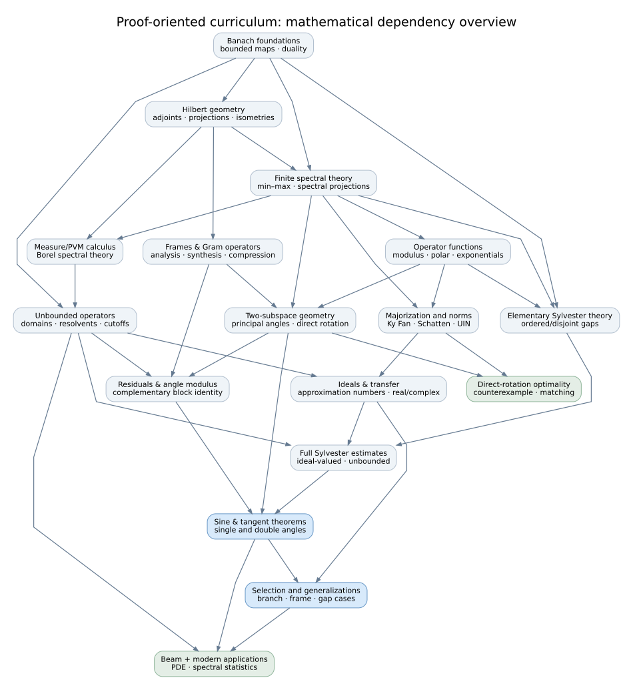

# Draft mathematical prerequisite DAG — review 1

**Status:** alternative course-planning artifact. It is not a revision to the current Manim lessons, the 1970 paper, the journal manuscript, or the formal Lean sources.

The objective is a course from which a student starting with basic linear algebra and calculus can reconstruct the **full mathematical arguments underlying the maintained Davis–Kahan formalization**, including operator-theory foundations that were upstreamed to TauCeti. Historical pedagogy is a separate project.

## What the graph means

The vertices in [`lesson-dag.json`](lesson-dag.json) are planned **mathematical lessons/competencies**. An arrow `A → B` says that the **intended proof-depth treatment** of `B` invokes constructions or results that should already have been taught at `A`. Edges were curated from the expanded course outline, the journal manuscript's theory inventory, the 1970 result summaries, the sine-theta proof study, and the recorded upstream mathematics. They are **not** automatically inferred from Lean imports, filenames, or the first Manim lecture set.

The prerequisite graph is **partly proof-route-specific**: for example, contour integration is required to teach the contour-based Rosenblum argument, not for every conceivable Sylvester proof; scalar-measure representation is required for the chosen PVM-construction route, not for every logically possible spectral theorem proof. An early statement of a theorem may be taught without all its later *proof* prerequisites if the early lesson explicitly says it is motivation rather than a full derivation.

There are two distinct objects:

- The **mathematical lesson DAG** here, which should expose the lemmas a human needs in order to reproduce a proof.
- The repository's **elaborated declaration dependency graph** (`papers/dk_formalization_journal/data/formalization_dependency_{nodes,edges}_20260817.csv` and associated reachability/evidence files). The saved compiler snapshot is dated **August 17, 2026**. It supplies a factual source trail, but neither a Lean import nor a declaration mention implies a teaching prerequisite. It also predates some TauCeti integrations.

The former must eventually be refined against the latter *declaration by declaration*, tracing original donor mathematics and later accepted declarations where possible. This pass is **not** a complete transitive audit of all Mathlib/TauCeti proof dependencies.

## Visual overview



The overview deliberately collapses many detailed nodes. The editable source is [`overview.dot`](overview.dot); the complete 159-vertex network is [`lesson-dag.dot`](lesson-dag.dot). For a precise order, use [`topological-order.md`](topological-order.md).

## Initial review outcome

The **149 numbered candidates** in the previous outline, plus the `000000` introduction, comprise **150 outlined topics**. The previous description as "149 including the introduction" was off by one. This review introduces **nine provisional missing-foundation nodes**, yielding **159 vertices** and **441 curated prerequisite edges**. The graph is acyclic, with **ten direct numerical-order inversions**. It is not a claim that there are 159 ideal video lengths; the teaching units can still be merged and split.

The most consequential ordering repairs are:

1. **Banach-space principles should not be assumed** in proofs of general bounded inverse/resolvent and operator-equation results. Add a lecture deriving the uniform boundedness, open mapping, and closed graph principles from their own prerequisites, including Baire-category reasoning as needed.
2. **Weyl monotonicity (`029000`) uses quadratic-form ordering (`033000`).** Move the latter before the former, or introduce and prove exactly the needed form-order facts in the min–max unit.
3. **Compact angle classification (`051000`) needs compact-operator spectral theory.** Separate the finite two-projection classification (which belongs early) from compact-angle classification (which belongs after `095000` and the compact spectral theorem), rather than pushing all finite geometry late.
4. **Sylvester theory has multiple branches.** The algebraic, ordered-gap, and Banach inverse estimates can come early. The contour Rosenblum approach needs complex analysis; norm-general estimates (`069000`) need ideal membership (`098000`); Hilbert–Schmidt group estimates (`070000`) need Hilbert–Schmidt operator theory (`099000`). These should not be treated as one linear unit.
5. **`071000` is really a residual-block identity.** The current title makes it appear foundational, but its full trial/exact content needs `107000`. Move it after the residual constructions or split off a purely algebraic intertwiner identity that genuinely belongs in the Sylvester unit.
6. **The full unbounded, ideal-valued Sylvester estimate (`094000`) needs operator-ideal machinery (`098000`, `101000`).** Keep finite and Banach-operator versions earlier, then develop its full ideal-valued form only after the ideal prerequisites.
7. **The proof-readiness assembly (`105000`) cannot fully assemble the sine proof before `107000`–`110000` have taught residuals, modulus and the theorem.** Recast it as an *analytic readiness* checkpoint with reduced scope or relocate it as a post-theorem reconstruction exercise.
8. **Missing logical bridges matter even when the final Lean source is upstream.** The graph explicitly flags operator topologies/strong convergence, approximation/measure representation, compact spectral theory, complex contour calculus, operator integration, Riccati graph equations, and Sobolev/domain foundations for the fourth-order beam problem.

See [`topological-order.md`](topological-order.md) for every numerical inversion, suggested insertion slot, per-proof prerequisite closure, and a **valid deterministic topological order**. The algorithm preserves the existing number order whenever both choices are already eligible; there are many other valid orders.

## What should *not* change yet

- **Do not renumber existing drafted lecture IDs** from an auto-sort. Topological order is an audit; its ordering choices are not automatically good exposition. Once the outline is revised, adopt stable IDs for inserted topics, and adjust titles/depth when a theorem is split between introductory and full-proof treatments.
- **Do not force a Lean appendix into the course introduction.** Substantial mathematical lessons should continue to end with an improved symbol-to-actual-Lean bridge. That bridge names the current declarations, types, exact hypotheses, and theorem scope from the pinned dependencies; the introduction remains exempt.
- **Do not treat the 29 original-paper result endpoints as the entire mathematical syllabus.** The endpoint-to-lecture map is in the JSON, but the supporting theorems—including those now under TauCeti—need their own mathematical proof checkpoints.
- **Do not claim that absence of a cycle proves coverage.** The coverage problem is to identify missing edges *and missing nodes*. Acyclicity proves only that the current assertions are mutually orderable.

## Next audit pass: theorem-to-lesson validation

For each principal endpoint, especially the full unbounded sine theorem, both tangent theorems, the Section 6 extensions, Sections 8–9 and the corrected rotation extremals:

1. Write a **mathematical proof spine** in individual lemma-sized steps, with actual hypotheses: scalar field, domains, spectral gap regime, norm/ideal membership, and branch restrictions.
2. Map every load-bearing step to one or more lessons that *prove* it, not merely name it. For example, the sine route must explain `F₁*R = Λ₁X − XA₀`, the relevant Sylvester bound, contraction by `F₁*`, and `|X| = sin Θ`.
3. Map those mathematical steps to the source paper and **verified** Lean declarations, including upstream TauCeti material and original donors when established. Record aliases or deleted donors without inventing present-day APIs.
4. Where a required result has no lesson, add a graph vertex; where a lesson invokes mathematics not yet proved, add an edge or split an introductory and proof-level version.
5. Re-run the DAG checker, choose a comprehensible topological schedule, and test the course against a student's proof reconstruction.

That next pass can turn this **plausible dependency map** into a much stronger coverage argument. It cannot be completed reliably merely by expanding a numbered lecture list.

## Files and usage

- `lesson-dag.json` — editable lesson vertices, hard prerequisite edges, proposed gaps, proof targets, and the 29-result teaching crosswalk.
- `check_dag.py` — standard-library-only cycle, reference, and endpoint validation plus stable topological sort.
- `topological-order.md` — generated, complete scheduling and coverage report.
- `lesson-dag.dot` — generated full detailed graph for Graphviz.
- `overview.dot` / `overview.svg` — hand-organized conceptual overview and a rendered diagram.

```bash
cd ~/code/aiq-dkps-formalization
python3 visualizations/draft-stages/prerequisites/check_dag.py --check-outline
python3 visualizations/draft-stages/prerequisites/check_dag.py --write
# Optional Graphviz full graph export, if Graphviz is installed:
dot -Tsvg visualizations/draft-stages/prerequisites/lesson-dag.dot -o /tmp/dkps-lesson-dag.svg
```

The checker does not build Lean, mutate the course outline, or call network services. `--write` updates only its derived `topological-order.md` and `lesson-dag.dot` files.
